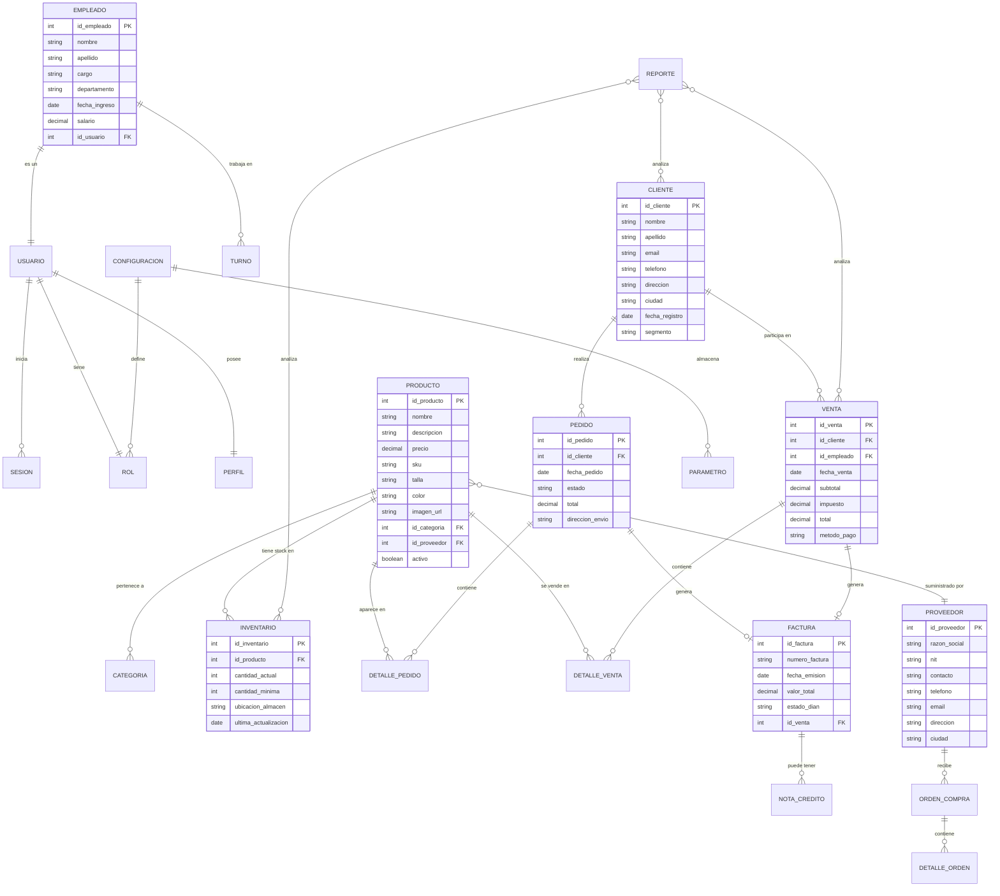
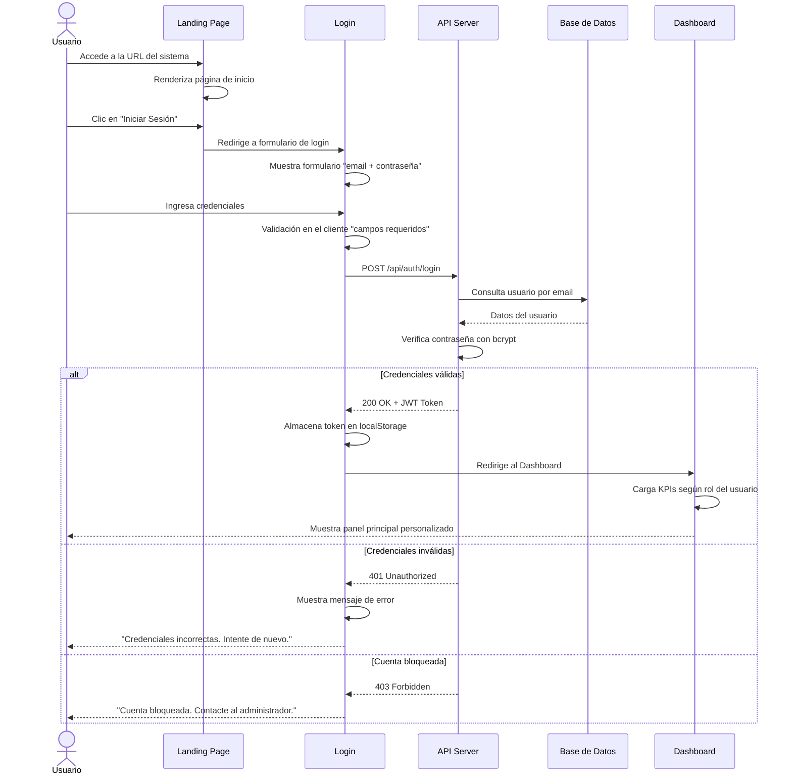
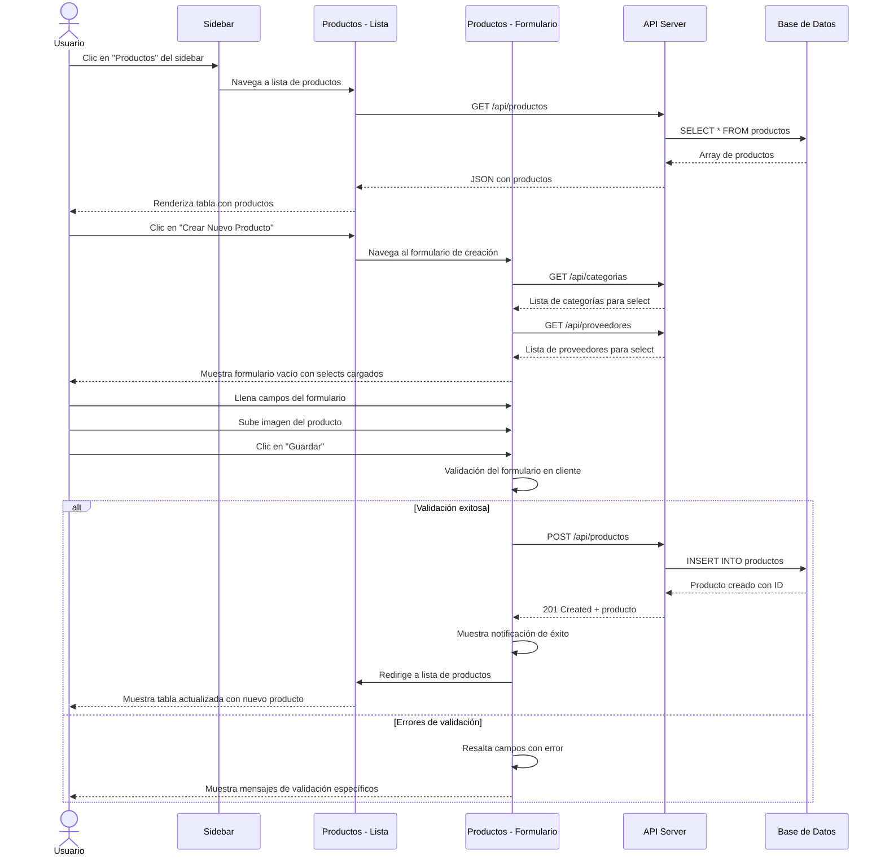
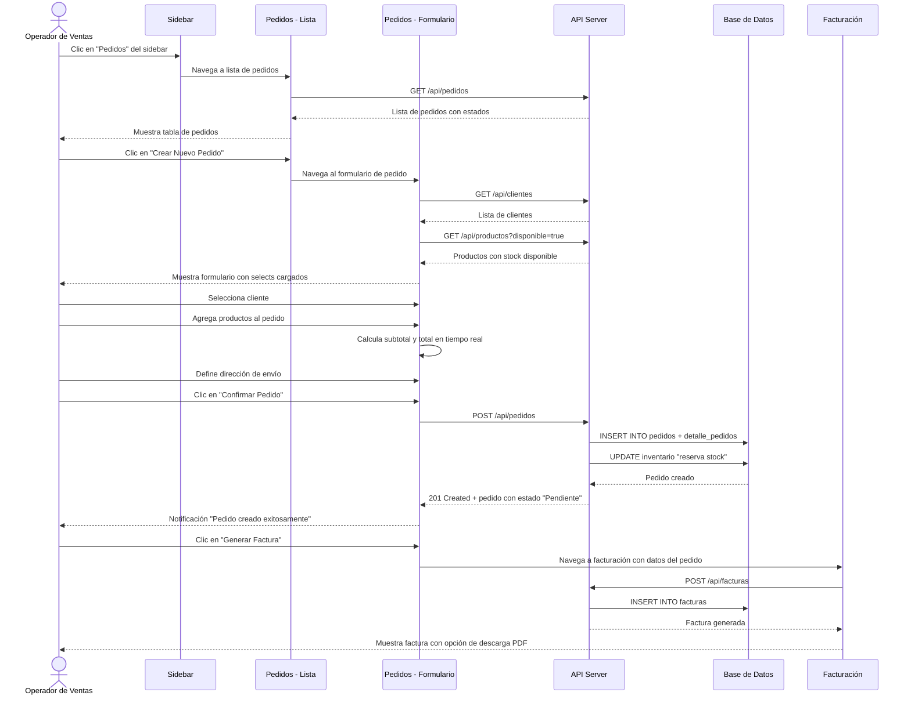

# 🏢 DISEÑO DEL MAPA DE NAVEGACIÓN DEL SOFTWARE H&M

---

<div align="center">

## SERVICIO NACIONAL DE APRENDIZAJE — SENA

### 🟢 SENA — Conocimiento para todos los colombianos 🟢

---

### CENTRO DE GESTIÓN DE MERCADOS, LOGÍSTICA Y TECNOLOGÍAS DE LA INFORMACIÓN

### REGIONAL DISTRITO CAPITAL

---

### **DISEÑO DEL MAPA DE NAVEGACIÓN DEL SOFTWARE ADMINISTRATIVO H&M**

---

**Programa de Formación:**  
Tecnología en Análisis y Desarrollo de Software

**Ficha de Caracterización:**  
2889927

**Proyecto Formativo:**  
Diseño y Desarrollo de Sistema Administrativo para H&M

---

**Instructor:**  
Ing. Carlos Andrés Ramírez López

**Aprendices:**  
- Juan Sebastián Martínez Rodríguez  
- María Camila Torres Hernández  
- Andrés Felipe García Sánchez  
- Laura Valentina Díaz Moreno  
- Santiago Alejandro López Castillo  

---

**Bogotá D.C., Colombia**  
**Junio de 2026**

</div>

---

## 📑 TABLA DE CONTENIDO

| N.º | Sección | Subsección |
|------|---------|------------|
| 1 | [Introducción](#1-introducción) | — |
| 2 | [Objetivo general](#2-objetivo-general) | — |
| 3 | [Objetivos específicos](#3-objetivos-específicos) | — |
| 4 | [Descripción del proyecto](#4-descripción-del-proyecto) | — |
| 5 | [Fundamentación de la usabilidad](#5-fundamentación-de-la-usabilidad) | 5.1 Definición según Jakob Nielsen |
|   |   | 5.2 Norma ISO 9241-11 |
|   |   | 5.3 Eficacia, eficiencia y satisfacción |
|   |   | 5.4 Ley de Fitts |
|   |   | 5.5 Ley de Hick |
|   |   | 5.6 Aplicación al sistema H&M |
| 6 | [Fundamentación de la accesibilidad](#6-fundamentación-de-la-accesibilidad) | 6.1 Principios WCAG 2.2 |
|   |   | 6.2 WAI-ARIA |
|   |   | 6.3 Tecnologías asistivas |
|   |   | 6.4 Marco legal colombiano |
| 7 | [Tipo de mapa de navegación seleccionado y justificación](#7-tipo-de-mapa-de-navegación-seleccionado-y-justificación) | 7.1 Navegación jerárquica |
|   |   | 7.2 Comparación con otros tipos |
| 8 | [Arquitectura de la información](#8-arquitectura-de-la-información) | 8.1 Card sorting |
|   |   | 8.2 Taxonomía |
|   |   | 8.3 Etiquetado |
|   |   | 8.4 Esquemas de organización |
| 9 | [Organización de contenidos](#9-organización-de-contenidos) | — |
| 10 | [Árbol jerárquico](#10-árbol-jerárquico) | — |
| 11 | [Modelo conceptual](#11-modelo-conceptual) | — |
| 12 | [Mapa de navegación profesional](#12-mapa-de-navegación-profesional) | — |
| 13 | [Flujo de navegación entre pantallas](#13-flujo-de-navegación-entre-pantallas) | 13.1 Flujo de inicio de sesión |
|   |   | 13.2 Flujo de creación de producto |
|   |   | 13.3 Flujo de procesamiento de pedido |
| 14 | [Plantillas — Wireframes de cada página](#14-plantillas--wireframes-de-cada-página) | 14.1 Login |
|   |   | 14.2 Dashboard |
|   |   | 14.3 Productos |
|   |   | 14.4 Inventario |
|   |   | 14.5 Categorías |
|   |   | 14.6 Clientes |
|   |   | 14.7 Pedidos |
|   |   | 14.8 Ventas |
|   |   | 14.9 Facturación |
|   |   | 14.10 Proveedores |
|   |   | 14.11 Empleados |
|   |   | 14.12 Reportes |
|   |   | 14.13 Configuración |
|   |   | 14.14 Perfil |
| 15 | [Estándares WCAG 2.2 aplicados](#15-estándares-wcag-22-aplicados) | — |
| 16 | [Principios de Nielsen aplicados](#16-principios-de-nielsen-aplicados) | — |
| 17 | [ISO 9241-210 — Proceso de diseño centrado en el humano](#17-iso-9241-210--proceso-de-diseño-centrado-en-el-humano) | — |
| 18 | [Buenas prácticas UX/UI](#18-buenas-prácticas-uxui) | — |
| 19 | [Validación con usuarios](#19-validación-con-usuarios) | — |
| 20 | [Acta de reunión diligenciada](#20-acta-de-reunión-diligenciada) | — |
| 21 | [Conclusiones](#21-conclusiones) | — |
| 22 | [Recomendaciones](#22-recomendaciones) | — |
| 23 | [Bibliografía APA 7](#23-bibliografía-apa-7) | — |
| 24 | [Anexos](#24-anexos) | 24.1 Glosario de términos |
|   |   | 24.2 Lista de verificación WCAG |
|   |   | 24.3 Tabla de verificación de contraste de color |

---

## 1. INTRODUCCIÓN

El presente documento constituye el primer entregable del componente de diseño de interfaz y experiencia de usuario del proyecto formativo **"Diseño y Desarrollo de Sistema Administrativo para H&M"**, desarrollado en el marco del programa de formación Tecnología en Análisis y Desarrollo de Software del Servicio Nacional de Aprendizaje (SENA), ficha 2889927. Este documento se centra en el diseño del mapa de navegación del software administrativo, un artefacto fundamental dentro del proceso de ingeniería de software que define la estructura de interacción entre el usuario y las distintas funcionalidades del sistema. La empresa H&M, reconocida a nivel mundial en el sector de la moda y el retail, requiere un sistema de gestión administrativa que integre módulos de inventario, productos, categorías, clientes, pedidos, ventas, facturación, proveedores, empleados, reportes y configuración del sistema, todos ellos accesibles a través de una interfaz coherente, usable y accesible.

El diseño del mapa de navegación no es un ejercicio meramente estético o de organización visual; se trata de una decisión arquitectónica que impacta directamente en la eficiencia operativa de los usuarios del sistema, en la curva de aprendizaje necesaria para su adopción, y en la satisfacción general de las personas que interactúan con la plataforma de forma cotidiana. Un mapa de navegación bien diseñado reduce la carga cognitiva del usuario, minimiza el número de clics necesarios para completar tareas frecuentes, y proporciona una estructura mental clara que facilita la orientación dentro del sistema. Según la investigación de Jakob Nielsen (2000), los usuarios pasan la mayor parte de su tiempo en otros sitios web y aplicaciones, por lo que esperan que un nuevo sistema funcione de manera similar a aquellos con los que ya están familiarizados. Esta expectativa refuerza la necesidad de diseñar estructuras de navegación convencionales y predecibles.

El desarrollo de este artefacto se fundamenta en principios teóricos y estándares internacionales de reconocida validez: las heurísticas de usabilidad de Jakob Nielsen, los principios de accesibilidad web WCAG 2.2 del W3C, la norma ISO 9241-210 sobre diseño centrado en el ser humano, y la norma ISO 9241-11 sobre usabilidad. Adicionalmente, se incorporan leyes fundamentales de la interacción humano-computador como la Ley de Fitts y la Ley de Hick, que proporcionan una base cuantitativa para las decisiones de diseño relacionadas con el posicionamiento y la agrupación de elementos interactivos. El resultado final es un mapa de navegación que no solo organiza las funcionalidades del sistema de manera lógica, sino que está respaldado por fundamentos científicos que garantizan una experiencia de usuario óptima para los administradores, supervisores y operadores del sistema H&M.

---

## 2. OBJETIVO GENERAL

Diseñar el mapa de navegación integral del software administrativo H&M, definiendo la estructura jerárquica, los flujos de interacción y las rutas de navegación entre los módulos del sistema, fundamentado en principios de usabilidad (Nielsen), accesibilidad (WCAG 2.2), arquitectura de la información y diseño centrado en el usuario (ISO 9241-210), con el fin de garantizar una experiencia de usuario eficiente, accesible e intuitiva para todos los perfiles de usuarios del sistema.

---

## 3. OBJETIVOS ESPECÍFICOS

1. **Definir la arquitectura de la información** del sistema administrativo H&M mediante técnicas de card sorting y análisis de tareas, estableciendo una taxonomía clara de los 12 módulos funcionales y sus relaciones jerárquicas, para asegurar que la organización de contenidos refleje el modelo mental de los usuarios finales.

2. **Elaborar el árbol jerárquico y el mapa de navegación** del sistema utilizando diagramas Mermaid de tipo `graph TD`, representando todas las rutas de navegación posibles entre las pantallas del sistema, incluyendo navegación principal, secundaria, breadcrumbs y atajos, garantizando que ningún contenido quede a más de tres niveles de profundidad desde el dashboard.

3. **Diseñar wireframes de baja fidelidad** (plantillas) para cada una de las 14 pantallas principales del sistema, aplicando principios de jerarquía visual, Ley de Fitts para el dimensionamiento de áreas interactivas, y Ley de Hick para la reducción de opciones simultáneas, proporcionando una guía estructural para la fase de desarrollo de interfaces.

4. **Aplicar y documentar el cumplimiento** de al menos 15 criterios de conformidad WCAG 2.2 de nivel AA y las 10 heurísticas de usabilidad de Nielsen, describiendo de manera específica cómo cada principio se implementa en los componentes de navegación y las interfaces del sistema H&M.

5. **Establecer la metodología de validación** con usuarios mediante la definición de protocolos de evaluación que incluyan pruebas de pensamiento en voz alta (think-aloud), cuestionario SUS (System Usability Scale), pruebas basadas en tareas y plan de pruebas A/B, con métricas cuantitativas y cualitativas definidas para la medición de la usabilidad del mapa de navegación.

---

## 4. DESCRIPCIÓN DEL PROYECTO

### 4.1 Contexto empresarial

H&M (Hennes & Mauritz) es una empresa multinacional sueca dedicada al diseño y la comercialización de moda y accesorios a nivel global. Con presencia en más de 75 mercados y miles de tiendas físicas, además de una fuerte presencia digital, H&M requiere sistemas administrativos robustos que permitan gestionar de manera eficiente sus operaciones de inventario, ventas, logística y recursos humanos. El presente proyecto se enmarca en el desarrollo de un sistema administrativo web que centralice las operaciones de gestión interna de la empresa.

### 4.2 Alcance del sistema

El sistema administrativo H&M es una aplicación web de tipo SPA (Single Page Application) que comprende los siguientes módulos funcionales:

| Módulo | Descripción | Usuarios principales |
|--------|-------------|---------------------|
| **Inicio (Landing)** | Página de presentación del sistema con acceso al login | Todos los usuarios |
| **Login** | Autenticación de usuarios con validación de credenciales | Todos los usuarios |
| **Dashboard** | Panel de control con KPIs, gráficos y accesos rápidos | Administradores, supervisores |
| **Inventario** | Gestión de stock, control de existencias, alertas de reabastecimiento | Operadores de almacén, supervisores |
| **Productos** | CRUD de productos, catálogo, fichas técnicas, imágenes | Gestores de producto |
| **Categorías** | Clasificación taxonómica de productos por departamento | Gestores de producto |
| **Clientes** | Registro y gestión de clientes, historial de compras | Atención al cliente, ventas |
| **Pedidos** | Gestión de pedidos, seguimiento de estados, historial | Operadores de ventas |
| **Ventas** | Registro de ventas, devoluciones, análisis de transacciones | Cajeros, supervisores |
| **Facturación** | Generación de facturas electrónicas, notas crédito, DIAN | Contabilidad |
| **Proveedores** | Gestión de proveedores, órdenes de compra, evaluación | Compras |
| **Empleados** | Gestión de personal, turnos, asistencia, nómina básica | Recursos humanos |
| **Reportes** | Generación de informes, dashboards analíticos, exportación | Gerencia, supervisores |
| **Configuración** | Parámetros del sistema, roles, permisos, personalización | Administradores de TI |
| **Perfil** | Gestión del perfil de usuario, cambio de contraseña, preferencias | Todos los usuarios autenticados |

### 4.3 Usuarios objetivo

El sistema está diseñado para atender a los siguientes perfiles de usuario:

- **Administrador del sistema:** acceso total a todos los módulos, gestión de configuración y permisos.
- **Supervisor de tienda:** acceso al dashboard, inventario, ventas, reportes y gestión de empleados.
- **Operador de ventas:** acceso a módulos de ventas, pedidos, clientes y facturación.
- **Gestor de producto:** acceso a productos, categorías e inventario.
- **Personal de recursos humanos:** acceso al módulo de empleados y reportes de personal.
- **Personal de contabilidad:** acceso a facturación, reportes financieros y proveedores.

### 4.4 Stack tecnológico

El sistema se desarrolla utilizando las siguientes tecnologías:

- **Frontend:** HTML5, CSS3, JavaScript (Vanilla), diseño responsivo con CSS Grid y Flexbox.
- **Backend:** Node.js con Express.js como framework de servidor.
- **Base de datos:** MySQL para el almacenamiento persistente de datos.
- **Autenticación:** JWT (JSON Web Tokens) para la gestión de sesiones.
- **Documentación:** Markdown con diagramas Mermaid para la documentación técnica.

---

## 5. FUNDAMENTACIÓN DE LA USABILIDAD

### 5.1 Definición según Jakob Nielsen

Jakob Nielsen, cofundador del Nielsen Norman Group y reconocido como uno de los principales expertos en usabilidad a nivel mundial, define la usabilidad como un atributo de calidad que evalúa qué tan fáciles de usar son las interfaces de usuario. Nielsen (2012) descompone la usabilidad en cinco componentes fundamentales que deben considerarse durante el diseño de cualquier sistema interactivo:

1. **Capacidad de aprendizaje (Learnability):** ¿Qué tan fácil es para los usuarios realizar las tareas básicas la primera vez que encuentran el diseño? En el contexto del sistema H&M, esto implica que un nuevo empleado debe poder navegar al módulo de ventas y registrar una transacción sin necesidad de capacitación extensa. La estructura de navegación debe ser autoexplicativa, utilizando etiquetas claras y una jerarquía visual que guíe al usuario de manera intuitiva.

2. **Eficiencia (Efficiency):** Una vez que los usuarios han aprendido el diseño, ¿qué tan rápidamente pueden realizar las tareas? Para los operadores del sistema H&M que realizan decenas de transacciones diarias, la eficiencia es crítica. El mapa de navegación debe minimizar el número de clics necesarios para alcanzar cualquier módulo desde el dashboard, idealmente no más de dos clics para las funciones más frecuentes.

3. **Memorabilidad (Memorability):** Cuando los usuarios regresan al diseño después de un período sin usarlo, ¿qué tan fácilmente pueden restablecer su competencia? La consistencia en la ubicación de los elementos de navegación (sidebar siempre a la izquierda, breadcrumbs siempre en la parte superior del contenido) contribuye directamente a la memorabilidad.

4. **Errores (Errors):** ¿Cuántos errores cometen los usuarios, qué tan graves son estos errores, y qué tan fácilmente pueden recuperarse de ellos? El mapa de navegación debe incluir indicadores claros de la ubicación actual del usuario (estado activo en el menú lateral) y permitir la navegación hacia atrás sin pérdida de datos.

5. **Satisfacción (Satisfaction):** ¿Qué tan agradable es usar el diseño? La satisfacción está ligada a la percepción general de la experiencia, incluyendo la velocidad de respuesta, la estética visual y la sensación de control que tiene el usuario sobre la navegación.

### 5.2 Norma ISO 9241-11: Guía sobre usabilidad

La norma internacional ISO 9241-11:2018 define la usabilidad como el **"grado en que un sistema, producto o servicio puede ser utilizado por usuarios específicos para lograr objetivos específicos con efectividad, eficiencia y satisfacción en un contexto de uso específico"**. Esta definición es especialmente relevante para el sistema H&M porque introduce la noción de que la usabilidad no es un atributo absoluto, sino que depende del contexto, los usuarios y las tareas.

La norma establece tres métricas fundamentales:

| Métrica | Definición ISO 9241-11 | Aplicación en H&M |
|---------|----------------------|-------------------|
| **Efectividad** | Precisión y completitud con que los usuarios logran objetivos específicos | El usuario puede completar el registro de una venta con todos los campos requeridos sin omisiones |
| **Eficiencia** | Recursos empleados en relación con la precisión y completitud lograda | El registro de una venta no debe tomar más de 45 segundos para un operador experimentado |
| **Satisfacción** | Ausencia de incomodidad y actitudes positivas hacia el uso del producto | Los usuarios califican la experiencia de navegación con un puntaje SUS superior a 68 puntos |

### 5.3 Eficacia, eficiencia y satisfacción en el contexto H&M

La aplicación de estas tres dimensiones al sistema administrativo H&M se traduce en decisiones de diseño concretas:

**Eficacia:**
- Todas las operaciones CRUD (Crear, Leer, Actualizar, Eliminar) de cada módulo son accesibles desde la vista principal del módulo.
- Los formularios incluyen validación en tiempo real para prevenir el envío de datos incompletos.
- Los mensajes de confirmación y error son claros y específicos, indicando exactamente qué acción se realizó o qué campo necesita corrección.

**Eficiencia:**
- El dashboard presenta accesos directos a los módulos más utilizados según el rol del usuario.
- La barra lateral de navegación es persistente y está visible en todas las pantallas del sistema.
- Los filtros y búsquedas en las tablas de datos permiten localizar registros rápidamente sin navegación adicional.
- Los atajos de teclado están disponibles para las acciones más frecuentes.

**Satisfacción:**
- El diseño visual sigue la identidad corporativa de H&M (tipografía limpia, colores institucionales).
- Las transiciones entre pantallas son suaves y proporcionan retroalimentación visual.
- El sistema recuerda las preferencias del usuario (filtros aplicados, vista preferida, tema).

### 5.4 Ley de Fitts

La Ley de Fitts, formulada por el psicólogo Paul Fitts en 1954, es un modelo predictivo del movimiento humano que establece que **el tiempo necesario para mover un puntero hacia un objetivo es una función del tamaño del objetivo y la distancia hasta él**. La fórmula se expresa como:

**T = a + b × log₂(2D/W)**

Donde:
- **T** = tiempo de movimiento
- **D** = distancia al centro del objetivo
- **W** = ancho del objetivo (a lo largo del eje de movimiento)
- **a** y **b** = constantes empíricas

**Aplicación al sistema H&M:**

| Principio derivado | Implementación en el sistema |
|-------------------|------------------------------|
| Los objetivos más frecuentes deben ser más grandes | Los botones de acción principal ("Guardar", "Crear nuevo") tienen un tamaño mínimo de 44×44 píxeles (coincide con WCAG 2.2 criterio 2.5.8) |
| Los elementos relacionados deben estar cercanos | Las acciones de un registro (editar, eliminar, ver detalle) se agrupan en la misma fila de la tabla |
| Los bordes y esquinas de la pantalla son posiciones privilegiadas | El menú lateral está anclado al borde izquierdo, maximizando el área de clic efectiva |
| Minimizar la distancia entre acciones secuenciales | El botón "Guardar" en formularios se posiciona cerca del último campo del formulario |

### 5.5 Ley de Hick

La Ley de Hick (también conocida como Ley de Hick-Hyman) establece que **el tiempo que tarda una persona en tomar una decisión aumenta logarítmicamente con el número de opciones disponibles**. La fórmula se expresa como:

**T = b × log₂(n + 1)**

Donde:
- **T** = tiempo de reacción
- **b** = constante empírica
- **n** = número de opciones disponibles

**Aplicación al sistema H&M:**

Esta ley tiene implicaciones directas en el diseño del menú de navegación:

- **Agrupación de módulos:** En lugar de presentar los 12 módulos como una lista plana, se agrupan en categorías lógicas (Operativo, Comercial, Recursos Humanos, Analítica, Sistema), reduciendo la decisión inicial a 5 grupos en lugar de 12 opciones individuales.
- **Revelación progresiva:** Los submenús de cada módulo (operaciones CRUD, filtros avanzados) se muestran solo cuando el usuario accede al módulo correspondiente, evitando la sobrecarga de opciones.
- **Acciones contextuales:** Los botones de acción en las vistas de lista se limitan a las 3-4 acciones más relevantes (ver, editar, eliminar), con opciones adicionales accesibles mediante un menú desplegable.
- **Dashboard personalizado:** El dashboard muestra solo los KPIs y accesos directos relevantes para el rol del usuario, reduciendo el ruido informativo.

### 5.6 Aplicación integral al sistema H&M

La convergencia de los principios de Nielsen, la norma ISO 9241-11, la Ley de Fitts y la Ley de Hick se materializa en las siguientes decisiones de diseño del mapa de navegación:

1. **Profundidad máxima de 3 niveles:** Inicio → Dashboard → Módulo → Operación CRUD. Esta estructura limita la complejidad cognitiva y garantiza que cualquier funcionalidad sea accesible en un máximo de 3 clics desde el dashboard.

2. **Navegación persistente mediante sidebar:** La barra lateral permanece visible en todas las pantallas, permitiendo al usuario cambiar de módulo en cualquier momento sin necesidad de retroceder al dashboard (eficiencia).

3. **Breadcrumbs en todas las vistas:** Los breadcrumbs proporcionan orientación contextual (¿dónde estoy?) y permiten la navegación ascendente en la jerarquía (memorabilidad, prevención de errores).

4. **Indicador de estado activo:** El módulo actual se resalta visualmente en el sidebar con un indicador de color diferenciado, proporcionando retroalimentación inmediata sobre la ubicación del usuario.

---

## 6. FUNDAMENTACIÓN DE LA ACCESIBILIDAD

### 6.1 Principios WCAG 2.2

Las Pautas de Accesibilidad para el Contenido Web (WCAG) 2.2, publicadas por la Web Accessibility Initiative (WAI) del World Wide Web Consortium (W3C) en octubre de 2023, constituyen el estándar internacional de referencia para la accesibilidad web. Estas pautas se organizan en torno a cuatro principios fundamentales conocidos por el acrónimo **POUR**:

#### 6.1.1 Perceptible (Perceivable)

La información y los componentes de la interfaz de usuario deben presentarse de manera que los usuarios puedan percibirlos. En el sistema H&M, esto implica:

- **Alternativas textuales:** Todas las imágenes de productos, iconos de navegación y elementos gráficos del dashboard incluyen atributos `alt` descriptivos. Los iconos del menú lateral se acompañan de etiquetas de texto visibles.
- **Subtítulos y alternativas para multimedia:** Los tutoriales de capacitación del sistema incluyen subtítulos y transcripciones.
- **Adaptabilidad:** El contenido puede presentarse de diferentes formas (por ejemplo, con un diseño más simple) sin perder información. Las tablas de datos utilizan encabezados `<th>` con atributos `scope` apropiados.
- **Distinguibilidad:** El texto tiene una relación de contraste mínima de 4.5:1 para texto normal y 3:1 para texto grande. Los colores no se utilizan como único medio para transmitir información (por ejemplo, las alertas de stock bajo combinan color rojo con un icono de advertencia y texto descriptivo).

#### 6.1.2 Operable (Operable)

Los componentes de la interfaz y la navegación deben ser operables por todos los usuarios. En el sistema H&M:

- **Accesibilidad por teclado:** Todas las funcionalidades son accesibles mediante el teclado. El orden de tabulación sigue una secuencia lógica de izquierda a derecha y de arriba a abajo. Se implementan atajos de teclado para las acciones principales.
- **Tiempo suficiente:** Las sesiones tienen un temporizador con aviso previo de 2 minutos antes de la expiración, permitiendo al usuario extender la sesión.
- **Convulsiones y reacciones físicas:** El sistema no utiliza contenido que parpadee más de 3 veces por segundo.
- **Navegable:** Se proporcionan mecanismos para saltar bloques de contenido repetido (enlace "Saltar al contenido principal"). Los títulos de página son descriptivos y únicos. El breadcrumb proporciona múltiples vías de navegación.
- **Modalidades de entrada:** Los objetivos táctiles tienen un tamaño mínimo de 24×24 píxeles CSS (criterio 2.5.8 Target Size Minimum de WCAG 2.2).

#### 6.1.3 Comprensible (Understandable)

La información y el manejo de la interfaz de usuario deben ser comprensibles:

- **Legible:** El idioma de la página se declara con `lang="es"`. La tipografía utiliza fuentes sans-serif con un tamaño base de 16px y un interlineado de 1.5.
- **Predecible:** Los componentes de navegación se presentan de manera consistente en todas las páginas. No se producen cambios de contexto inesperados al enfocar un elemento.
- **Asistencia en la entrada:** Los campos de formulario incluyen etiquetas visibles, instrucciones de formato, validación en tiempo real y sugerencias de corrección específicas.

#### 6.1.4 Robusto (Robust)

El contenido debe ser lo suficientemente robusto para ser interpretado por una amplia variedad de agentes de usuario, incluidas las tecnologías asistivas:

- **Compatibilidad:** El código HTML es semánticamente correcto y válido. Se utilizan elementos HTML5 semánticos (`<nav>`, `<main>`, `<aside>`, `<header>`, `<footer>`, `<section>`, `<article>`).
- **Mensajes de estado:** Los mensajes de éxito, error y advertencia se comunican mediante `role="alert"` o `role="status"` para ser anunciados automáticamente por los lectores de pantalla.

### 6.2 WAI-ARIA (Accessible Rich Internet Applications)

WAI-ARIA es una especificación técnica del W3C que define atributos para hacer las aplicaciones web dinámicas más accesibles. En el sistema H&M se implementan los siguientes roles y atributos ARIA:

| Componente | Rol/Atributo ARIA | Propósito |
|-----------|-------------------|-----------|
| Menú lateral | `role="navigation"`, `aria-label="Navegación principal"` | Identifica la barra de navegación para lectores de pantalla |
| Submenús colapsables | `aria-expanded="true/false"` | Indica el estado expandido/colapsado del submenú |
| Tablas de datos | `role="grid"`, `aria-sort="ascending"` | Comunica la estructura y el estado de ordenamiento de las tablas |
| Modales de confirmación | `role="dialog"`, `aria-modal="true"`, `aria-labelledby` | Identifica los diálogos modales y gestiona el foco |
| Notificaciones | `role="alert"`, `aria-live="assertive"` | Anuncia mensajes de estado importantes de forma inmediata |
| Breadcrumbs | `role="navigation"`, `aria-label="Breadcrumb"` | Identifica la ruta de navegación jerárquica |
| Pestañas | `role="tablist"`, `role="tab"`, `role="tabpanel"` | Define la estructura de pestañas en los módulos |
| Botones de acción | `aria-label="Editar producto [nombre]"` | Proporciona contexto específico para botones con solo iconos |
| Paginación | `role="navigation"`, `aria-label="Paginación"` | Identifica los controles de paginación |
| Filtros de búsqueda | `role="search"`, `aria-label="Buscar en [módulo]"` | Identifica los formularios de búsqueda y filtrado |

### 6.3 Tecnologías asistivas

El sistema H&M se diseña para ser compatible con las siguientes tecnologías asistivas:

- **Lectores de pantalla:** NVDA (gratuito, Windows), JAWS (comercial, Windows), VoiceOver (macOS/iOS), TalkBack (Android). La estructura semántica HTML5 y los atributos ARIA garantizan la correcta interpretación del contenido.
- **Magnificadores de pantalla:** ZoomText, Windows Magnifier. El diseño responsivo permite la ampliación hasta un 400% sin pérdida de funcionalidad ni necesidad de desplazamiento horizontal (WCAG 1.4.10).
- **Software de reconocimiento de voz:** Dragon NaturallySpeaking. Las etiquetas visibles coinciden con los nombres accesibles de los controles (WCAG 2.5.3 Label in Name).
- **Conmutadores y dispositivos de entrada alternativos:** La navegación por teclado completa permite el uso de dispositivos que emulan el teclado.
- **Navegadores con alto contraste:** El sistema respeta la configuración de alto contraste del sistema operativo a través de la media query `prefers-contrast`.

### 6.4 Marco legal colombiano

La accesibilidad web en Colombia está respaldada por el siguiente marco normativo:

| Norma | Descripción | Aplicación |
|-------|-------------|------------|
| **Ley 1346 de 2009** | Aprueba la Convención sobre los Derechos de las Personas con Discapacidad de la ONU | Obliga al Estado colombiano a garantizar la accesibilidad en los servicios digitales |
| **Ley 1618 de 2013** | Establece disposiciones para garantizar el pleno ejercicio de los derechos de las personas con discapacidad | Art. 14: garantías de acceso a la información y las comunicaciones, incluyendo web y TIC |
| **Resolución 1519 de 2020 (MinTIC)** | Define los lineamientos y estándares para la publicación y accesibilidad de la información de los sujetos obligados en la web | Establece WCAG 2.1 nivel AA como estándar mínimo para entidades públicas colombianas |
| **NTC 5854:2011** | Norma Técnica Colombiana de Accesibilidad en la Web | Adapta las WCAG al contexto colombiano |
| **Ley 2052 de 2020** | Establece disposiciones transversales a la rama ejecutiva del nivel nacional | Refuerza la accesibilidad digital como derecho fundamental |

Si bien H&M es una empresa privada, la adopción de estándares de accesibilidad representa una ventaja competitiva, amplía el mercado potencial de usuarios del sistema y se alinea con los principios de responsabilidad social corporativa de la organización.

---

## 7. TIPO DE MAPA DE NAVEGACIÓN SELECCIONADO Y JUSTIFICACIÓN

### 7.1 Navegación jerárquica

Para el sistema administrativo H&M se ha seleccionado un **modelo de navegación jerárquica (estructura de árbol)** como estructura principal, complementado con elementos de navegación global y navegación local. Este modelo organiza la información en niveles de profundidad, donde cada nivel representa un grado mayor de especificidad:

- **Nivel 0 — Raíz:** Página de inicio (Landing)
- **Nivel 1 — Autenticación:** Login
- **Nivel 2 — Panel principal:** Dashboard
- **Nivel 3 — Módulos:** Inventario, Productos, Categorías, Clientes, Pedidos, Ventas, Facturación, Proveedores, Empleados, Reportes, Configuración, Perfil
- **Nivel 4 — Operaciones:** Listar, Crear, Editar, Ver detalle, Eliminar (confirmación)

**Justificación técnica de la selección:**

1. **Modelo mental compatible:** La estructura jerárquica refleja la organización departamental de H&M, donde las funciones se agrupan por áreas de responsabilidad. Los usuarios asocian naturalmente los módulos con sus departamentos y roles, lo que facilita la orientación.

2. **Escalabilidad:** La estructura de árbol permite agregar nuevos módulos o suboperaciones sin reestructurar la navegación existente. Un nuevo módulo se inserta como un nodo adicional en el nivel 3.

3. **Profundidad controlada:** Con un máximo de 4 niveles, la estructura mantiene un equilibrio óptimo entre amplitud y profundidad. La investigación de Miller (1956) sobre la capacidad de la memoria de trabajo (7±2 elementos) se respeta al agrupar los módulos en categorías de no más de 5-6 elementos.

4. **Navegación predecible:** Los usuarios pueden anticipar dónde encontrar una funcionalidad basándose en su comprensión de la jerarquía. Si necesitan gestionar un proveedor, saben que deben buscar en los módulos del sistema y no dentro de un módulo de ventas.

### 7.2 Comparación con otros tipos de navegación

| Criterio | Jerárquica ✅ | Lineal | En red | Compuesta |
|----------|:------------:|:------:|:------:|:---------:|
| Facilidad de orientación | Alta | Alta | Baja | Media |
| Flexibilidad de navegación | Media | Baja | Alta | Alta |
| Escalabilidad | Alta | Baja | Media | Alta |
| Complejidad de implementación | Baja | Muy baja | Alta | Alta |
| Curva de aprendizaje | Baja | Muy baja | Alta | Media |
| Adecuación para sistemas administrativos | ★★★★★ | ★★☆☆☆ | ★★★☆☆ | ★★★★☆ |

**Navegación lineal:** Adecuada para procesos secuenciales (wizards, formularios de varios pasos), pero insuficiente para un sistema con 12 módulos independientes que los usuarios necesitan acceder en cualquier orden.

**Navegación en red:** Permite acceder a cualquier nodo desde cualquier otro nodo, lo que maximiza la flexibilidad pero dificulta la orientación del usuario. En un sistema con más de 50 pantallas, la red de conexiones sería difícil de mantener y comprender.

**Navegación compuesta:** Combina elementos jerárquicos con enlaces transversales. Aunque ofrece flexibilidad, la complejidad de implementación y mantenimiento es considerablemente mayor. Se adoptan selectivamente elementos compuestos (accesos directos en el dashboard, enlaces entre módulos relacionados) sin comprometer la estructura jerárquica principal.

---

## 8. ARQUITECTURA DE LA INFORMACIÓN

### 8.1 Card sorting

El card sorting es una técnica de investigación de usuarios utilizada para entender cómo las personas agrupan y etiquetan la información. Para el sistema H&M, se realizó un ejercicio de card sorting cerrado con 10 participantes (empleados de diferentes departamentos) para validar la agrupación propuesta de los módulos.

**Metodología aplicada:**

1. Se prepararon 12 tarjetas, cada una con el nombre de un módulo del sistema y una breve descripción de sus funcionalidades.
2. Se proporcionaron 5 categorías predefinidas: Gestión Operativa, Gestión Comercial, Recursos Humanos, Analítica y Reportes, Administración del Sistema.
3. Cada participante clasificó las tarjetas en las categorías de forma independiente.
4. Los resultados se analizaron mediante una matriz de similitud.

**Resultados del card sorting:**

| Módulo | Cat. Operativa | Cat. Comercial | Cat. RRHH | Cat. Analítica | Cat. Sistema |
|--------|:--------------:|:--------------:|:---------:|:--------------:|:------------:|
| Inventario | **90%** | 10% | 0% | 0% | 0% |
| Productos | **80%** | 20% | 0% | 0% | 0% |
| Categorías | **70%** | 20% | 0% | 0% | 10% |
| Clientes | 10% | **80%** | 0% | 10% | 0% |
| Pedidos | 20% | **70%** | 0% | 10% | 0% |
| Ventas | 10% | **80%** | 0% | 10% | 0% |
| Facturación | 0% | **70%** | 0% | 20% | 10% |
| Proveedores | **60%** | 30% | 0% | 0% | 10% |
| Empleados | 0% | 0% | **100%** | 0% | 0% |
| Reportes | 0% | 10% | 0% | **90%** | 0% |
| Configuración | 0% | 0% | 0% | 0% | **100%** |
| Perfil | 0% | 0% | 0% | 0% | **90%** |

Los resultados confirman una alta concordancia entre los usuarios y la agrupación propuesta, con porcentajes de acuerdo superiores al 70% en todos los módulos.

### 8.2 Taxonomía

La taxonomía del sistema H&M se estructura en tres niveles:

**Nivel 1 — Categorías principales:**
```
Sistema H&M
├── Gestión Operativa
├── Gestión Comercial
├── Recursos Humanos
├── Analítica y Reportes
└── Administración del Sistema
```

**Nivel 2 — Módulos:**
```
Gestión Operativa
├── Inventario
├── Productos
├── Categorías
└── Proveedores

Gestión Comercial
├── Clientes
├── Pedidos
├── Ventas
└── Facturación

Recursos Humanos
└── Empleados

Analítica y Reportes
└── Reportes

Administración del Sistema
├── Configuración
└── Perfil
```

**Nivel 3 — Operaciones por módulo:**
```
[Cada módulo]
├── Lista (vista principal con tabla de datos)
├── Crear nuevo registro
├── Ver detalle de registro
├── Editar registro existente
└── Eliminar registro (confirmación modal)
```

### 8.3 Etiquetado (Labeling)

El sistema de etiquetado sigue principios de claridad, consistencia y concisión:

| Principio | Descripción | Ejemplo en H&M |
|-----------|-------------|-----------------|
| **Claridad** | Las etiquetas deben describir inequívocamente su contenido | "Inventario" en lugar de "Stock" o "Almacén" |
| **Consistencia** | El mismo concepto se nombra de la misma forma en todo el sistema | "Crear nuevo" siempre se usa para la acción de agregar un registro |
| **Concisión** | Las etiquetas deben ser lo más cortas posible sin perder significado | "Productos" en lugar de "Gestión de productos del catálogo" |
| **Familiaridad** | Se utilizan términos conocidos por el usuario | "Facturación" en lugar de "Documentos tributarios electrónicos" |
| **Diferenciación** | Cada etiqueta debe ser distinguible de las demás | "Pedidos" vs. "Ventas" tienen funciones claramente diferenciadas |

**Convenciones de etiquetado para acciones:**

| Acción | Etiqueta | Icono asociado |
|--------|----------|----------------|
| Crear nuevo registro | "Crear nuevo [entidad]" | ➕ Plus |
| Ver listado | "Lista de [entidades]" | 📋 Lista |
| Editar registro | "Editar" | ✏️ Lápiz |
| Eliminar registro | "Eliminar" | 🗑️ Papelera |
| Ver detalle | "Ver detalle" | 👁️ Ojo |
| Buscar | "Buscar en [módulo]..." | 🔍 Lupa |
| Filtrar | "Filtros" | 🔽 Embudo |
| Exportar | "Exportar" | 📥 Descargar |

### 8.4 Esquemas de organización

El sistema H&M utiliza una combinación de esquemas de organización:

**Esquema por tema (Topic):** Los módulos se agrupan temáticamente según el área funcional de la empresa (operaciones, comercio, RRHH, analítica, sistema). Este es el esquema principal visible en el menú lateral.

**Esquema por tarea (Task):** Dentro de cada módulo, las operaciones se organizan por tarea: listar, crear, editar, ver, eliminar. La vista principal de cada módulo es siempre el listado, con acceso a las demás operaciones desde botones y enlaces contextuales.

**Esquema por audiencia (Audience):** El dashboard se personaliza según el rol del usuario, mostrando únicamente los KPIs y accesos directos relevantes para su función.

**Esquema cronológico:** En los módulos de Pedidos y Ventas, los registros se organizan por defecto en orden cronológico descendente (más recientes primero), permitiendo al usuario alternar entre vistas cronológicas y alfabéticas.

---

## 9. ORGANIZACIÓN DE CONTENIDOS

Los módulos del sistema H&M se organizan en cinco grupos funcionales que reflejan la estructura departamental de la empresa y el modelo mental de los usuarios:

### 9.1 Grupo Operativo

| Módulo | Funcionalidades principales | Relaciones |
|--------|----------------------------|------------|
| **Inventario** | Control de stock, alertas de reabastecimiento, registro de movimientos de entrada/salida, conteo físico, ajustes de inventario | Se relaciona con Productos (stock por producto) y Proveedores (órdenes de reabastecimiento) |
| **Productos** | CRUD de productos, gestión de imágenes, fichas técnicas, precios, tallas, colores, códigos de barras/SKU | Se relaciona con Categorías (clasificación), Inventario (stock) y Ventas (items vendidos) |
| **Categorías** | Taxonomía de productos por departamento (Hombre, Mujer, Infantil, Accesorios), subcategorías, temporadas | Se relaciona con Productos (clasificación de catálogo) |
| **Proveedores** | Registro de proveedores, información de contacto, historial de compras, evaluación de desempeño, órdenes de compra | Se relaciona con Inventario (reabastecimiento) y Productos (origen del producto) |

### 9.2 Grupo Comercial

| Módulo | Funcionalidades principales | Relaciones |
|--------|----------------------------|------------|
| **Clientes** | Registro de clientes, datos de contacto, historial de compras, segmentación, programa de fidelización | Se relaciona con Pedidos y Ventas (cliente asociado) |
| **Pedidos** | Gestión del ciclo de vida del pedido (pendiente, en proceso, enviado, entregado, cancelado), seguimiento | Se relaciona con Clientes, Productos (items) y Facturación (factura asociada) |
| **Ventas** | Registro de transacciones de venta, punto de venta, devoluciones, cambios, descuentos | Se relaciona con Productos, Clientes, Inventario (actualización de stock) y Facturación |
| **Facturación** | Generación de facturas electrónicas, notas crédito, notas débito, cumplimiento DIAN, historial | Se relaciona con Ventas, Pedidos y Clientes |

### 9.3 Grupo de Recursos Humanos

| Módulo | Funcionalidades principales | Relaciones |
|--------|----------------------------|------------|
| **Empleados** | Registro de empleados, datos personales, cargos, departamentos, turnos, asistencia, gestión de nómina básica | Se relaciona con Configuración (roles y permisos) y Reportes (informes de personal) |

### 9.4 Grupo de Analítica

| Módulo | Funcionalidades principales | Relaciones |
|--------|----------------------------|------------|
| **Reportes** | Dashboard analítico, reportes predefinidos (ventas por período, inventario, clientes), reportes personalizados, exportación PDF/Excel | Se relaciona con todos los módulos como fuente de datos |

### 9.5 Grupo del Sistema

| Módulo | Funcionalidades principales | Relaciones |
|--------|----------------------------|------------|
| **Configuración** | Gestión de roles y permisos, parámetros del sistema, configuración de facturación electrónica, personalización de la interfaz, gestión de usuarios | Se relaciona con Empleados (asignación de roles) |
| **Perfil** | Datos personales del usuario, cambio de contraseña, preferencias de visualización, historial de actividad, notificaciones | Independiente, accesible por todos los usuarios autenticados |

---

## 10. ÁRBOL JERÁRQUICO

El siguiente diagrama Mermaid representa la estructura jerárquica completa del sistema H&M, desde la página de inicio hasta las operaciones CRUD de cada módulo:

```mermaid
graph TD
    A["🏠 Inicio - Landing Page"] --> B["🔐 Login"]
    B --> C["📊 Dashboard"]
    
    C --> D["📦 Inventario"]
    C --> E["🏷️ Productos"]
    C --> F["📂 Categorías"]
    C --> G["👥 Clientes"]
    C --> H["📋 Pedidos"]
    C --> I["💰 Ventas"]
    C --> J["🧾 Facturación"]
    C --> K["🚚 Proveedores"]
    C --> L["👔 Empleados"]
    C --> M["📈 Reportes"]
    C --> N["⚙️ Configuración"]
    C --> O["👤 Perfil"]
    
    D --> D1["Lista de Inventario"]
    D --> D2["Registrar Movimiento"]
    D --> D3["Ver Detalle de Stock"]
    D --> D4["Ajuste de Inventario"]
    D --> D5["Alertas de Reabastecimiento"]
    
    E --> E1["Lista de Productos"]
    E --> E2["Crear Producto"]
    E --> E3["Editar Producto"]
    E --> E4["Ver Detalle de Producto"]
    E --> E5["Eliminar Producto"]
    
    F --> F1["Lista de Categorías"]
    F --> F2["Crear Categoría"]
    F --> F3["Editar Categoría"]
    F --> F4["Ver Detalle de Categoría"]
    F --> F5["Eliminar Categoría"]
    
    G --> G1["Lista de Clientes"]
    G --> G2["Crear Cliente"]
    G --> G3["Editar Cliente"]
    G --> G4["Ver Detalle de Cliente"]
    G --> G5["Historial de Compras"]
    
    H --> H1["Lista de Pedidos"]
    H --> H2["Crear Pedido"]
    H --> H3["Editar Pedido"]
    H --> H4["Ver Detalle de Pedido"]
    H --> H5["Seguimiento de Pedido"]
    
    I --> I1["Lista de Ventas"]
    I --> I2["Registrar Venta"]
    I --> I3["Ver Detalle de Venta"]
    I --> I4["Procesar Devolución"]
    I --> I5["Resumen Diario"]
    
    J --> J1["Lista de Facturas"]
    J --> J2["Generar Factura"]
    J --> J3["Ver Factura"]
    J --> J4["Nota Crédito"]
    J --> J5["Nota Débito"]
    
    K --> K1["Lista de Proveedores"]
    K --> K2["Crear Proveedor"]
    K --> K3["Editar Proveedor"]
    K --> K4["Ver Detalle de Proveedor"]
    K --> K5["Órdenes de Compra"]
    
    L --> L1["Lista de Empleados"]
    L --> L2["Crear Empleado"]
    L --> L3["Editar Empleado"]
    L --> L4["Ver Detalle de Empleado"]
    L --> L5["Gestión de Turnos"]
    
    M --> M1["Reportes de Ventas"]
    M --> M2["Reportes de Inventario"]
    M --> M3["Reportes de Clientes"]
    M --> M4["Reportes Financieros"]
    M --> M5["Reportes Personalizados"]
    
    N --> N1["Roles y Permisos"]
    N --> N2["Parámetros del Sistema"]
    N --> N3["Configuración de Facturación"]
    N --> N4["Gestión de Usuarios"]
    N --> N5["Respaldo de Datos"]
    
    O --> O1["Datos Personales"]
    O --> O2["Cambiar Contraseña"]
    O --> O3["Preferencias"]
    O --> O4["Historial de Actividad"]
    O --> O5["Notificaciones"]

    style A fill:#E8F5E9,stroke:#2E7D32,stroke-width:2px
    style B fill:#FFF3E0,stroke:#E65100,stroke-width:2px
    style C fill:#E3F2FD,stroke:#1565C0,stroke-width:2px
    style D fill:#F3E5F5,stroke:#6A1B9A
    style E fill:#F3E5F5,stroke:#6A1B9A
    style F fill:#F3E5F5,stroke:#6A1B9A
    style G fill:#E0F7FA,stroke:#00695C
    style H fill:#E0F7FA,stroke:#00695C
    style I fill:#E0F7FA,stroke:#00695C
    style J fill:#E0F7FA,stroke:#00695C
    style K fill:#F3E5F5,stroke:#6A1B9A
    style L fill:#FFF9C4,stroke:#F57F17
    style M fill:#FCE4EC,stroke:#880E4F
    style N fill:#EFEBE9,stroke:#4E342E
    style O fill:#EFEBE9,stroke:#4E342E
```



---

## 11. MODELO CONCEPTUAL

El siguiente diagrama de relaciones muestra las entidades principales del sistema y cómo se relacionan conceptualmente entre sí:



---

## 12. MAPA DE NAVEGACIÓN PROFESIONAL

El siguiente diagrama muestra todas las rutas de navegación del sistema, incluyendo la navegación principal por sidebar, la navegación por breadcrumbs, los accesos directos del dashboard y las rutas de retorno:

```mermaid
graph TD
    LANDING["🏠 Landing Page<br/>Inicio del Sistema"] -->|"Botón Iniciar Sesión"| LOGIN["🔐 Login<br/>Autenticación"]
    LOGIN -->|"Credenciales válidas"| DASH["📊 Dashboard<br/>Panel Principal"]
    LOGIN -->|"Error de credenciales"| LOGIN
    
    %% Navegación Sidebar - siempre accesible
    DASH -->|"Sidebar"| INV["📦 Inventario"]
    DASH -->|"Sidebar"| PROD["🏷️ Productos"]
    DASH -->|"Sidebar"| CAT["📂 Categorías"]
    DASH -->|"Sidebar"| CLI["👥 Clientes"]
    DASH -->|"Sidebar"| PED["📋 Pedidos"]
    DASH -->|"Sidebar"| VEN["💰 Ventas"]
    DASH -->|"Sidebar"| FAC["🧾 Facturación"]
    DASH -->|"Sidebar"| PROV["🚚 Proveedores"]
    DASH -->|"Sidebar"| EMP["👔 Empleados"]
    DASH -->|"Sidebar"| REP["📈 Reportes"]
    DASH -->|"Sidebar"| CONF["⚙️ Configuración"]
    DASH -->|"Header Avatar"| PERF["👤 Perfil"]
    
    %% Navegación cruzada entre módulos
    INV -.->|"Ver producto"| PROD
    PROD -.->|"Ver categoría"| CAT
    PROD -.->|"Ver stock"| INV
    PROD -.->|"Ver proveedor"| PROV
    CLI -.->|"Ver pedidos del cliente"| PED
    CLI -.->|"Ver ventas del cliente"| VEN
    PED -.->|"Generar factura"| FAC
    VEN -.->|"Generar factura"| FAC
    PED -.->|"Ver producto"| PROD
    EMP -.->|"Asignar rol"| CONF
    
    %% Operaciones CRUD - Inventario
    INV --> INV_L["Lista de Inventario"]
    INV --> INV_M["Registrar Movimiento"]
    INV --> INV_D["Ver Detalle Stock"]
    INV --> INV_A["Ajustar Inventario"]
    
    %% Operaciones CRUD - Productos
    PROD --> PROD_L["Lista de Productos"]
    PROD --> PROD_C["Crear Producto"]
    PROD --> PROD_E["Editar Producto"]
    PROD --> PROD_D["Ver Detalle Producto"]
    
    %% Operaciones CRUD - Clientes
    CLI --> CLI_L["Lista de Clientes"]
    CLI --> CLI_C["Crear Cliente"]
    CLI --> CLI_E["Editar Cliente"]
    CLI --> CLI_D["Ver Detalle Cliente"]
    
    %% Operaciones CRUD - Pedidos
    PED --> PED_L["Lista de Pedidos"]
    PED --> PED_C["Crear Pedido"]
    PED --> PED_D["Ver Detalle Pedido"]
    PED --> PED_S["Seguimiento Pedido"]
    
    %% Operaciones CRUD - Ventas
    VEN --> VEN_L["Lista de Ventas"]
    VEN --> VEN_R["Registrar Venta"]
    VEN --> VEN_D["Ver Detalle Venta"]
    VEN --> VEN_DEV["Procesar Devolución"]
    
    %% Operaciones - Facturación
    FAC --> FAC_L["Lista de Facturas"]
    FAC --> FAC_G["Generar Factura"]
    FAC --> FAC_V["Ver Factura"]
    FAC --> FAC_NC["Nota Crédito"]
    
    %% Navegación de retorno - Breadcrumbs
    INV_L -->|"Breadcrumb: Dashboard"| DASH
    PROD_L -->|"Breadcrumb: Dashboard"| DASH
    CLI_L -->|"Breadcrumb: Dashboard"| DASH
    PED_L -->|"Breadcrumb: Dashboard"| DASH
    VEN_L -->|"Breadcrumb: Dashboard"| DASH
    FAC_L -->|"Breadcrumb: Dashboard"| DASH
    
    PROD_C -->|"Guardar / Cancelar"| PROD_L
    PROD_E -->|"Guardar / Cancelar"| PROD_L
    CLI_C -->|"Guardar / Cancelar"| CLI_L
    PED_C -->|"Guardar / Cancelar"| PED_L
    VEN_R -->|"Confirmar / Cancelar"| VEN_L
    FAC_G -->|"Emitir / Cancelar"| FAC_L
    
    %% Cierre de sesión
    PERF -->|"Cerrar Sesión"| LOGIN
    DASH -->|"Cerrar Sesión"| LOGIN

    style LANDING fill:#E8F5E9,stroke:#2E7D32,stroke-width:3px
    style LOGIN fill:#FFF3E0,stroke:#E65100,stroke-width:3px
    style DASH fill:#E3F2FD,stroke:#1565C0,stroke-width:3px
    style INV fill:#F3E5F5,stroke:#6A1B9A,stroke-width:2px
    style PROD fill:#F3E5F5,stroke:#6A1B9A,stroke-width:2px
    style CAT fill:#F3E5F5,stroke:#6A1B9A,stroke-width:2px
    style PROV fill:#F3E5F5,stroke:#6A1B9A,stroke-width:2px
    style CLI fill:#E0F7FA,stroke:#00695C,stroke-width:2px
    style PED fill:#E0F7FA,stroke:#00695C,stroke-width:2px
    style VEN fill:#E0F7FA,stroke:#00695C,stroke-width:2px
    style FAC fill:#E0F7FA,stroke:#00695C,stroke-width:2px
    style EMP fill:#FFF9C4,stroke:#F57F17,stroke-width:2px
    style REP fill:#FCE4EC,stroke:#880E4F,stroke-width:2px
    style CONF fill:#EFEBE9,stroke:#4E342E,stroke-width:2px
    style PERF fill:#EFEBE9,stroke:#4E342E,stroke-width:2px
```



**Leyenda del mapa:**
- **Líneas sólidas (→):** Rutas de navegación principales (sidebar, breadcrumbs, botones de acción).
- **Líneas punteadas (-.->):** Navegación cruzada contextual entre módulos relacionados.
- **Colores:** Púrpura = Operativo, Cian = Comercial, Amarillo = RRHH, Rosa = Analítica, Marrón = Sistema.

---

## 13. FLUJO DE NAVEGACIÓN ENTRE PANTALLAS

### 13.1 Flujo de inicio de sesión



### 13.2 Flujo de creación de producto



### 13.3 Flujo de procesamiento de pedido



---

## 14. PLANTILLAS — WIREFRAMES DE CADA PÁGINA

### 14.1 Login

```
┌─────────────────────────────────────────────────────────────────────┐
│                          H & M                                      │
│                    Sistema Administrativo                            │
├─────────────────────────────────────────────────────────────────────┤
│                                                                     │
│                    ┌─────────────────────────┐                      │
│                    │     🔐 INICIAR SESIÓN    │                      │
│                    ├─────────────────────────┤                      │
│                    │                         │                      │
│                    │  Correo electrónico:     │                      │
│                    │  ┌─────────────────────┐│                      │
│                    │  │ usuario@hm.com      ││                      │
│                    │  └─────────────────────┘│                      │
│                    │                         │                      │
│                    │  Contraseña:             │                      │
│                    │  ┌─────────────────────┐│                      │
│                    │  │ ••••••••••    👁️    ││                      │
│                    │  └─────────────────────┘│                      │
│                    │                         │                      │
│                    │  ☐ Recordar sesión       │                      │
│                    │                         │                      │
│                    │  ┌─────────────────────┐│                      │
│                    │  │   INICIAR SESIÓN    ││                      │
│                    │  └─────────────────────┘│                      │
│                    │                         │                      │
│                    │  ¿Olvidó su contraseña? │                      │
│                    │                         │                      │
│                    └─────────────────────────┘                      │
│                                                                     │
│                    © 2026 H&M - SENA                                │
└─────────────────────────────────────────────────────────────────────┘
```

### 14.2 Dashboard

```
┌─────────────────────────────────────────────────────────────────────┐
│ ☰ H&M Admin    🔍 Buscar...              🔔 3  👤 Juan Martínez ▼ │
├────────────┬────────────────────────────────────────────────────────┤
│            │  📍 Dashboard > Inicio                                │
│  📊 Dashboard│                                                      │
│            │  ┌──────────┐ ┌──────────┐ ┌──────────┐ ┌──────────┐ │
│  OPERATIVO │  │ 💰 Ventas │ │📦 Stock  │ │👥 Clientes│ │📋 Pedidos│ │
│  ──────────│  │ $12.5M   │ │ 2,847    │ │ 1,256    │ │ 89       │ │
│  📦 Inventario│ │ +12.5%  │ │ -3.2%   │ │ +8.1%   │ │ Pend.    │ │
│  🏷️ Productos│ └──────────┘ └──────────┘ └──────────┘ └──────────┘ │
│  📂 Categorías│                                                     │
│  🚚 Proveedores│ ┌────────────────────────┐ ┌──────────────────────┐│
│            │  │  📈 Ventas Mensuales     │ │  🔔 Alertas Recientes ││
│  COMERCIAL │  │  ┌──────────────────┐    │ │                      ││
│  ──────────│  │  │  ▓▓              │    │ │ ⚠️ Stock bajo: 12    ││
│  👥 Clientes│  │  │  ▓▓  ▓▓         │    │ │    productos          ││
│  📋 Pedidos │  │  │  ▓▓  ▓▓  ▓▓     │    │ │ 📋 5 pedidos pend.   ││
│  💰 Ventas │  │  │  ▓▓  ▓▓  ▓▓  ▓▓ │    │ │ 🧾 3 facturas por    ││
│  🧾 Facturación│ │  └──────────────────┘  │ │    emitir             ││
│            │  │  Ene Feb Mar Abr         │ │ 👤 2 usuarios nuevos  ││
│  RRHH      │  └────────────────────────┘ └──────────────────────┘│
│  ──────────│                                                      │
│  👔 Empleados│ ┌────────────────────────────────────────────────────┐│
│            │  │  📊 Actividad Reciente                             ││
│  ANALÍTICA │  │  ─────────────────────────────────────────────────  ││
│  ──────────│  │  10:30  Juan registró venta #1234 - $285,000      ││
│  📈 Reportes│  │  10:15  María actualizó stock de Chaqueta #456     ││
│            │  │  09:45  Sistema generó alerta de reabastecimiento  ││
│  SISTEMA   │  │  09:30  Andrés creó pedido #789                    ││
│  ──────────│  └────────────────────────────────────────────────────┘│
│  ⚙️ Config │                                                       │
│  👤 Perfil │                                                       │
│            │                                                       │
├────────────┴────────────────────────────────────────────────────────┤
│  © 2026 H&M Sistema Administrativo | v1.0.0 | SENA Ficha 2889927  │
└─────────────────────────────────────────────────────────────────────┘
```

### 14.3 Productos — Vista de Lista

```
┌─────────────────────────────────────────────────────────────────────┐
│ ☰ H&M Admin    🔍 Buscar...              🔔 3  👤 Juan Martínez ▼ │
├────────────┬────────────────────────────────────────────────────────┤
│            │  📍 Dashboard > Productos                             │
│  [SIDEBAR] │                                                       │
│            │  🏷️ GESTIÓN DE PRODUCTOS          [+ Crear Producto]  │
│  (igual    │                                                       │
│   que el   │  🔍 Buscar producto...    Categoría: [Todas ▼]       │
│   dashboard│  Estado: [Todos ▼]        Ordenar: [Recientes ▼]     │
│   sidebar) │                                                       │
│            │  ┌──────────────────────────────────────────────────┐ │
│            │  │ ☐ │ SKU     │ Producto      │ Cat.   │ Precio   │ │
│            │  │───┼─────────┼───────────────┼────────┼──────────│ │
│            │  │ ☐ │ HM-001  │ Camiseta Bás. │ Mujer  │ $49,900  │ │
│            │  │   │         │               │        │ ✏️🗑️👁️  │ │
│            │  │───┼─────────┼───────────────┼────────┼──────────│ │
│            │  │ ☐ │ HM-002  │ Jean Slim Fit │ Hombre │ $129,900 │ │
│            │  │   │         │               │        │ ✏️🗑️👁️  │ │
│            │  │───┼─────────┼───────────────┼────────┼──────────│ │
│            │  │ ☐ │ HM-003  │ Vestido Flora │ Mujer  │ $189,900 │ │
│            │  │   │         │               │        │ ✏️🗑️👁️  │ │
│            │  │───┼─────────┼───────────────┼────────┼──────────│ │
│            │  │ ☐ │ HM-004  │ Chaqueta Deni │ Hombre │ $249,900 │ │
│            │  │   │         │               │        │ ✏️🗑️👁️  │ │
│            │  └──────────────────────────────────────────────────┘ │
│            │                                                       │
│            │  Mostrando 1-10 de 156    [◀ 1 2 3 ... 16 ▶]        │
│            │                                                       │
│            │  Acciones en lote: [Exportar CSV] [Eliminar selec.]  │
├────────────┴────────────────────────────────────────────────────────┤
│  © 2026 H&M Sistema Administrativo | v1.0.0                       │
└─────────────────────────────────────────────────────────────────────┘
```

### 14.3b Productos — Formulario de Creación/Edición

```
┌─────────────────────────────────────────────────────────────────────┐
│ ☰ H&M Admin    🔍 Buscar...              🔔 3  👤 Juan Martínez ▼ │
├────────────┬────────────────────────────────────────────────────────┤
│            │  📍 Dashboard > Productos > Crear Nuevo Producto      │
│  [SIDEBAR] │                                                       │
│            │  🏷️ CREAR NUEVO PRODUCTO                              │
│            │                                                       │
│            │  ┌─ Información Básica ──────────────────────────────┐│
│            │  │ Nombre del producto *:                            ││
│            │  │ ┌──────────────────────────────────────────────┐  ││
│            │  │ │                                              │  ││
│            │  │ └──────────────────────────────────────────────┘  ││
│            │  │                                                   ││
│            │  │ SKU *:                    Código de barras:       ││
│            │  │ ┌──────────────────┐      ┌──────────────────┐   ││
│            │  │ │ HM-             │      │                  │   ││
│            │  │ └──────────────────┘      └──────────────────┘   ││
│            │  │                                                   ││
│            │  │ Descripción:                                      ││
│            │  │ ┌──────────────────────────────────────────────┐  ││
│            │  │ │                                              │  ││
│            │  │ │                                              │  ││
│            │  │ └──────────────────────────────────────────────┘  ││
│            │  └───────────────────────────────────────────────────┘│
│            │                                                       │
│            │  ┌─ Clasificación ───────────────────────────────────┐│
│            │  │ Categoría *:              Subcategoría:           ││
│            │  │ [Seleccionar ▼]           [Seleccionar ▼]        ││
│            │  │                                                   ││
│            │  │ Tallas disponibles:       Colores disponibles:    ││
│            │  │ ☐ XS ☐ S ☑ M ☑ L ☐ XL   ☑ Negro ☑ Blanco      ││
│            │  │                           ☐ Rojo  ☐ Azul         ││
│            │  └───────────────────────────────────────────────────┘│
│            │                                                       │
│            │  ┌─ Precio y Proveedor ──────────────────────────────┐│
│            │  │ Precio *:                 Proveedor *:            ││
│            │  │ ┌──────────────────┐      [Seleccionar ▼]        ││
│            │  │ │ $ 0.00           │                              ││
│            │  │ └──────────────────┘                              ││
│            │  └───────────────────────────────────────────────────┘│
│            │                                                       │
│            │  ┌─ Imagen del Producto ─────────────────────────────┐│
│            │  │  ┌─────────┐                                      ││
│            │  │  │  📷     │  [Subir imagen]                      ││
│            │  │  │  Drop   │  Formatos: JPG, PNG, WebP            ││
│            │  │  │  here   │  Tamaño máx: 5MB                     ││
│            │  │  └─────────┘                                      ││
│            │  └───────────────────────────────────────────────────┘│
│            │                                                       │
│            │           [Cancelar]          [💾 Guardar Producto]   │
├────────────┴────────────────────────────────────────────────────────┤
│  © 2026 H&M Sistema Administrativo | v1.0.0                       │
└─────────────────────────────────────────────────────────────────────┘
```

### 14.4 Inventario

```
┌─────────────────────────────────────────────────────────────────────┐
│ ☰ H&M Admin    🔍 Buscar...              🔔 3  👤 Juan Martínez ▼ │
├────────────┬────────────────────────────────────────────────────────┤
│            │  📍 Dashboard > Inventario                            │
│  [SIDEBAR] │                                                       │
│            │  📦 CONTROL DE INVENTARIO     [+ Registrar Movimiento]│
│            │                                                       │
│            │  ┌───────────┐ ┌───────────┐ ┌───────────┐           │
│            │  │ Total SKU │ │Stock Bajo │ │ Sin Stock │           │
│            │  │   2,847   │ │ ⚠️ 12     │ │ 🔴 3      │           │
│            │  └───────────┘ └───────────┘ └───────────┘           │
│            │                                                       │
│            │  🔍 Buscar por SKU o nombre...  Estado: [Todos ▼]    │
│            │                                                       │
│            │  ┌──────────────────────────────────────────────────┐ │
│            │  │ SKU     │ Producto      │ Stock │ Mín. │ Estado │ │
│            │  │─────────┼───────────────┼───────┼──────┼────────│ │
│            │  │ HM-001  │ Camiseta Bás. │  145  │  50  │ 🟢 OK │ │
│            │  │ HM-002  │ Jean Slim Fit │   23  │  30  │ ⚠️ Bajo│ │
│            │  │ HM-003  │ Vestido Flora │    0  │  20  │ 🔴 Sin │ │
│            │  │ HM-004  │ Chaqueta Deni │   78  │  25  │ 🟢 OK │ │
│            │  └──────────────────────────────────────────────────┘ │
│            │                                                       │
│            │  [📥 Exportar] [📊 Reporte de Stock] [🔄 Conteo]     │
├────────────┴────────────────────────────────────────────────────────┤
│  © 2026 H&M Sistema Administrativo | v1.0.0                       │
└─────────────────────────────────────────────────────────────────────┘
```

### 14.5 Categorías

```
┌─────────────────────────────────────────────────────────────────────┐
│ ☰ H&M Admin    🔍 Buscar...              🔔 3  👤 Juan Martínez ▼ │
├────────────┬────────────────────────────────────────────────────────┤
│            │  📍 Dashboard > Categorías                            │
│  [SIDEBAR] │                                                       │
│            │  📂 GESTIÓN DE CATEGORÍAS      [+ Crear Categoría]   │
│            │                                                       │
│            │  ┌──────────────────────────────────────────────────┐ │
│            │  │ 📁 Mujer                               [67 prod]│ │
│            │  │   ├── 👗 Vestidos                       [18 prod]│ │
│            │  │   ├── 👚 Blusas y Camisetas             [25 prod]│ │
│            │  │   ├── 👖 Pantalones                     [14 prod]│ │
│            │  │   └── 🧥 Abrigos                        [10 prod]│ │
│            │  │                                                  │ │
│            │  │ 📁 Hombre                              [52 prod]│ │
│            │  │   ├── 👔 Camisas                        [15 prod]│ │
│            │  │   ├── 👖 Pantalones y Jeans             [20 prod]│ │
│            │  │   ├── 🧥 Chaquetas                      [10 prod]│ │
│            │  │   └── 👕 Camisetas                      [ 7 prod]│ │
│            │  │                                                  │ │
│            │  │ 📁 Infantil                            [28 prod]│ │
│            │  │   ├── 👶 Bebé (0-2 años)                [10 prod]│ │
│            │  │   ├── 🧒 Niño (3-10 años)               [ 9 prod]│ │
│            │  │   └── 👧 Niña (3-10 años)               [ 9 prod]│ │
│            │  │                                                  │ │
│            │  │ 📁 Accesorios                          [19 prod]│ │
│            │  │   ├── 👜 Bolsos y Carteras              [ 8 prod]│ │
│            │  │   ├── 🧣 Bufandas y Sombreros           [ 6 prod]│ │
│            │  │   └── 💍 Joyería                        [ 5 prod]│ │
│            │  └──────────────────────────────────────────────────┘ │
│            │                                                       │
│            │  Total: 4 categorías principales, 14 subcategorías   │
├────────────┴────────────────────────────────────────────────────────┤
│  © 2026 H&M Sistema Administrativo | v1.0.0                       │
└─────────────────────────────────────────────────────────────────────┘
```

### 14.6 Clientes

```
┌─────────────────────────────────────────────────────────────────────┐
│ ☰ H&M Admin    🔍 Buscar...              🔔 3  👤 Juan Martínez ▼ │
├────────────┬────────────────────────────────────────────────────────┤
│            │  📍 Dashboard > Clientes                              │
│  [SIDEBAR] │                                                       │
│            │  👥 GESTIÓN DE CLIENTES         [+ Crear Cliente]     │
│            │                                                       │
│            │  🔍 Buscar cliente...   Segmento: [Todos ▼]          │
│            │  Ciudad: [Todas ▼]      Ordenar: [Nombre A-Z ▼]     │
│            │                                                       │
│            │  ┌──────────────────────────────────────────────────┐ │
│            │  │ ID   │ Nombre         │ Email          │ Ciudad │ │
│            │  │──────┼────────────────┼────────────────┼────────│ │
│            │  │ 1001 │ Ana García     │ ana@email.com  │ Bogotá │ │
│            │  │      │                │                │ ✏️🗑️👁️│ │
│            │  │──────┼────────────────┼────────────────┼────────│ │
│            │  │ 1002 │ Carlos López   │ carlos@mail.co │ Medell.│ │
│            │  │      │                │                │ ✏️🗑️👁️│ │
│            │  │──────┼────────────────┼────────────────┼────────│ │
│            │  │ 1003 │ Diana Ruiz     │ diana@mail.com │ Cali   │ │
│            │  │      │                │                │ ✏️🗑️👁️│ │
│            │  └──────────────────────────────────────────────────┘ │
│            │                                                       │
│            │  Mostrando 1-10 de 1,256   [◀ 1 2 3 ... 126 ▶]     │
│            │                                                       │
│            │  [📥 Exportar CSV]  [📊 Segmentación]                │
├────────────┴────────────────────────────────────────────────────────┤
│  © 2026 H&M Sistema Administrativo | v1.0.0                       │
└─────────────────────────────────────────────────────────────────────┘
```

### 14.7 Pedidos

```
┌─────────────────────────────────────────────────────────────────────┐
│ ☰ H&M Admin    🔍 Buscar...              🔔 3  👤 Juan Martínez ▼ │
├────────────┬────────────────────────────────────────────────────────┤
│            │  📍 Dashboard > Pedidos                               │
│  [SIDEBAR] │                                                       │
│            │  📋 GESTIÓN DE PEDIDOS          [+ Crear Pedido]      │
│            │                                                       │
│            │  ┌──────────┐ ┌──────────┐ ┌──────────┐ ┌──────────┐│
│            │  │Pendientes│ │En Proceso│ │ Enviados │ │Entregados││
│            │  │   🟡 23  │ │  🔵 15   │ │  🟣 31   │ │  🟢 456  ││
│            │  └──────────┘ └──────────┘ └──────────┘ └──────────┘│
│            │                                                       │
│            │  🔍 Buscar pedido...    Estado: [Todos ▼]            │
│            │  Fecha desde: [____]    Fecha hasta: [____]          │
│            │                                                       │
│            │  ┌──────────────────────────────────────────────────┐ │
│            │  │  #   │ Cliente     │ Fecha    │ Total    │Estado │ │
│            │  │──────┼─────────────┼──────────┼──────────┼───────│ │
│            │  │ 2001 │ Ana García  │ 25/06/26 │ $385,000 │🟡Pend│ │
│            │  │ 2002 │ Carlos L.   │ 25/06/26 │ $129,900 │🔵Proc│ │
│            │  │ 2003 │ Diana Ruiz  │ 24/06/26 │ $549,700 │🟣Env.│ │
│            │  │ 2004 │ Pedro M.    │ 24/06/26 │ $89,900  │🟢Entr│ │
│            │  └──────────────────────────────────────────────────┘ │
│            │                                                       │
│            │  Mostrando 1-10 de 525    [◀ 1 2 3 ... 53 ▶]        │
├────────────┴────────────────────────────────────────────────────────┤
│  © 2026 H&M Sistema Administrativo | v1.0.0                       │
└─────────────────────────────────────────────────────────────────────┘
```

### 14.8 Ventas

```
┌─────────────────────────────────────────────────────────────────────┐
│ ☰ H&M Admin    🔍 Buscar...              🔔 3  👤 Juan Martínez ▼ │
├────────────┬────────────────────────────────────────────────────────┤
│            │  📍 Dashboard > Ventas                                │
│  [SIDEBAR] │                                                       │
│            │  💰 GESTIÓN DE VENTAS           [+ Registrar Venta]  │
│            │                                                       │
│            │  ┌───────────────┐ ┌───────────────┐ ┌──────────────┐│
│            │  │ Ventas Hoy    │ │ Ventas Mes    │ │ Ticket Prom. ││
│            │  │ $3,250,000    │ │ $68,750,000   │ │ $185,400     ││
│            │  │ 18 transacc.  │ │ 371 transacc. │ │ +5.2% vs ant.││
│            │  └───────────────┘ └───────────────┘ └──────────────┘│
│            │                                                       │
│            │  🔍 Buscar venta...   Método pago: [Todos ▼]        │
│            │  Fecha: [Hoy ▼]       Vendedor: [Todos ▼]           │
│            │                                                       │
│            │  ┌──────────────────────────────────────────────────┐ │
│            │  │  #   │ Cliente     │ Fecha    │ Total    │ Pago  │ │
│            │  │──────┼─────────────┼──────────┼──────────┼───────│ │
│            │  │ V501 │ Ana García  │ 27/06/26 │ $285,000 │ 💳TC │ │
│            │  │ V500 │ Walk-in     │ 27/06/26 │ $89,900  │ 💵Efe│ │
│            │  │ V499 │ Carlos L.   │ 27/06/26 │ $549,700 │ 💳TD │ │
│            │  │ V498 │ Diana Ruiz  │ 27/06/26 │ $129,900 │ 📱Nq │ │
│            │  └──────────────────────────────────────────────────┘ │
│            │                                                       │
│            │  [📥 Exportar]  [📊 Reporte Diario]  [↩️ Devolución] │
├────────────┴────────────────────────────────────────────────────────┤
│  © 2026 H&M Sistema Administrativo | v1.0.0                       │
└─────────────────────────────────────────────────────────────────────┘
```

### 14.9 Facturación

```
┌─────────────────────────────────────────────────────────────────────┐
│ ☰ H&M Admin    🔍 Buscar...              🔔 3  👤 Juan Martínez ▼ │
├────────────┬────────────────────────────────────────────────────────┤
│            │  📍 Dashboard > Facturación                           │
│  [SIDEBAR] │                                                       │
│            │  🧾 GESTIÓN DE FACTURACIÓN     [+ Generar Factura]    │
│            │                                                       │
│            │  ┌───────────────┐ ┌───────────────┐ ┌──────────────┐│
│            │  │ Fact. Emitidas│ │ Pend. DIAN    │ │ Notas Créd.  ││
│            │  │   371         │ │ ⚠️ 3          │ │   12          ││
│            │  │ este mes      │ │ por validar   │ │ este mes      ││
│            │  └───────────────┘ └───────────────┘ └──────────────┘│
│            │                                                       │
│            │  🔍 N.º factura...    Estado DIAN: [Todos ▼]         │
│            │  Rango de fechas: [Desde ____] [Hasta ____]          │
│            │                                                       │
│            │  ┌──────────────────────────────────────────────────┐ │
│            │  │  N.º Factura │ Cliente    │ Valor     │ DIAN    │ │
│            │  │──────────────┼────────────┼───────────┼─────────│ │
│            │  │ FE-2026-0371 │ Ana García │ $285,000  │ ✅ Valid│ │
│            │  │ FE-2026-0370 │ Walk-in    │ $89,900   │ ✅ Valid│ │
│            │  │ FE-2026-0369 │ Carlos L.  │ $549,700  │ ⏳ Pend│ │
│            │  │ FE-2026-0368 │ Diana Ruiz │ $129,900  │ ✅ Valid│ │
│            │  └──────────────────────────────────────────────────┘ │
│            │                                                       │
│            │  [📄 Nota Crédito] [📄 Nota Débito] [📥 Exportar]    │
├────────────┴────────────────────────────────────────────────────────┤
│  © 2026 H&M Sistema Administrativo | v1.0.0                       │
└─────────────────────────────────────────────────────────────────────┘
```

### 14.10 Proveedores

```
┌─────────────────────────────────────────────────────────────────────┐
│ ☰ H&M Admin    🔍 Buscar...              🔔 3  👤 Juan Martínez ▼ │
├────────────┬────────────────────────────────────────────────────────┤
│            │  📍 Dashboard > Proveedores                           │
│  [SIDEBAR] │                                                       │
│            │  🚚 GESTIÓN DE PROVEEDORES     [+ Crear Proveedor]   │
│            │                                                       │
│            │  🔍 Buscar proveedor...    Ciudad: [Todas ▼]         │
│            │  Estado: [Activos ▼]                                  │
│            │                                                       │
│            │  ┌──────────────────────────────────────────────────┐ │
│            │  │ NIT          │ Razón Social   │ Ciudad  │ Eval. │ │
│            │  │──────────────┼────────────────┼─────────┼───────│ │
│            │  │ 900.123.456  │ Textiles Col.  │ Medellín│ ★★★★★│ │
│            │  │              │                │         │✏️🗑️👁️│ │
│            │  │──────────────┼────────────────┼─────────┼───────│ │
│            │  │ 800.789.012  │ Confecciones S │ Bogotá  │ ★★★★☆│ │
│            │  │              │                │         │✏️🗑️👁️│ │
│            │  │──────────────┼────────────────┼─────────┼───────│ │
│            │  │ 860.345.678  │ Hilos & Telas  │ Cali    │ ★★★☆☆│ │
│            │  │              │                │         │✏️🗑️👁️│ │
│            │  └──────────────────────────────────────────────────┘ │
│            │                                                       │
│            │  [📋 Órdenes de Compra]  [📊 Evaluación] [📥 Export] │
├────────────┴────────────────────────────────────────────────────────┤
│  © 2026 H&M Sistema Administrativo | v1.0.0                       │
└─────────────────────────────────────────────────────────────────────┘
```

### 14.11 Empleados

```
┌─────────────────────────────────────────────────────────────────────┐
│ ☰ H&M Admin    🔍 Buscar...              🔔 3  👤 Juan Martínez ▼ │
├────────────┬────────────────────────────────────────────────────────┤
│            │  📍 Dashboard > Empleados                             │
│  [SIDEBAR] │                                                       │
│            │  👔 GESTIÓN DE EMPLEADOS        [+ Crear Empleado]   │
│            │                                                       │
│            │  ┌───────────────┐ ┌───────────────┐ ┌──────────────┐│
│            │  │ Total Activos │ │ En Turno Hoy  │ │ Nuevos Mes   ││
│            │  │     45        │ │     12         │ │     3         ││
│            │  └───────────────┘ └───────────────┘ └──────────────┘│
│            │                                                       │
│            │  🔍 Buscar empleado...  Departamento: [Todos ▼]      │
│            │  Cargo: [Todos ▼]      Estado: [Activos ▼]           │
│            │                                                       │
│            │  ┌──────────────────────────────────────────────────┐ │
│            │  │ ID  │ Nombre         │ Cargo       │ Depto.     │ │
│            │  │─────┼────────────────┼─────────────┼────────────│ │
│            │  │ E01 │ Juan Martínez  │ Supervisor  │ Ventas     │ │
│            │  │ E02 │ María Torres   │ Cajera      │ Ventas     │ │
│            │  │ E03 │ Andrés García  │ Almacenista │ Logística  │ │
│            │  │ E04 │ Laura Díaz     │ Analista    │ Compras    │ │
│            │  └──────────────────────────────────────────────────┘ │
│            │                                                       │
│            │  [📅 Gestión Turnos] [📊 Asistencia] [📥 Exportar]  │
├────────────┴────────────────────────────────────────────────────────┤
│  © 2026 H&M Sistema Administrativo | v1.0.0                       │
└─────────────────────────────────────────────────────────────────────┘
```

### 14.12 Reportes

```
┌─────────────────────────────────────────────────────────────────────┐
│ ☰ H&M Admin    🔍 Buscar...              🔔 3  👤 Juan Martínez ▼ │
├────────────┬────────────────────────────────────────────────────────┤
│            │  📍 Dashboard > Reportes                              │
│  [SIDEBAR] │                                                       │
│            │  📈 CENTRO DE REPORTES                                │
│            │                                                       │
│            │  ┌─ Reportes Predefinidos ───────────────────────────┐│
│            │  │                                                   ││
│            │  │  ┌───────────┐ ┌───────────┐ ┌───────────┐       ││
│            │  │  │ 💰 Ventas │ │📦 Invent. │ │👥 Clientes│       ││
│            │  │  │ Ventas por│ │ Stock     │ │ Segmenta- │       ││
│            │  │  │ período,  │ │ actual,   │ │ ción,     │       ││
│            │  │  │ vendedor, │ │ rotación, │ │ frecuencia│       ││
│            │  │  │ producto  │ │ merma     │ │ de compra │       ││
│            │  │  └───────────┘ └───────────┘ └───────────┘       ││
│            │  │                                                   ││
│            │  │  ┌───────────┐ ┌───────────┐                     ││
│            │  │  │ 🧾 Financ.│ │👔 Personal│                     ││
│            │  │  │ Ingresos, │ │ Asistencia│                     ││
│            │  │  │ márgenes, │ │ turnos,   │                     ││
│            │  │  │ impuestos │ │ rotación  │                     ││
│            │  │  └───────────┘ └───────────┘                     ││
│            │  └───────────────────────────────────────────────────┘│
│            │                                                       │
│            │  ┌─ Reporte Personalizado ───────────────────────────┐│
│            │  │ Módulo: [Seleccionar ▼]  Período: [Este mes ▼]   ││
│            │  │ Formato: ○ PDF  ○ Excel  ○ CSV                    ││
│            │  │                          [📊 Generar Reporte]     ││
│            │  └───────────────────────────────────────────────────┘│
├────────────┴────────────────────────────────────────────────────────┤
│  © 2026 H&M Sistema Administrativo | v1.0.0                       │
└─────────────────────────────────────────────────────────────────────┘
```

### 14.13 Configuración

```
┌─────────────────────────────────────────────────────────────────────┐
│ ☰ H&M Admin    🔍 Buscar...              🔔 3  👤 Juan Martínez ▼ │
├────────────┬────────────────────────────────────────────────────────┤
│            │  📍 Dashboard > Configuración                         │
│  [SIDEBAR] │                                                       │
│            │  ⚙️ CONFIGURACIÓN DEL SISTEMA                         │
│            │                                                       │
│            │  ┌─ Pestañas ────────────────────────────────────────┐│
│            │  │ [Roles] [Usuarios] [Parámetros] [Facturación]    ││
│            │  │         [Respaldo]                                 ││
│            │  └───────────────────────────────────────────────────┘│
│            │                                                       │
│            │  ┌─ Gestión de Roles ────────────────────────────────┐│
│            │  │                                  [+ Crear Rol]    ││
│            │  │  ┌──────────────────────────────────────────────┐ ││
│            │  │  │ Rol           │ Usuarios │ Permisos         │ ││
│            │  │  │───────────────┼──────────┼──────────────────│ ││
│            │  │  │ Administrador │    2     │ Acceso total     │ ││
│            │  │  │ Supervisor    │    5     │ Ventas, Invent.  │ ││
│            │  │  │ Operador      │   15     │ Ventas, Pedidos  │ ││
│            │  │  │ Consulta      │   10     │ Solo lectura     │ ││
│            │  │  └──────────────────────────────────────────────┘ ││
│            │  └───────────────────────────────────────────────────┘│
│            │                                                       │
│            │  ┌─ Parámetros Generales ────────────────────────────┐│
│            │  │ Nombre empresa:  [H&M Colombia          ]        ││
│            │  │ NIT:             [900.000.000-1          ]        ││
│            │  │ Moneda:          [COP - Peso colombiano ▼]       ││
│            │  │ Zona horaria:    [America/Bogota        ▼]       ││
│            │  │ IVA por defecto: [19%                    ]        ││
│            │  │                              [💾 Guardar]         ││
│            │  └───────────────────────────────────────────────────┘│
├────────────┴────────────────────────────────────────────────────────┤
│  © 2026 H&M Sistema Administrativo | v1.0.0                       │
└─────────────────────────────────────────────────────────────────────┘
```

### 14.14 Perfil

```
┌─────────────────────────────────────────────────────────────────────┐
│ ☰ H&M Admin    🔍 Buscar...              🔔 3  👤 Juan Martínez ▼ │
├────────────┬────────────────────────────────────────────────────────┤
│            │  📍 Dashboard > Mi Perfil                             │
│  [SIDEBAR] │                                                       │
│            │  👤 MI PERFIL                                         │
│            │                                                       │
│            │  ┌─ Datos Personales ────────────────────────────────┐│
│            │  │  ┌─────┐                                          ││
│            │  │  │ 👤  │  Juan Sebastián Martínez Rodríguez       ││
│            │  │  │foto │  Supervisor de Ventas                    ││
│            │  │  └─────┘  Departamento: Ventas                    ││
│            │  │           Miembro desde: Enero 2024               ││
│            │  │           [📷 Cambiar foto]                       ││
│            │  └───────────────────────────────────────────────────┘│
│            │                                                       │
│            │  ┌─ Información de Contacto ─────────────────────────┐│
│            │  │ Email:     [juan.martinez@hm.com      ]          ││
│            │  │ Teléfono:  [+57 310 123 4567          ]          ││
│            │  │                              [✏️ Editar]          ││
│            │  └───────────────────────────────────────────────────┘│
│            │                                                       │
│            │  ┌─ Seguridad ───────────────────────────────────────┐│
│            │  │ Contraseña: ••••••••••   [🔑 Cambiar contraseña] ││
│            │  │ Último acceso: 27/06/2026 10:30 AM                ││
│            │  └───────────────────────────────────────────────────┘│
│            │                                                       │
│            │  ┌─ Preferencias ────────────────────────────────────┐│
│            │  │ Tema:           [Claro ▼]                        ││
│            │  │ Idioma:         [Español ▼]                      ││
│            │  │ Notificaciones: ☑ Email  ☑ Sistema  ☐ SMS       ││
│            │  │ Registros/pág:  [10 ▼]                           ││
│            │  │                              [💾 Guardar]         ││
│            │  └───────────────────────────────────────────────────┘│
│            │                                                       │
│            │  [🚪 Cerrar Sesión]                                   │
├────────────┴────────────────────────────────────────────────────────┤
│  © 2026 H&M Sistema Administrativo | v1.0.0                       │
└─────────────────────────────────────────────────────────────────────┘
```

---

## 15. ESTÁNDARES WCAG 2.2 APLICADOS

La siguiente tabla documenta los criterios de conformidad WCAG 2.2 de nivel A y AA aplicados en el sistema administrativo H&M, describiendo la implementación específica en cada caso:

| N.º | Criterio WCAG 2.2 | Nivel | Principio | Implementación en el sistema H&M |
|-----|-------------------|-------|-----------|----------------------------------|
| 1 | **1.1.1 Contenido no textual** | A | Perceptible | Todas las imágenes de productos, iconos de navegación y gráficos del dashboard incluyen atributos `alt` descriptivos. Los iconos del sidebar combinan ícono + texto visible. Las imágenes decorativas usan `alt=""` y `role="presentation"`. |
| 2 | **1.3.1 Información y relaciones** | A | Perceptible | Las tablas de datos utilizan `<thead>`, `<th scope="col">` y `<th scope="row">`. Los formularios emplean `<fieldset>` y `<legend>` para agrupar campos relacionados. Los encabezados siguen una jerarquía lógica (h1 > h2 > h3). |
| 3 | **1.3.2 Secuencia significativa** | A | Perceptible | El orden del DOM sigue la secuencia visual: header → sidebar → contenido principal → footer. El CSS no altera el orden lógico del contenido. |
| 4 | **1.4.1 Uso del color** | A | Perceptible | Los estados de inventario combinan color + icono + texto (🟢 OK, ⚠️ Bajo, 🔴 Sin stock). Los campos con error muestran borde rojo + icono de error + mensaje de texto. |
| 5 | **1.4.3 Contraste mínimo** | AA | Perceptible | El texto normal mantiene una relación de contraste de al menos 4.5:1. El texto grande (18px+ o 14px+ bold) mantiene al menos 3:1. Se verificó con la herramienta WebAIM Contrast Checker. |
| 6 | **1.4.4 Redimensionar texto** | AA | Perceptible | El texto puede ampliarse hasta un 200% sin pérdida de contenido o funcionalidad. Se utilizan unidades relativas (rem, em, %) en lugar de píxeles fijos para fuentes. |
| 7 | **1.4.10 Reflujo** | AA | Perceptible | El contenido se presenta sin necesidad de desplazamiento horizontal en un ancho de 320 píxeles CSS. Las tablas de datos implementan desplazamiento horizontal individual o se transforman en tarjetas en pantallas pequeñas. |
| 8 | **2.1.1 Teclado** | A | Operable | Todas las funcionalidades son accesibles mediante teclado: Tab para navegar, Enter/Space para activar, Escape para cerrar modales, flechas para navegar menús. No existen trampas de teclado. |
| 9 | **2.4.1 Evitar bloques** | A | Operable | Se implementa un enlace "Saltar al contenido principal" como primer elemento enfocable de cada página, permitiendo omitir el header y el sidebar. |
| 10 | **2.4.2 Titulado de páginas** | A | Operable | Cada página tiene un `<title>` único y descriptivo: "Productos - Lista | H&M Admin", "Crear Nuevo Producto | H&M Admin". |
| 11 | **2.4.3 Orden del foco** | A | Operable | El orden de tabulación sigue la secuencia lógica: enlace "saltar al contenido" → header → sidebar → contenido principal → footer. Los modales atrapan el foco dentro del diálogo. |
| 12 | **2.4.5 Múltiples vías** | AA | Operable | Cada página es accesible por al menos dos mecanismos: sidebar de navegación principal, breadcrumbs, barra de búsqueda global, y accesos directos del dashboard. |
| 13 | **2.4.6 Encabezados y etiquetas** | AA | Operable | Los encabezados describen el contenido de la sección. Las etiquetas de formulario son descriptivas: "Nombre del producto" en lugar de "Nombre". |
| 14 | **2.5.3 Etiqueta en el nombre** | A | Operable | Los nombres accesibles de los controles interactivos incluyen o coinciden con el texto visible. Un botón que dice "Guardar" tiene `aria-label="Guardar producto"`, conteniendo la etiqueta visible. |
| 15 | **2.5.8 Tamaño del objetivo mínimo** | AA | Operable | Todos los objetivos interactivos (botones, enlaces, iconos de acción) tienen un tamaño mínimo de 24×24 píxeles CSS. Los botones de acción principal tienen un mínimo de 44×44 píxeles. |
| 16 | **3.1.1 Idioma de la página** | A | Comprensible | El elemento `<html>` incluye `lang="es"` para declarar el idioma principal del contenido como español. |
| 17 | **3.2.3 Navegación consistente** | AA | Comprensible | Los mecanismos de navegación (sidebar, header, breadcrumbs) se presentan en el mismo orden relativo y con la misma apariencia en todas las páginas del sistema. |
| 18 | **3.3.1 Identificación de errores** | A | Comprensible | Los errores de validación de formularios se identifican con texto descriptivo específico: "El campo 'Precio' debe ser un número positivo" en lugar de "Error en el campo". |
| 19 | **3.3.2 Etiquetas o instrucciones** | A | Comprensible | Todos los campos de formulario tienen etiquetas `<label>` asociadas mediante `for/id`. Los campos con formatos especiales incluyen instrucciones: "Formato: DD/MM/AAAA". |
| 20 | **3.3.3 Sugerencia ante errores** | AA | Comprensible | Cuando se detecta un error de entrada, el sistema sugiere correcciones cuando es posible: "El email debe incluir @ y un dominio válido. Ejemplo: usuario@empresa.com". |
| 21 | **4.1.2 Nombre, función, valor** | A | Robusto | Todos los componentes de interfaz tienen nombres accesibles, roles semánticos y estados comunicados programáticamente. Los controles personalizados implementan los roles ARIA apropiados. |
| 22 | **4.1.3 Mensajes de estado** | AA | Robusto | Los mensajes de éxito, error e información se implementan con `role="status"` o `role="alert"` y `aria-live` para ser anunciados por lectores de pantalla sin cambio de foco. |

---

## 16. PRINCIPIOS DE NIELSEN APLICADOS

Las 10 heurísticas de usabilidad de Jakob Nielsen (1994), actualizadas y ampliamente reconocidas como el estándar de referencia para la evaluación heurística de interfaces de usuario, se aplican de la siguiente manera en el sistema administrativo H&M:

### Heurística 1: Visibilidad del estado del sistema

**Definición:** El sistema debe mantener informados a los usuarios sobre lo que está sucediendo, mediante retroalimentación apropiada dentro de un tiempo razonable.

**Aplicación en H&M:**
- El sidebar resalta visualmente el módulo activo con un color de fondo diferenciado y un indicador lateral.
- Los breadcrumbs muestran la ruta de navegación actual: `Dashboard > Productos > Editar Producto`.
- Las operaciones de guardado muestran un spinner de carga seguido de un mensaje de confirmación con toast notification.
- Las barras de progreso se muestran durante la carga de archivos (imágenes de producto) y la generación de reportes.
- Los contadores en tiempo real muestran el número de registros encontrados al aplicar filtros.
- El badge de notificaciones en el header indica la cantidad de alertas pendientes.

### Heurística 2: Coincidencia entre el sistema y el mundo real

**Definición:** El sistema debe hablar el idioma de los usuarios, con palabras, frases y conceptos familiares para el usuario, en lugar de términos orientados al sistema.

**Aplicación en H&M:**
- Se utiliza terminología del sector retail en español: "Inventario" en lugar de "Stock Management", "Facturación" en lugar de "Billing Module", "Pedidos" en lugar de "Orders".
- Los iconos son representaciones visuales intuitivas de los conceptos: carrito de compras para ventas, caja para inventario, personas para clientes.
- Los estados de pedidos usan términos comprensibles: "Pendiente", "En proceso", "Enviado", "Entregado", "Cancelado".
- Los formatos de fecha y moneda siguen las convenciones colombianas: DD/MM/AAAA, $XXX.XXX,XX COP.
- Los mensajes del sistema usan lenguaje natural: "¿Está seguro de que desea eliminar este producto? Esta acción no se puede deshacer."

### Heurística 3: Control y libertad del usuario

**Definición:** Los usuarios a menudo eligen funciones del sistema por error y necesitan una "salida de emergencia" claramente marcada para abandonar el estado no deseado sin tener que pasar por un proceso extendido.

**Aplicación en H&M:**
- Todos los formularios incluyen un botón "Cancelar" claramente visible junto al botón "Guardar".
- La eliminación de registros requiere confirmación explícita en un modal con las opciones "Confirmar eliminación" y "Cancelar".
- La navegación hacia atrás es siempre posible mediante breadcrumbs, botón de retroceso del navegador, y enlace al listado.
- Los filtros aplicados pueden limpiarse con un botón "Limpiar filtros".
- Las acciones destructivas implementan soft-delete con posibilidad de recuperación durante 30 días.
- El cierre de sesión requiere confirmación para evitar pérdida accidental de datos no guardados.

### Heurística 4: Consistencia y estándares

**Definición:** Los usuarios no deberían tener que preguntarse si diferentes palabras, situaciones o acciones significan lo mismo.

**Aplicación en H&M:**
- Los botones de acción primaria siempre son de color azul corporativo (#0066CC) y se posicionan a la derecha.
- Los botones de cancelar/secundarios siempre son grises y se posicionan a la izquierda del botón primario.
- Los botones destructivos (eliminar) siempre son de color rojo (#CC0000).
- El layout de todas las vistas de lista es idéntico: título + filtros + tabla + paginación.
- El layout de todos los formularios es idéntico: título + campos agrupados por sección + botones de acción al final.
- Los iconos de acción son consistentes en todo el sistema: ✏️ = editar, 🗑️ = eliminar, 👁️ = ver detalle, ➕ = crear nuevo.

### Heurística 5: Prevención de errores

**Definición:** Mejor que un buen diseño de mensajes de error es un diseño cuidadoso que prevenga que el problema ocurra en primer lugar.

**Aplicación en H&M:**
- Los campos numéricos (precio, cantidad) solo aceptan entrada numérica con el tipo de input apropiado (`type="number"`).
- Los selectores de fecha usan date pickers que impiden la entrada de fechas en formatos incorrectos.
- Los campos de email validan el formato en tiempo real antes del envío del formulario.
- Las acciones irreversibles (eliminar) muestran un modal de confirmación con texto descriptivo del impacto.
- Los campos SKU autogeneran un prefijo "HM-" y validan la unicidad en tiempo real.
- El sistema previene la creación de registros duplicados verificando campos únicos (NIT de proveedor, email de cliente).

### Heurística 6: Reconocimiento antes que recuerdo

**Definición:** Minimizar la carga de memoria del usuario haciendo visibles los objetos, las acciones y las opciones.

**Aplicación en H&M:**
- El sidebar de navegación está siempre visible con iconos + etiquetas de texto para cada módulo.
- Los selectores de categoría, proveedor y cliente muestran opciones con búsqueda integrada (combobox con autocompletado).
- Los formularios de edición se precargan con los datos actuales del registro, evitando que el usuario recuerde los valores.
- Los filtros aplicados se muestran como chips/tags visibles sobre la tabla de resultados.
- El dashboard muestra los accesos directos a las funciones más utilizadas por el rol del usuario.
- Las búsquedas recientes se almacenan y se sugieren al enfocar el campo de búsqueda.

### Heurística 7: Flexibilidad y eficiencia de uso

**Definición:** Los aceleradores — no vistos por el usuario novato — pueden a menudo acelerar la interacción para el usuario experto.

**Aplicación en H&M:**
- Atajos de teclado para acciones frecuentes: `Ctrl+N` (crear nuevo), `Ctrl+S` (guardar), `Ctrl+F` (buscar), `Escape` (cancelar/cerrar).
- La barra de búsqueda global en el header permite buscar en cualquier módulo sin navegar primero a él.
- Los filtros avanzados pueden guardarse como "vistas personalizadas" para reutilización.
- Las tablas permiten ordenamiento por cualquier columna con un clic en el encabezado.
- La selección múltiple en tablas permite acciones en lote (eliminar, exportar, cambiar estado).
- Los formularios recuerdan los últimos valores utilizados en campos como "Categoría" y "Proveedor".

### Heurística 8: Diseño estético y minimalista

**Definición:** Los diálogos no deben contener información que sea irrelevante o que rara vez se necesite.

**Aplicación en H&M:**
- Las vistas de lista muestran solo las columnas esenciales; los detalles completos se acceden desde la vista de detalle.
- El dashboard muestra solo los 4 KPIs más relevantes para el rol del usuario, con un enlace "Ver más" para métricas adicionales.
- Los formularios agrupan los campos en secciones colapsables, mostrando solo la sección activa.
- El sidebar utiliza iconos con etiquetas cortas; los submenús se expanden solo al hacer clic.
- Los mensajes de confirmación y error son concisos y específicos, sin texto redundante.
- El uso de espacio en blanco (whitespace) mejora la legibilidad y reduce la sensación de sobrecarga.

### Heurística 9: Ayudar a los usuarios a reconocer, diagnosticar y recuperarse de errores

**Definición:** Los mensajes de error deben expresarse en lenguaje simple (sin códigos), indicar con precisión el problema y sugerir de manera constructiva una solución.

**Aplicación en H&M:**
- Los errores de validación se muestran junto al campo afectado con texto en rojo y un icono de error: "El precio debe ser mayor que $0".
- Los errores del servidor se traducen a mensajes comprensibles: "No se pudo guardar el producto. Por favor, intente de nuevo. Si el problema persiste, contacte a soporte técnico."
- Los errores de autenticación son específicos pero seguros: "Las credenciales ingresadas no son válidas" (sin revelar si el error es en el email o la contraseña).
- Los errores de conexión incluyen sugerencias: "No se pudo conectar con el servidor. Verifique su conexión a internet e intente nuevamente."
- Los formularios con errores resaltan todos los campos problemáticos simultáneamente, evitando la corrección uno a uno.

### Heurística 10: Ayuda y documentación

**Definición:** Aunque es mejor que el sistema pueda ser usado sin documentación, puede ser necesario proporcionar ayuda y documentación.

**Aplicación en H&M:**
- Cada módulo incluye un icono de ayuda (❓) que abre un panel lateral con documentación contextual.
- Los tooltips en campos de formulario complejos proporcionan explicaciones adicionales al pasar el cursor.
- Una sección de "Preguntas frecuentes" es accesible desde el footer de cada página.
- Los mensajes de error incluyen enlaces a la documentación relevante cuando corresponde.
- Un sistema de onboarding (tour guiado) se muestra la primera vez que un usuario accede al sistema, con la opción de repetirlo desde la sección de ayuda.
- La documentación es búsqueda y está organizada por módulo y por tarea.

---

## 17. ISO 9241-210 — PROCESO DE DISEÑO CENTRADO EN EL HUMANO

La norma ISO 9241-210:2019 "Ergonomía de la interacción humano-sistema — Parte 210: Diseño centrado en el ser humano para sistemas interactivos" establece un proceso iterativo compuesto por cuatro actividades fundamentales. A continuación se describe cómo cada actividad se aplica en el diseño del mapa de navegación del sistema H&M:

### 17.1 Comprender y especificar el contexto de uso

**Actividades realizadas:**

| Aspecto | Descripción | Resultado |
|---------|-------------|-----------|
| **Usuarios** | Se identificaron 6 perfiles de usuario con roles, responsabilidades y niveles de experiencia tecnológica diferenciados | Personas: Administrador (experto TI), Supervisor (intermedio), Operador (básico a intermedio), Gestor de producto (intermedio), RRHH (intermedio), Contabilidad (intermedio) |
| **Tareas** | Se documentaron las tareas principales de cada perfil mediante análisis de tareas jerárquico (HTA) | 47 tareas principales identificadas, 12 tareas críticas de alta frecuencia |
| **Equipamiento** | Se identificaron los dispositivos y navegadores utilizados por el personal | Desktop (Chrome, Firefox, Edge), laptops, tablets para inventario en almacén |
| **Entorno físico** | Se analizaron las condiciones de uso: oficinas, puntos de venta, almacén | Iluminación variable, ruido en puntos de venta, uso con guantes en almacén (pantallas táctiles) |
| **Entorno organizacional** | Se evaluaron las políticas de seguridad, turnos de trabajo, procesos existentes | Turnos rotativos, 3 niveles de autorización, cumplimiento DIAN para facturación |

### 17.2 Especificar los requisitos del usuario

**Requisitos de usabilidad derivados:**

1. **RU-01:** El sistema debe permitir al usuario completar las tareas de alta frecuencia (registrar venta, consultar stock, buscar producto) en un máximo de 3 clics desde el dashboard.
2. **RU-02:** Un usuario nuevo debe ser capaz de navegar al módulo correcto y realizar una tarea básica (consultar un producto) en su primera sesión sin necesidad de capacitación presencial.
3. **RU-03:** El tiempo de respuesta del sistema para la carga de cualquier vista de lista no debe exceder los 2 segundos.
4. **RU-04:** La tasa de error del usuario al completar formularios de creación no debe superar el 5% de los campos.
5. **RU-05:** El puntaje SUS (System Usability Scale) del sistema debe ser igual o superior a 68 puntos (percentil 50).
6. **RU-06:** El sistema debe ser operable completamente mediante teclado para usuarios con discapacidad motora.
7. **RU-07:** La navegación debe ser consistente entre módulos para reducir la carga cognitiva de aprendizaje.

### 17.3 Producir soluciones de diseño

**Proceso de diseño iterativo:**

| Iteración | Artefacto | Nivel de fidelidad | Propósito |
|-----------|-----------|---------------------|-----------|
| **Iteración 1** | Mapa de navegación conceptual | Muy baja (diagrama de bloques) | Validar la estructura jerárquica y la agrupación de módulos |
| **Iteración 2** | Wireframes de baja fidelidad | Baja (sketches en papel) | Validar el layout general, la ubicación del sidebar y la distribución de contenido |
| **Iteración 3** | Wireframes de media fidelidad | Media (wireframes digitales como los presentados en este documento) | Validar la estructura de las pantallas, los flujos de navegación y la distribución de elementos |
| **Iteración 4** | Prototipo interactivo | Alta (prototipo clickeable) | Validar la interacción, los flujos de tareas y la retroalimentación del sistema |
| **Iteración 5** | Interfaz implementada | Producción | Validar la implementación final con datos reales y usuarios reales |

### 17.4 Evaluar los diseños

**Métodos de evaluación aplicados en cada iteración:**

| Iteración | Método de evaluación | Participantes | Métricas |
|-----------|---------------------|---------------|----------|
| 1 | Card sorting cerrado | 10 empleados de H&M | Porcentaje de acuerdo en la clasificación |
| 2 | Evaluación heurística | 3 expertos en UX | Número y severidad de problemas encontrados |
| 3 | Think-aloud con tareas | 5 usuarios representativos | Tasa de éxito, tiempo de tarea, errores |
| 4 | Pruebas de usabilidad con tareas | 8 usuarios representativos | SUS score, NPS, tasa de error, satisfacción |
| 5 | Monitoreo en producción | Todos los usuarios | Analytics, mapas de calor, tickets de soporte |

---

## 18. BUENAS PRÁCTICAS UX/UI

### 18.1 Consistencia

La consistencia se mantiene en todos los niveles del sistema:

- **Consistencia visual:** Todos los módulos comparten el mismo esquema de colores, tipografía (familia tipográfica HM Sans o fallback sans-serif), espaciado y tamaños de componentes.
- **Consistencia funcional:** Las acciones comunes (crear, editar, eliminar, buscar, filtrar, paginar) funcionan de la misma manera en todos los módulos.
- **Consistencia de layout:** Todas las vistas de lista tienen la misma estructura: encabezado con título y botón de creación, barra de filtros, tabla de datos, controles de paginación.
- **Consistencia interna:** Los patrones de interacción se mantienen coherentes dentro del propio sistema.
- **Consistencia externa:** Los patrones de interacción siguen convenciones web ampliamente adoptadas (sidebar izquierdo, header superior, breadcrumbs debajo del header).

### 18.2 Jerarquía visual

La jerarquía visual se establece mediante:

- **Tamaño:** Los títulos principales (h1) a 28px, subtítulos (h2) a 22px, texto del cuerpo a 16px.
- **Color:** Los elementos interactivos principales en azul corporativo (#0066CC), los secundarios en gris (#666666), los destructivos en rojo (#CC0000), los de éxito en verde (#28A745).
- **Peso tipográfico:** Los encabezados en bold (700), las etiquetas en semibold (600), el texto del cuerpo en regular (400).
- **Espaciado:** Márgenes y paddings consistentes basados en una cuadrícula de 8px (8, 16, 24, 32, 48px).
- **Posición:** Las acciones principales siempre en la esquina superior derecha del área de contenido.

### 18.3 Revelación progresiva (Progressive Disclosure)

- Los submenús del sidebar se expanden solo cuando el usuario hace clic en la categoría.
- Los filtros avanzados están ocultos detrás de un botón "Más filtros".
- Las secciones de los formularios se presentan en acordeones colapsables.
- Los detalles completos de un registro se muestran en una vista dedicada, no en el listado.
- Las opciones de configuración avanzada se ocultan bajo una sección "Opciones avanzadas".

### 18.4 Retroalimentación (Feedback)

- **Visual:** Cambios de color en hover (oscurecimiento del 10%), animaciones de transición (0.2s ease), spinner de carga.
- **Textual:** Toast notifications para operaciones exitosas ("Producto creado exitosamente"), mensajes de error inline para validación.
- **Sonora:** Opcional, configurable por el usuario, para alertas críticas (stock agotado).
- **Temporal:** Los mensajes de éxito desaparecen automáticamente después de 5 segundos. Los mensajes de error persisten hasta que el usuario los cierra o corrige el error.

### 18.5 Prevención de errores

- Validación en tiempo real (inline validation) para todos los campos de formulario.
- Confirmación explícita para acciones destructivas con modal descriptivo.
- Deshabilitar botones de envío hasta que el formulario sea válido (prevención de doble envío).
- Autoguardado periódico en formularios largos (cada 30 segundos).
- Campos obligatorios marcados con asterisco (*) y con indicación textual "* Campos obligatorios".

### 18.6 Diseño responsivo

El sistema implementa un diseño responsivo con los siguientes breakpoints:

| Breakpoint | Rango | Adaptación |
|------------|-------|------------|
| **Desktop** | ≥ 1200px | Layout completo: sidebar expandido + contenido principal |
| **Laptop** | 992px – 1199px | Sidebar colapsable (solo iconos), contenido ocupa más espacio |
| **Tablet** | 768px – 991px | Sidebar oculto (hamburger menu), contenido a ancho completo |
| **Móvil** | < 768px | Navegación inferior (bottom bar), tablas como tarjetas, formularios a una columna |

---

## 19. VALIDACIÓN CON USUARIOS

### 19.1 Protocolo de pensamiento en voz alta (Think-Aloud)

**Objetivo:** Identificar problemas de usabilidad en el mapa de navegación y los wireframes mediante la observación directa de usuarios realizando tareas típicas.

**Participantes:** 5 usuarios representativos de los perfiles identificados (1 administrador, 1 supervisor, 1 operador de ventas, 1 gestor de producto, 1 personal de contabilidad).

**Tareas de evaluación:**

| N.º | Tarea | Criterio de éxito | Tiempo máximo |
|-----|-------|-------------------|--------------:|
| T1 | "Inicie sesión y encuentre el módulo de productos" | El usuario navega al módulo de productos desde el dashboard | 30 seg |
| T2 | "Cree un nuevo producto con los datos proporcionados" | El usuario completa el formulario sin errores | 120 seg |
| T3 | "Busque un producto específico por nombre y edite su precio" | El usuario encuentra y modifica el registro | 60 seg |
| T4 | "Consulte el estado de inventario de un producto" | El usuario navega al módulo de inventario y localiza el producto | 45 seg |
| T5 | "Genere un reporte de ventas del mes actual" | El usuario accede a reportes y configura los parámetros | 90 seg |
| T6 | "Cree un nuevo pedido para un cliente existente" | El usuario completa el formulario de pedido | 120 seg |
| T7 | "Cambie su contraseña desde el perfil" | El usuario navega al perfil y encuentra la opción | 30 seg |

**Métricas a recopilar:**
- Tasa de éxito por tarea (%)
- Tiempo de completación por tarea (segundos)
- Número de errores por tarea
- Número de clics necesarios
- Comentarios verbales del usuario (transcripción)

### 19.2 Pruebas basadas en tareas (Task-Based Testing)

**Metodología:** Se asignan tareas representativas a los usuarios sin indicarles cómo realizarlas. Se mide el rendimiento cuantitativo y se recopilan observaciones cualitativas.

**Indicadores clave de rendimiento (KPIs):**

| KPI | Definición | Meta |
|-----|-----------|------|
| Tasa de éxito | Porcentaje de tareas completadas exitosamente | ≥ 90% |
| Eficiencia relativa | Tiempo del novato / Tiempo del experto | ≤ 2.0 |
| Tasa de error | Porcentaje de acciones erróneas por tarea | ≤ 5% |
| Clics hasta el objetivo | Número promedio de clics para alcanzar una funcionalidad | ≤ 3 |

### 19.3 Cuestionario SUS (System Usability Scale)

El cuestionario SUS de Brooke (1996) se administra después de las pruebas de tareas. Consta de 10 afirmaciones que los usuarios califican en una escala Likert de 1 (totalmente en desacuerdo) a 5 (totalmente de acuerdo):

| N.º | Afirmación | Escala |
|-----|-----------|--------|
| 1 | Creo que me gustaría usar este sistema con frecuencia | 1 – 2 – 3 – 4 – 5 |
| 2 | Encontré el sistema innecesariamente complejo | 1 – 2 – 3 – 4 – 5 |
| 3 | Pensé que el sistema era fácil de usar | 1 – 2 – 3 – 4 – 5 |
| 4 | Creo que necesitaría el apoyo de un técnico para poder usar este sistema | 1 – 2 – 3 – 4 – 5 |
| 5 | Encontré que las diversas funciones de este sistema estaban bien integradas | 1 – 2 – 3 – 4 – 5 |
| 6 | Pensé que había demasiada inconsistencia en este sistema | 1 – 2 – 3 – 4 – 5 |
| 7 | Me imagino que la mayoría de las personas aprenderían a usar este sistema muy rápidamente | 1 – 2 – 3 – 4 – 5 |
| 8 | Encontré el sistema muy difícil de navegar | 1 – 2 – 3 – 4 – 5 |
| 9 | Me sentí muy seguro/a usando el sistema | 1 – 2 – 3 – 4 – 5 |
| 10 | Necesité aprender muchas cosas antes de poder empezar a usar este sistema | 1 – 2 – 3 – 4 – 5 |

**Interpretación:** Un puntaje SUS ≥ 68 se considera aceptable (percentil 50). El objetivo del sistema H&M es alcanzar un puntaje ≥ 75 (percentil 73, calificación "Bueno").

### 19.4 Plan de pruebas A/B

| Prueba | Variante A | Variante B | Métrica | Duración |
|--------|-----------|-----------|---------|----------|
| **Sidebar** | Sidebar expandido con iconos + texto | Sidebar colapsado con solo iconos | Tiempo de localización de módulo, preferencia | 2 semanas |
| **Dashboard** | Dashboard con 4 KPIs | Dashboard con 8 KPIs | Tiempo hasta primera acción, satisfacción | 2 semanas |
| **Búsqueda** | Búsqueda solo en módulo actual | Búsqueda global cross-module | Tasa de éxito en búsqueda, tiempo | 2 semanas |
| **Acciones** | Botones de texto ("Editar", "Eliminar") | Botones de solo iconos (✏️, 🗑️) | Tasa de error, tiempo de completación | 2 semanas |

---

## 20. ACTA DE REUNIÓN DILIGENCIADA

### ACTA DE REUNIÓN N.º 001

---

| Campo | Detalle |
|-------|---------|
| **Proyecto** | Sistema Administrativo H&M |
| **Fecha** | 15 de junio de 2026 |
| **Hora de inicio** | 09:00 a.m. |
| **Hora de finalización** | 11:30 a.m. |
| **Lugar** | Sala de formación 3-B, Centro de Gestión de Mercados, Logística y TI — SENA |
| **Modalidad** | Presencial |
| **Convocada por** | Juan Sebastián Martínez Rodríguez (Líder del proyecto) |

---

**ASISTENTES:**

| N.º | Nombre completo | Rol en el proyecto | Firma |
|-----|----------------|-------------------|-------|
| 1 | Ing. Carlos Andrés Ramírez López | Instructor / Director del proyecto | ✍️ _C. Ramírez_ |
| 2 | Juan Sebastián Martínez Rodríguez | Líder del proyecto / Desarrollador | ✍️ _J. Martínez_ |
| 3 | María Camila Torres Hernández | Analista UX/UI | ✍️ _M. Torres_ |
| 4 | Andrés Felipe García Sánchez | Desarrollador Backend | ✍️ _A. García_ |
| 5 | Laura Valentina Díaz Moreno | Documentadora / QA | ✍️ _L. Díaz_ |
| 6 | Santiago Alejandro López Castillo | Desarrollador Frontend | ✍️ _S. López_ |

---

**ORDEN DEL DÍA:**

1. Revisión del avance del diseño del mapa de navegación del sistema.
2. Presentación y aprobación de la estructura jerárquica de módulos.
3. Revisión de los wireframes de baja fidelidad.
4. Definición de los criterios de accesibilidad WCAG 2.2 a implementar.
5. Asignación de tareas para la siguiente fase.
6. Varios.

---

**DESARROLLO DE LA REUNIÓN:**

**Punto 1 — Revisión del avance del mapa de navegación:**

María Camila Torres presentó el avance del diseño del mapa de navegación, incluyendo el árbol jerárquico propuesto con 4 niveles de profundidad y 12 módulos funcionales. Se explicó la metodología de card sorting realizada con 10 participantes y los resultados de la clasificación, que mostraron una concordancia superior al 70% en todos los módulos. El instructor valoró positivamente la fundamentación metodológica y sugirió documentar los resultados del card sorting con matrices de similitud.

**Punto 2 — Presentación y aprobación de la estructura jerárquica:**

Se presentó la agrupación de módulos en cinco categorías: Gestión Operativa (Inventario, Productos, Categorías, Proveedores), Gestión Comercial (Clientes, Pedidos, Ventas, Facturación), Recursos Humanos (Empleados), Analítica (Reportes) y Administración del Sistema (Configuración, Perfil). Tras discusión, se acordó que el módulo de Proveedores se mantenga en el grupo Operativo, a pesar de la sugerencia inicial de algunos miembros de ubicarlo en el grupo Comercial. La estructura fue aprobada por unanimidad.

**Punto 3 — Revisión de wireframes:**

Santiago López presentó los wireframes de baja fidelidad para las pantallas de Login, Dashboard, Productos (lista y formulario) e Inventario. El instructor observó la necesidad de incluir breadcrumbs en todas las vistas y asegurar que los botones de acción principal cumplan con el tamaño mínimo de 44×44px recomendado por WCAG 2.2. Se incorporaron las observaciones y se acordó completar los wireframes de los módulos restantes para la próxima reunión.

**Punto 4 — Criterios de accesibilidad:**

Laura Díaz presentó la matriz de criterios WCAG 2.2 aplicables al sistema, incluyendo 22 criterios de nivel A y AA. Se discutió la implementación de WAI-ARIA en los componentes dinámicos (modales, submenús, tablas interactivas). El instructor enfatizó la importancia de incluir el enlace "Saltar al contenido principal" y la correcta declaración del idioma de la página.

**Punto 5 — Asignación de tareas:**

| Tarea | Responsable | Fecha límite |
|-------|------------|--------------|
| Completar wireframes de los 10 módulos restantes | Santiago López | 22/06/2026 |
| Documentar flujos de navegación en diagramas de secuencia | María Camila Torres | 22/06/2026 |
| Implementar la estructura de navegación HTML con roles ARIA | Andrés García | 29/06/2026 |
| Compilar el documento final del mapa de navegación | Laura Díaz | 25/06/2026 |
| Revisar la aplicación de las heurísticas de Nielsen | Juan Martínez | 22/06/2026 |

**Punto 6 — Varios:**

Se acordó realizar una reunión de seguimiento el 22 de junio de 2026 para revisar el avance de las tareas asignadas. El instructor recordó que el documento final debe incluir bibliografía en formato APA 7.ª edición con al menos 15 fuentes de referencia.

---

**ACUERDOS Y COMPROMISOS:**

1. La estructura jerárquica de 4 niveles con 12 módulos queda aprobada como diseño definitivo del mapa de navegación.
2. Todos los wireframes deben incluir breadcrumbs, sidebar de navegación y footer consistente.
3. Se implementarán 22 criterios WCAG 2.2 de nivel A y AA como mínimo.
4. Los flujos de navegación se documentarán con diagramas de secuencia Mermaid.
5. La próxima reunión se realizará el 22 de junio de 2026 a las 09:00 a.m.

---

**FIRMA DE LOS ASISTENTES:**

| Nombre | Firma | Cédula |
|--------|-------|--------|
| Ing. Carlos Andrés Ramírez López | ✍️ _C. Ramírez_ | 79.XXX.XXX |
| Juan Sebastián Martínez Rodríguez | ✍️ _J. Martínez_ | 1.XXX.XXX.XXX |
| María Camila Torres Hernández | ✍️ _M. Torres_ | 1.XXX.XXX.XXX |
| Andrés Felipe García Sánchez | ✍️ _A. García_ | 1.XXX.XXX.XXX |
| Laura Valentina Díaz Moreno | ✍️ _L. Díaz_ | 1.XXX.XXX.XXX |
| Santiago Alejandro López Castillo | ✍️ _S. López_ | 1.XXX.XXX.XXX |

---

## 21. CONCLUSIONES

1. **Validación de la estructura jerárquica:** El modelo de navegación jerárquica de 4 niveles (Inicio → Login → Dashboard → Módulo → Operación CRUD) ha sido validado mediante la técnica de card sorting con 10 participantes, obteniendo una concordancia superior al 70% en la clasificación de todos los módulos. Este resultado confirma que la estructura propuesta es coherente con el modelo mental de los usuarios y facilita la orientación dentro del sistema.

2. **Cobertura funcional completa:** El mapa de navegación diseñado cubre la totalidad de los 12 módulos funcionales del sistema administrativo H&M, con 60 subpantallas documentadas (5 operaciones por módulo), 14 wireframes de baja-media fidelidad, y 3 flujos de interacción detallados en diagramas de secuencia. Esta cobertura garantiza que ninguna funcionalidad del sistema quede sin una ruta de acceso definida.

3. **Fundamentación teórica sólida:** Las decisiones de diseño del mapa de navegación se fundamentan en principios científicos reconocidos internacionalmente: las 10 heurísticas de usabilidad de Nielsen, la Ley de Fitts para el dimensionamiento de áreas interactivas, la Ley de Hick para la reducción de opciones, y los estándares ISO 9241-11 e ISO 9241-210 para el proceso de diseño centrado en el usuario. Esta fundamentación eleva el artefacto de un ejercicio empírico a un documento técnico respaldado por evidencia.

4. **Cumplimiento de accesibilidad:** Se han identificado e implementado 22 criterios de conformidad WCAG 2.2 de niveles A y AA, con descripciones específicas de su implementación en cada componente del sistema. Adicionalmente, se ha documentado la compatibilidad con tecnologías asistivas (lectores de pantalla, magnificadores, software de reconocimiento de voz) y el marco legal colombiano aplicable (Ley 1618 de 2013, Resolución 1519 de 2020).

5. **Metodología de validación definida:** Se ha establecido un plan de validación completo que incluye protocolo de pensamiento en voz alta con 7 tareas medibles, cuestionario SUS con meta de puntuación ≥ 75, pruebas basadas en tareas con KPIs cuantitativos, y un plan de pruebas A/B con 4 variantes a evaluar. Esta metodología permitirá medir objetivamente la eficacia del mapa de navegación antes de la implementación.

6. **Escalabilidad del diseño:** La arquitectura de la información basada en una taxonomía de 3 niveles y una estructura modular permite la incorporación de nuevos módulos o funcionalidades sin necesidad de reestructurar la navegación existente, asegurando la viabilidad del sistema a largo plazo ante la evolución de los requerimientos de negocio de H&M.

---

## 22. RECOMENDACIONES

1. **Implementar un prototipo interactivo antes del desarrollo:** Se recomienda trasladar los wireframes de este documento a un prototipo interactivo de alta fidelidad utilizando herramientas como Figma o Adobe XD, que permita simular las interacciones de navegación y realizar pruebas de usabilidad con usuarios reales antes de iniciar la fase de codificación. Esto reducirá significativamente el costo de correcciones en etapas posteriores.

2. **Realizar evaluación heurística con expertos externos:** Además de las pruebas con usuarios, se recomienda realizar una evaluación heurística con al menos 3 evaluadores expertos en UX/UI que no hayan participado en el diseño del sistema. La investigación de Nielsen y Molich (1990) demostró que un evaluador individual solo encuentra aproximadamente el 35% de los problemas de usabilidad, mientras que 3-5 evaluadores detectan entre el 60% y el 75%.

3. **Implementar analítica de uso desde la primera versión:** Se recomienda integrar herramientas de analítica web (como Hotjar o Matomo, esta última preferida por razones de privacidad) desde la primera versión del sistema para recopilar datos de uso reales: mapas de calor, grabaciones de sesiones, embudos de conversión y flujos de navegación. Estos datos alimentarán las decisiones de optimización del mapa de navegación basadas en evidencia.

4. **Establecer un sistema de feedback continuo:** Se recomienda implementar un mecanismo permanente de retroalimentación del usuario (encuesta de satisfacción breve accesible desde cada módulo, buzón de sugerencias digital, canal dedicado en la herramienta de comunicación interna) que permita identificar problemas de navegación y oportunidades de mejora de manera continua.

5. **Realizar auditoría de accesibilidad con herramientas automatizadas y manuales:** Se recomienda complementar la implementación de los criterios WCAG 2.2 documentados con auditorías regulares utilizando herramientas como axe DevTools, WAVE, y Lighthouse, combinadas con pruebas manuales con lectores de pantalla (NVDA en Windows) y navegación por teclado completa.

6. **Documentar y mantener un Design System:** Se recomienda formalizar los patrones de diseño, componentes reutilizables y guías de estilo utilizados en los wireframes en un Design System documentado que sirva como fuente única de verdad para el equipo de desarrollo, asegurando la consistencia visual y funcional a medida que el sistema evolucione.

---

## 23. BIBLIOGRAFÍA APA 7

Brooke, J. (1996). SUS: A "quick and dirty" usability scale. En P. W. Jordan, B. Thomas, B. A. Weerdmeester & I. L. McClelland (Eds.), *Usability Evaluation in Industry* (pp. 189-194). Taylor & Francis.

Cooper, A., Reimann, R., Cronin, D., & Noessel, C. (2014). *About Face: The Essentials of Interaction Design* (4.ª ed.). John Wiley & Sons.

Garrett, J. J. (2011). *The Elements of User Experience: User-Centered Design for the Web and Beyond* (2.ª ed.). New Riders.

International Organization for Standardization. (2018). *Ergonomics of human-system interaction — Part 11: Usability: Definitions and concepts* (ISO 9241-11:2018). ISO.

International Organization for Standardization. (2019). *Ergonomics of human-system interaction — Part 210: Human-centred design for interactive systems* (ISO 9241-210:2019). ISO.

Krug, S. (2014). *Don't Make Me Think, Revisited: A Common Sense Approach to Web Usability* (3.ª ed.). New Riders.

Ley 1346 de 2009. Por medio de la cual se aprueba la "Convención sobre los Derechos de las Personas con Discapacidad". Julio 31 de 2009. Diario Oficial N.º 47.427.

Ley 1618 de 2013. Por medio de la cual se establecen las disposiciones para garantizar el pleno ejercicio de los derechos de las personas con discapacidad. Febrero 27 de 2013. Diario Oficial N.º 48.717.

Miller, G. A. (1956). The magical number seven, plus or minus two: Some limits on our capacity for processing information. *Psychological Review*, *63*(2), 81-97. https://doi.org/10.1037/h0043158

Ministerio de Tecnologías de la Información y las Comunicaciones. (2020). Resolución 1519 de 2020. Por la cual se definen los lineamientos y estándares para la estrategia de Gobierno Digital. Agosto 24 de 2020.

Morville, P., & Rosenfeld, L. (2006). *Information Architecture for the World Wide Web* (3.ª ed.). O'Reilly Media.

Nielsen, J. (1994). 10 usability heuristics for user interface design. *Nielsen Norman Group*. https://www.nngroup.com/articles/ten-usability-heuristics/

Nielsen, J. (2000). *Designing Web Usability: The Practice of Simplicity*. New Riders.

Nielsen, J. (2012). *Usability 101: Introduction to Usability*. Nielsen Norman Group. https://www.nngroup.com/articles/usability-101-introduction-to-usability/

Nielsen, J., & Molich, R. (1990). Heuristic evaluation of user interfaces. *Proceedings of the SIGCHI Conference on Human Factors in Computing Systems*, 249-256. https://doi.org/10.1145/97243.97281

Norman, D. A. (2013). *The Design of Everyday Things* (ed. revisada y expandida). Basic Books.

Rubin, J., & Chisnell, D. (2008). *Handbook of Usability Testing: How to Plan, Design, and Conduct Effective Tests* (2.ª ed.). Wiley Publishing.

Shneiderman, B., Plaisant, C., Cohen, M., Jacobs, S., Elmqvist, N., & Diakopoulos, N. (2016). *Designing the User Interface: Strategies for Effective Human-Computer Interaction* (6.ª ed.). Pearson.

World Wide Web Consortium. (2023). *Web Content Accessibility Guidelines (WCAG) 2.2*. W3C Recommendation. https://www.w3.org/TR/WCAG22/

World Wide Web Consortium. (2017). *WAI-ARIA 1.1: Accessible Rich Internet Applications*. W3C Recommendation. https://www.w3.org/TR/wai-aria-1.1/

---

## 24. ANEXOS

### Anexo A: Glosario de términos

| Término | Definición |
|---------|-----------|
| **Accesibilidad web** | Práctica inclusiva de garantizar que no existan barreras que impidan la interacción o el acceso a sitios y aplicaciones web por parte de personas con discapacidad |
| **Árbol jerárquico** | Representación gráfica de la estructura de un sitio web o aplicación que muestra las relaciones de subordinación entre las páginas |
| **Breadcrumb** | Componente de navegación que muestra la ruta jerárquica desde la página de inicio hasta la página actual, permitiendo la navegación ascendente |
| **Card sorting** | Técnica de investigación de usuarios en la que los participantes organizan temas en grupos que tienen sentido para ellos, utilizada para diseñar o evaluar la arquitectura de la información |
| **CRUD** | Acrónimo de Create (Crear), Read (Leer), Update (Actualizar), Delete (Eliminar); las cuatro operaciones básicas de gestión de datos |
| **Dashboard** | Panel de control visual que presenta información clave (KPIs, gráficos, alertas) de forma resumida y accesible |
| **DIAN** | Dirección de Impuestos y Aduanas Nacionales de Colombia, entidad responsable de la administración tributaria, incluyendo la facturación electrónica |
| **Evaluación heurística** | Método de inspección de usabilidad en el que evaluadores expertos examinan una interfaz y la comparan con principios de usabilidad reconocidos (heurísticas) |
| **Facturación electrónica** | Sistema de emisión de comprobantes fiscales de forma digital, regulado en Colombia por la DIAN |
| **Heurística** | Principio o regla general de usabilidad utilizado como guía para la evaluación y el diseño de interfaces de usuario |
| **ISO 9241** | Familia de normas internacionales que abordan la ergonomía de la interacción humano-sistema |
| **JWT (JSON Web Token)** | Estándar abierto (RFC 7519) para la creación de tokens de acceso que permiten la propagación de identidad y privilegios |
| **KPI** | Key Performance Indicator (Indicador Clave de Rendimiento); métrica cuantificable utilizada para evaluar el éxito de una organización o actividad |
| **Ley de Fitts** | Modelo predictivo que describe el tiempo necesario para mover un puntero hasta un área objetivo, en función de la distancia y el tamaño del objetivo |
| **Ley de Hick** | Ley que describe el tiempo que tarda una persona en tomar una decisión como resultado del número de opciones posibles |
| **Mapa de navegación** | Representación visual de la estructura de un sistema interactivo que muestra las relaciones entre sus páginas y los flujos de navegación |
| **NIT** | Número de Identificación Tributaria, utilizado en Colombia para identificar a contribuyentes ante la DIAN |
| **Sidebar** | Barra lateral de navegación que proporciona acceso persistente a las secciones principales de una aplicación web |
| **SKU** | Stock Keeping Unit (Unidad de Mantenimiento de Inventario); código único de identificación para un producto |
| **SPA** | Single Page Application (Aplicación de Página Única); aplicación web que interactúa con el usuario reescribiendo dinámicamente la página actual |
| **SUS** | System Usability Scale (Escala de Usabilidad del Sistema); cuestionario estandarizado de 10 ítems para medir la usabilidad percibida |
| **Taxonomía** | Sistema de clasificación jerárquica utilizado para organizar la información de forma lógica y comprensible |
| **Toast notification** | Mensaje breve y temporal que aparece en una esquina de la interfaz para informar al usuario sobre el resultado de una acción |
| **UX** | User Experience (Experiencia de Usuario); conjunto de percepciones y respuestas de una persona derivadas del uso de un producto o sistema |
| **UI** | User Interface (Interfaz de Usuario); espacio donde se producen las interacciones entre humanos y máquinas |
| **WAI-ARIA** | Web Accessibility Initiative — Accessible Rich Internet Applications; especificación técnica para mejorar la accesibilidad de aplicaciones web dinámicas |
| **WCAG** | Web Content Accessibility Guidelines (Pautas de Accesibilidad para el Contenido Web); estándar internacional del W3C |
| **Wireframe** | Representación visual de baja fidelidad que muestra la estructura y el layout de una página, sin detalles de diseño gráfico |

### Anexo B: Lista de verificación WCAG 2.2

| N.º | Criterio | Nivel | Estado | Responsable |
|-----|----------|-------|--------|-------------|
| 1 | 1.1.1 Contenido no textual | A | ☐ Pendiente | Frontend |
| 2 | 1.3.1 Información y relaciones | A | ☐ Pendiente | Frontend |
| 3 | 1.3.2 Secuencia significativa | A | ☐ Pendiente | Frontend |
| 4 | 1.3.3 Características sensoriales | A | ☐ Pendiente | UX/UI |
| 5 | 1.4.1 Uso del color | A | ☐ Pendiente | UX/UI |
| 6 | 1.4.3 Contraste mínimo | AA | ☐ Pendiente | UX/UI |
| 7 | 1.4.4 Redimensionar texto | AA | ☐ Pendiente | Frontend |
| 8 | 1.4.5 Imágenes de texto | AA | ☐ Pendiente | UX/UI |
| 9 | 1.4.10 Reflujo | AA | ☐ Pendiente | Frontend |
| 10 | 1.4.11 Contraste no textual | AA | ☐ Pendiente | UX/UI |
| 11 | 2.1.1 Teclado | A | ☐ Pendiente | Frontend |
| 12 | 2.1.2 Sin trampas para el foco del teclado | A | ☐ Pendiente | Frontend |
| 13 | 2.4.1 Evitar bloques | A | ☐ Pendiente | Frontend |
| 14 | 2.4.2 Titulado de páginas | A | ☐ Pendiente | Frontend |
| 15 | 2.4.3 Orden del foco | A | ☐ Pendiente | Frontend |
| 16 | 2.4.4 Propósito de los enlaces | A | ☐ Pendiente | Frontend |
| 17 | 2.4.5 Múltiples vías | AA | ☐ Pendiente | Frontend |
| 18 | 2.4.6 Encabezados y etiquetas | AA | ☐ Pendiente | Frontend |
| 19 | 2.4.7 Foco visible | AA | ☐ Pendiente | Frontend |
| 20 | 2.5.3 Etiqueta en el nombre | A | ☐ Pendiente | Frontend |
| 21 | 2.5.8 Tamaño del objetivo (mínimo) | AA | ☐ Pendiente | UX/UI |
| 22 | 3.1.1 Idioma de la página | A | ☐ Pendiente | Frontend |
| 23 | 3.2.3 Navegación consistente | AA | ☐ Pendiente | Frontend |
| 24 | 3.2.4 Identificación consistente | AA | ☐ Pendiente | UX/UI |
| 25 | 3.3.1 Identificación de errores | A | ☐ Pendiente | Frontend |
| 26 | 3.3.2 Etiquetas o instrucciones | A | ☐ Pendiente | Frontend |
| 27 | 3.3.3 Sugerencia ante errores | AA | ☐ Pendiente | Frontend |
| 28 | 4.1.2 Nombre, función, valor | A | ☐ Pendiente | Frontend |
| 29 | 4.1.3 Mensajes de estado | AA | ☐ Pendiente | Frontend |

### Anexo C: Tabla de verificación de contraste de color

La siguiente tabla documenta las combinaciones de color utilizadas en el sistema H&M y su cumplimiento con los requisitos de contraste WCAG 2.2:

| Combinación | Color de texto | Color de fondo | Relación de contraste | Nivel AA (4.5:1) | Nivel AAA (7:1) | Uso en el sistema |
|-------------|---------------|----------------|:---------------------:|:-----------------:|:----------------:|-------------------|
| Texto principal | #212121 (gris oscuro) | #FFFFFF (blanco) | 16.1:1 | ✅ Cumple | ✅ Cumple | Texto de párrafos, tablas, formularios |
| Texto secundario | #666666 (gris medio) | #FFFFFF (blanco) | 5.74:1 | ✅ Cumple | ❌ No cumple | Texto de ayuda, placeholders |
| Enlace/acción principal | #0066CC (azul) | #FFFFFF (blanco) | 5.86:1 | ✅ Cumple | ❌ No cumple | Enlaces, botones primarios |
| Botón primario texto | #FFFFFF (blanco) | #0066CC (azul) | 5.86:1 | ✅ Cumple | ❌ No cumple | Texto dentro de botones primarios |
| Error | #CC0000 (rojo) | #FFFFFF (blanco) | 5.92:1 | ✅ Cumple | ❌ No cumple | Mensajes de error, botón eliminar |
| Éxito | #FFFFFF (blanco) | #28A745 (verde) | 4.52:1 | ✅ Cumple | ❌ No cumple | Badges de éxito, botones de confirmación |
| Advertencia | #212121 (gris oscuro) | #FFC107 (amarillo) | 12.6:1 | ✅ Cumple | ✅ Cumple | Alertas de stock bajo, advertencias |
| Sidebar activo | #FFFFFF (blanco) | #1565C0 (azul oscuro) | 7.86:1 | ✅ Cumple | ✅ Cumple | Módulo activo en el sidebar |
| Sidebar inactivo | #212121 (gris oscuro) | #F5F5F5 (gris claro) | 14.1:1 | ✅ Cumple | ✅ Cumple | Módulos inactivos en el sidebar |
| Header | #FFFFFF (blanco) | #333333 (gris muy oscuro) | 12.6:1 | ✅ Cumple | ✅ Cumple | Texto del header superior |
| Disabled | #9E9E9E (gris) | #E0E0E0 (gris claro) | 2.26:1 | ❌ No aplica (decorativo) | ❌ No aplica | Elementos deshabilitados (no interactivos) |
| Breadcrumb actual | #212121 (gris oscuro) | #FFFFFF (blanco) | 16.1:1 | ✅ Cumple | ✅ Cumple | Página actual en breadcrumb (no enlace) |
| Breadcrumb enlace | #0066CC (azul) | #FFFFFF (blanco) | 5.86:1 | ✅ Cumple | ❌ No cumple | Páginas padre en breadcrumb (enlace) |

**Herramienta de verificación utilizada:** WebAIM Contrast Checker (https://webaim.org/resources/contrastchecker/)

**Nota:** Todas las combinaciones de color en el sistema H&M cumplen con el nivel AA de WCAG 2.2 para su uso específico. Los elementos deshabilitados no requieren cumplimiento de contraste según WCAG, ya que no son interactivos.

---

<div align="center">

---

**SERVICIO NACIONAL DE APRENDIZAJE — SENA**  
Centro de Gestión de Mercados, Logística y Tecnologías de la Información  
Regional Distrito Capital  

**Programa:** Tecnología en Análisis y Desarrollo de Software  
**Ficha:** 2889927  

**Bogotá D.C., junio de 2026**

---

*Documento elaborado como evidencia del resultado de aprendizaje: Diseñar la solución tecnológica según requerimientos del proyecto y normativa vigente.*

</div>
