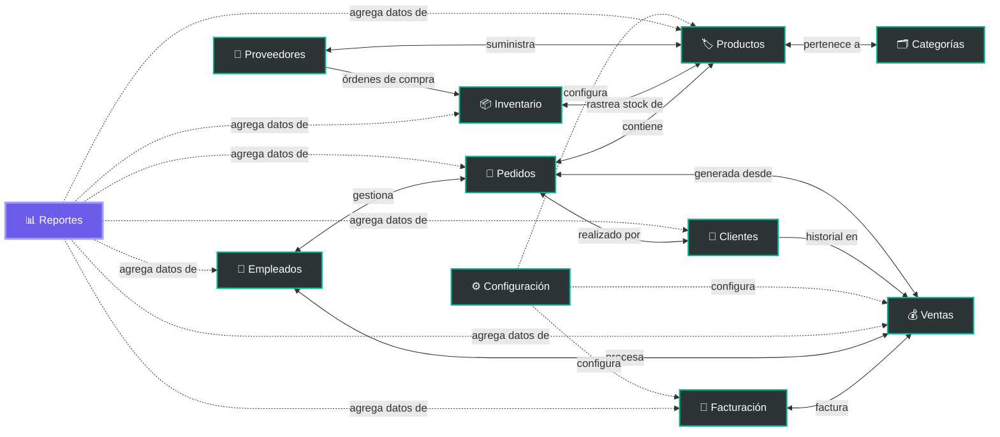
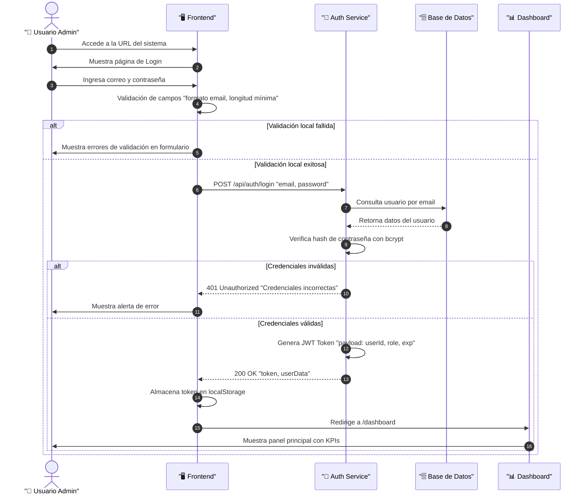
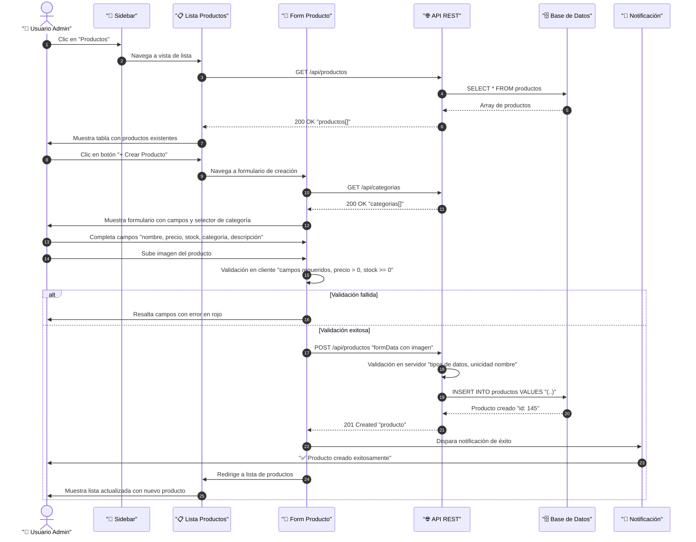
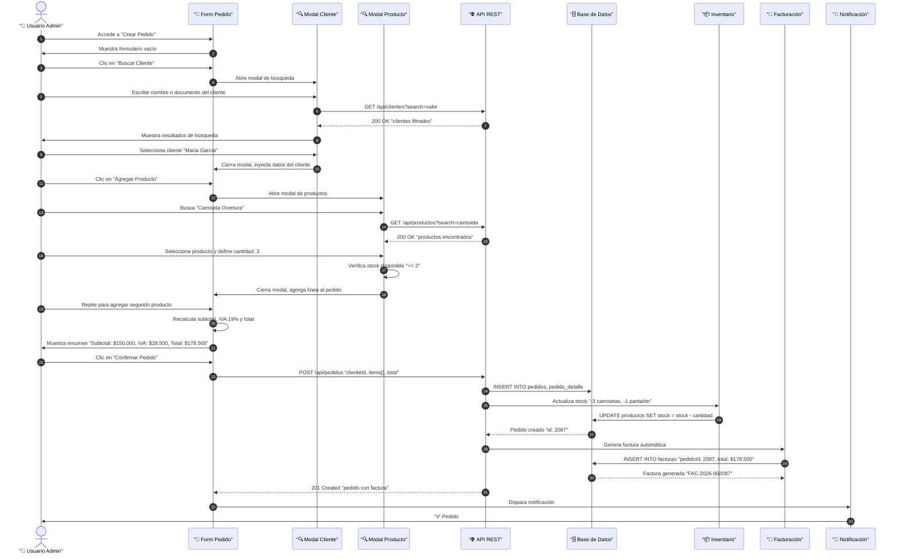
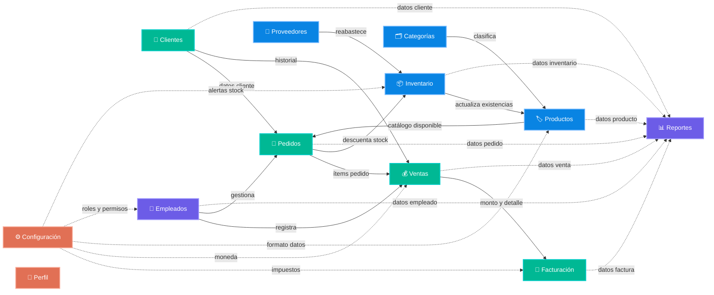
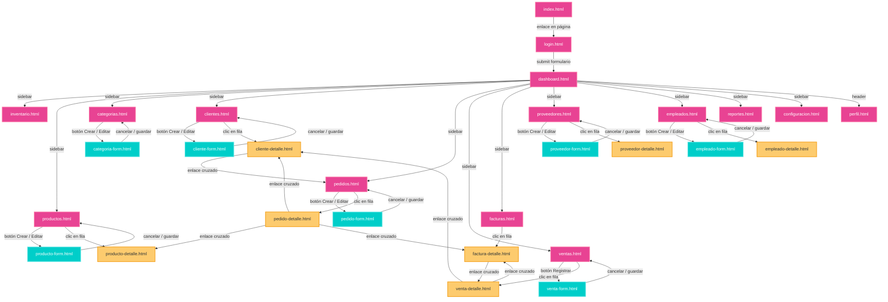
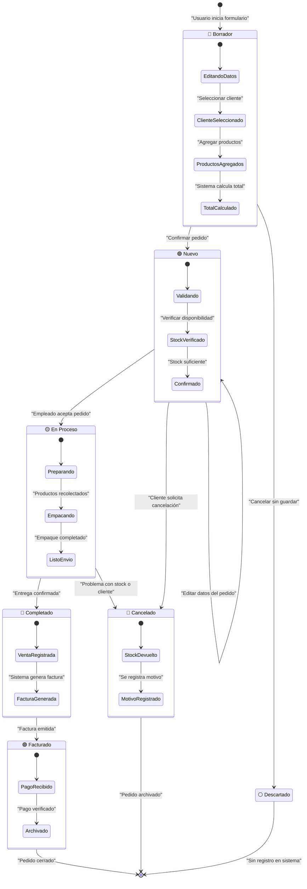

# 📊 Diagramas Profesionales del Sistema H&M

---

<div align="center">

### SERVICIO NACIONAL DE APRENDIZAJE — SENA

#### Centro de Gestión de Mercados, Logística y Tecnologías de la Información

---

## **Diagramas Profesionales del Sistema Administrativo H&M**

### Análisis Visual de la Arquitectura, Navegación e Interacción del Software

---

**Ficha de Caracterización:** 2889927

**Programa de Formación:** Tecnología en Análisis y Desarrollo de Software

**Fase del Proyecto:** Diseño y Documentación Técnica

**Fecha de Entrega:** Junio de 2026

**Ciudad:** Bogotá D.C., Colombia

</div>

---

## 📑 Tabla de Contenido

| N.° | Sección | Descripción |
|-----|---------|-------------|
| 1 | [Introducción](#1-introducción) | Propósito y alcance del documento de diagramas |
| 2 | [Diagrama 1: Árbol Jerárquico del Sistema](#2-diagrama-1-árbol-jerárquico-del-sistema) | Estructura completa del sistema en niveles jerárquicos |
| 3 | [Diagrama 2: Mapa Conceptual de Relaciones](#3-diagrama-2-mapa-conceptual-de-relaciones) | Relaciones conceptuales entre módulos del sistema |
| 4 | [Diagrama 3: Mapa de Navegación](#4-diagrama-3-mapa-de-navegación) | Rutas de navegación primarias, secundarias y cruzadas |
| 5 | [Diagrama 4: Flujo del Usuario](#5-diagrama-4-flujo-del-usuario) | Secuencias de interacción usuario–sistema |
| 6 | [Diagrama 5: Interacción entre Módulos](#6-diagrama-5-diagrama-de-interacción-entre-módulos) | Flujos de datos entre los componentes del sistema |
| 7 | [Diagrama 6: Arquitectura de Información](#7-diagrama-6-arquitectura-de-información) | Organización jerárquica por áreas funcionales |
| 8 | [Diagrama 7: Relación entre Pantallas](#8-diagrama-7-relación-entre-pantallas) | Conexiones entre archivos HTML del sistema |
| 9 | [Diagrama 8: Wireframes de Baja Fidelidad](#9-diagrama-8-wireframes-de-baja-fidelidad) | Bocetos esquemáticos de las pantallas principales |
| 10 | [Diagrama 9: Wireframes de Media Fidelidad](#10-diagrama-9-wireframes-de-media-fidelidad) | Wireframes detallados con datos y campos específicos |
| 11 | [Diagrama 10: Flujo de Estados de un Pedido](#11-diagrama-10-flujo-de-estados-de-un-pedido) | Ciclo de vida completo de un pedido en el sistema |
| 12 | [Conclusiones](#12-conclusiones) | Síntesis del aporte de los diagramas al desarrollo |
| 13 | [Bibliografía](#13-bibliografía) | Referencias en formato APA séptima edición |

---

## 1. Introducción

El presente documento constituye el segundo entregable del proyecto formativo **Sistema Administrativo H&M**, desarrollado en el marco del programa de Tecnología en Análisis y Desarrollo de Software del SENA, ficha 2889927. Su propósito fundamental es presentar, de manera visual y técnicamente rigurosa, la totalidad de diagramas profesionales que describen la arquitectura, la navegación, los flujos de interacción y la estructura de información del sistema.

La documentación visual desempeña un papel insustituible en la ingeniería de software contemporánea: facilita la comunicación entre los miembros del equipo de desarrollo, permite la validación temprana de decisiones de diseño con los interesados (stakeholders), y constituye una referencia permanente para las fases de implementación, pruebas y mantenimiento. Según Pressman y Maxim (2020), los modelos visuales reducen la ambigüedad inherente a las especificaciones textuales y promueven un entendimiento compartido del sistema.

Este documento contiene diez (10) diagramas profesionales organizados en categorías complementarias: diagramas estructurales (árbol jerárquico, arquitectura de información), diagramas de comportamiento (flujo del usuario, estados del pedido), diagramas de relación (mapa conceptual, interacción entre módulos) y diagramas de presentación (wireframes de baja y media fidelidad). Cada diagrama se acompaña de una explicación detallada que contextualiza su propósito, describe los elementos representados y justifica las decisiones de diseño tomadas. La notación empleada sigue los estándares de Mermaid.js para los diagramas renderizables y la convención de caracteres ASCII para los wireframes.

---

## 2. Diagrama 1: Árbol Jerárquico del Sistema

El árbol jerárquico representa la estructura organizativa completa del sistema, desde el punto de entrada hasta las operaciones atómicas disponibles en cada módulo. Este diagrama permite visualizar la profundidad funcional del software y la cantidad de pantallas que el equipo de desarrollo debe implementar.

```mermaid
graph TD
    classDef raiz fill:#1a1a2e,color:#fff,stroke:#e94560,stroke-width:3px
    classDef nivel1 fill:#16213e,color:#fff,stroke:#0f3460,stroke-width:2px
    classDef nivel2 fill:#0f3460,color:#fff,stroke:#533483,stroke-width:2px
    classDef nivel3 fill:#533483,color:#fff,stroke:#e94560,stroke-width:1px
    classDef nivel4 fill:#e94560,color:#fff,stroke:#fff,stroke-width:1px

    INICIO["🏠 Inicio"]:::raiz
    LOGIN["🔐 Login"]:::nivel1
    DASH["📊 Dashboard"]:::nivel1

    INICIO --> LOGIN
    LOGIN --> DASH

    %% ── Módulo Inventario ──
    INV["📦 Inventario"]:::nivel2
    DASH --> INV
    INV --> INV_LIST["📋 Lista de Stock"]:::nivel3
    INV --> INV_AJUSTE["🔄 Ajustar Inventario"]:::nivel3
    INV --> INV_HIST["📜 Historial Movimientos"]:::nivel3
    INV_LIST --> INV_DETALLE["🔍 Detalle Producto-Stock"]:::nivel4
    INV_LIST --> INV_FILTRO["🎯 Filtrar por Categoría"]:::nivel4
    INV_AJUSTE --> INV_ENTRADA["📥 Registrar Entrada"]:::nivel4
    INV_AJUSTE --> INV_SALIDA["📤 Registrar Salida"]:::nivel4
    INV_HIST --> INV_EXPORT["💾 Exportar Historial"]:::nivel4

    %% ── Módulo Productos ──
    PROD["🏷️ Productos"]:::nivel2
    DASH --> PROD
    PROD --> PROD_LIST["📋 Lista Productos"]:::nivel3
    PROD --> PROD_CREATE["➕ Crear Producto"]:::nivel3
    PROD --> PROD_EDIT["✏️ Editar Producto"]:::nivel3
    PROD_LIST --> PROD_DET["🔍 Detalle Producto"]:::nivel4
    PROD_LIST --> PROD_DEL["🗑️ Eliminar Producto"]:::nivel4
    PROD_CREATE --> PROD_IMG["📸 Subir Imágenes"]:::nivel4
    PROD_EDIT --> PROD_PRECIO["💲 Actualizar Precio"]:::nivel4

    %% ── Módulo Categorías ──
    CAT["🗂️ Categorías"]:::nivel2
    DASH --> CAT
    CAT --> CAT_LIST["📋 Lista Categorías"]:::nivel3
    CAT --> CAT_CREATE["➕ Crear Categoría"]:::nivel3
    CAT --> CAT_EDIT["✏️ Editar Categoría"]:::nivel3
    CAT_LIST --> CAT_DET["🔍 Detalle Categoría"]:::nivel4
    CAT_LIST --> CAT_DEL["🗑️ Eliminar Categoría"]:::nivel4
    CAT_CREATE --> CAT_ICON["🎨 Asignar Icono"]:::nivel4

    %% ── Módulo Clientes ──
    CLI["👥 Clientes"]:::nivel2
    DASH --> CLI
    CLI --> CLI_LIST["📋 Lista Clientes"]:::nivel3
    CLI --> CLI_CREATE["➕ Registrar Cliente"]:::nivel3
    CLI --> CLI_EDIT["✏️ Editar Cliente"]:::nivel3
    CLI_LIST --> CLI_DET["🔍 Detalle Cliente"]:::nivel4
    CLI_LIST --> CLI_DEL["🗑️ Eliminar Cliente"]:::nivel4
    CLI_DET --> CLI_HISTO["📊 Historial Compras"]:::nivel4

    %% ── Módulo Pedidos ──
    PED["📝 Pedidos"]:::nivel2
    DASH --> PED
    PED --> PED_LIST["📋 Lista Pedidos"]:::nivel3
    PED --> PED_CREATE["➕ Crear Pedido"]:::nivel3
    PED --> PED_EDIT["✏️ Editar Pedido"]:::nivel3
    PED_LIST --> PED_DET["🔍 Detalle Pedido"]:::nivel4
    PED_LIST --> PED_CANCEL["❌ Cancelar Pedido"]:::nivel4
    PED_CREATE --> PED_ITEMS["🛒 Agregar Ítems"]:::nivel4
    PED_DET --> PED_ESTADO["🔄 Cambiar Estado"]:::nivel4

    %% ── Módulo Ventas ──
    VEN["💰 Ventas"]:::nivel2
    DASH --> VEN
    VEN --> VEN_LIST["📋 Lista Ventas"]:::nivel3
    VEN --> VEN_CREATE["➕ Registrar Venta"]:::nivel3
    VEN --> VEN_HIST["📈 Historial Ventas"]:::nivel3
    VEN_LIST --> VEN_DET["🔍 Detalle Venta"]:::nivel4
    VEN_CREATE --> VEN_COBRO["💳 Procesar Cobro"]:::nivel4
    VEN_HIST --> VEN_GRAFICA["📊 Gráficas de Ventas"]:::nivel4

    %% ── Módulo Facturación ──
    FAC["🧾 Facturación"]:::nivel2
    DASH --> FAC
    FAC --> FAC_LIST["📋 Lista Facturas"]:::nivel3
    FAC --> FAC_CREATE["➕ Generar Factura"]:::nivel3
    FAC --> FAC_ANULAR["⛔ Anular Factura"]:::nivel3
    FAC_LIST --> FAC_DET["🔍 Detalle Factura"]:::nivel4
    FAC_LIST --> FAC_PDF["📄 Descargar PDF"]:::nivel4
    FAC_CREATE --> FAC_IMPUESTO["💹 Calcular Impuestos"]:::nivel4

    %% ── Módulo Proveedores ──
    PROV["🚚 Proveedores"]:::nivel2
    DASH --> PROV
    PROV --> PROV_LIST["📋 Lista Proveedores"]:::nivel3
    PROV --> PROV_CREATE["➕ Registrar Proveedor"]:::nivel3
    PROV --> PROV_EDIT["✏️ Editar Proveedor"]:::nivel3
    PROV_LIST --> PROV_DET["🔍 Detalle Proveedor"]:::nivel4
    PROV_LIST --> PROV_DEL["🗑️ Eliminar Proveedor"]:::nivel4
    PROV_DET --> PROV_ORDENES["📦 Órdenes de Compra"]:::nivel4

    %% ── Módulo Empleados ──
    EMP["👔 Empleados"]:::nivel2
    DASH --> EMP
    EMP --> EMP_LIST["📋 Lista Empleados"]:::nivel3
    EMP --> EMP_CREATE["➕ Registrar Empleado"]:::nivel3
    EMP --> EMP_EDIT["✏️ Editar Empleado"]:::nivel3
    EMP_LIST --> EMP_DET["🔍 Detalle Empleado"]:::nivel4
    EMP_LIST --> EMP_DEL["🗑️ Dar de Baja"]:::nivel4
    EMP_DET --> EMP_ROL["🛡️ Asignar Rol"]:::nivel4

    %% ── Módulo Reportes ──
    REP["📊 Reportes"]:::nivel2
    DASH --> REP
    REP --> REP_VENTAS["💰 Reporte Ventas"]:::nivel3
    REP --> REP_INV["📦 Reporte Inventario"]:::nivel3
    REP --> REP_CLI["👥 Reporte Clientes"]:::nivel3
    REP_VENTAS --> REP_V_DIARIO["📅 Ventas Diarias"]:::nivel4
    REP_VENTAS --> REP_V_MENSUAL["📆 Ventas Mensuales"]:::nivel4
    REP_INV --> REP_I_BAJO["⚠️ Stock Bajo"]:::nivel4
    REP_CLI --> REP_C_TOP["🏆 Top Clientes"]:::nivel4

    %% ── Módulo Configuración ──
    CONF["⚙️ Configuración"]:::nivel2
    DASH --> CONF
    CONF --> CONF_GRAL["🔧 General"]:::nivel3
    CONF --> CONF_SEG["🔒 Seguridad"]:::nivel3
    CONF --> CONF_NOTI["🔔 Notificaciones"]:::nivel3
    CONF_GRAL --> CONF_EMPRESA["🏢 Datos Empresa"]:::nivel4
    CONF_GRAL --> CONF_MONEDA["💱 Moneda y Formato"]:::nivel4
    CONF_SEG --> CONF_PASS["🔑 Políticas Contraseña"]:::nivel4
    CONF_NOTI --> CONF_EMAIL["📧 Config. Correo"]:::nivel4

    %% ── Módulo Perfil ──
    PERF["👤 Perfil"]:::nivel2
    DASH --> PERF
    PERF --> PERF_VER["📋 Ver Perfil"]:::nivel3
    PERF --> PERF_EDIT["✏️ Editar Perfil"]:::nivel3
    PERF --> PERF_PASS["🔑 Cambiar Contraseña"]:::nivel3
    PERF_VER --> PERF_AVATAR["📸 Foto de Perfil"]:::nivel4
    PERF_EDIT --> PERF_DATOS["📝 Datos Personales"]:::nivel4
    PERF_PASS --> PERF_2FA["🛡️ Autenticación 2FA"]:::nivel4
```



**Explicación del Diagrama:** El árbol jerárquico del Sistema H&M revela una arquitectura de cuatro niveles de profundidad que abarca trece (13) módulos funcionales y más de ochenta (80) nodos operativos. En el nivel raíz se encuentra la pantalla de Inicio, que conduce al proceso de autenticación (Login) y, tras una validación exitosa, desemboca en el Dashboard o panel de control central. Desde el Dashboard, el usuario administrador accede a cada uno de los módulos principales: Inventario, Productos, Categorías, Clientes, Pedidos, Ventas, Facturación, Proveedores, Empleados, Reportes, Configuración y Perfil. Cada módulo despliega un tercer nivel con las operaciones CRUD estándar (Listar, Crear, Editar) y un cuarto nivel con acciones especializadas como exportar historial, subir imágenes, procesar cobros o gestionar roles de usuario. La codificación cromática diferencia visualmente cada nivel de profundidad, mientras que los emojis facilitan el reconocimiento inmediato de la funcionalidad de cada nodo. Esta estructura demuestra que el sistema está diseñado siguiendo el principio de «profundidad mínima, amplitud controlada», lo que favorece la accesibilidad cognitiva del usuario conforme a la norma ISO 9241-210 (ISO, 2019).

---

## 3. Diagrama 2: Mapa Conceptual de Relaciones

El mapa conceptual ilustra las relaciones semánticas y funcionales que existen entre los módulos del sistema, permitiendo comprender cómo la información fluye y se vincula a nivel de dominio de negocio.



**Explicación del Diagrama:** El mapa conceptual de relaciones expone la red de interdependencias que sustenta la lógica de negocio del Sistema H&M. En el centro de la operación comercial se sitúa el módulo de **Productos**, que mantiene relaciones bidireccionales con Categorías (clasificación taxonómica), Inventario (control de existencias) y Proveedores (cadena de suministro). El ciclo transaccional sigue una secuencia lógica: los **Clientes** realizan **Pedidos** que contienen Productos; cuando un Pedido se completa, genera una **Venta**; y cada Venta produce una entrada en **Facturación**. Los **Empleados** actúan como agentes que procesan las Ventas y gestionan los Pedidos, vinculando el componente humano con el operativo. El módulo de **Reportes**, representado como nodo central de agregación, consume información de todos los demás módulos mediante líneas punteadas que simbolizan relaciones de lectura no transaccional. Finalmente, **Configuración** ejerce influencia transversal sobre los módulos que requieren parámetros del sistema (formatos de factura, moneda, impuestos). Este diagrama evidencia un diseño con bajo acoplamiento y alta cohesión, principios fundamentales de la ingeniería de software según Sommerville (2016).

---

## 4. Diagrama 3: Mapa de Navegación

El mapa de navegación documenta todas las rutas posibles que un usuario puede seguir dentro del sistema, distinguiendo entre navegación primaria (barra lateral), secundaria (migas de pan y botones de retorno) y cruzada (enlaces entre módulos).

```mermaid
graph TD
    classDef pag fill:#0984e3,color:#fff,stroke:#74b9ff,stroke-width:2px
    classDef sidebar fill:#00b894,color:#fff,stroke:#55efc4,stroke-width:2px
    classDef modal fill:#e17055,color:#fff,stroke:#fab1a0,stroke-width:2px
    classDef cruzado fill:#fdcb6e,color:#2d3436,stroke:#f39c12,stroke-width:2px

    INDEX["🏠 Página Inicio"]:::pag
    LOGIN["🔐 Login"]:::pag
    DASH["📊 Dashboard"]:::pag

    INDEX -->|"Botón Ingresar"| LOGIN
    LOGIN -->|"Autenticación exitosa"| DASH
    LOGIN -->|"Recuperar contraseña"| RECOVER["🔑 Recuperar Clave"]:::modal

    %% ── Navegación Primaria - Sidebar ──
    DASH -->|"📌 Sidebar"| INV_P["📦 Inventario"]:::sidebar
    DASH -->|"📌 Sidebar"| PROD_P["🏷️ Productos"]:::sidebar
    DASH -->|"📌 Sidebar"| CAT_P["🗂️ Categorías"]:::sidebar
    DASH -->|"📌 Sidebar"| CLI_P["👥 Clientes"]:::sidebar
    DASH -->|"📌 Sidebar"| PED_P["📝 Pedidos"]:::sidebar
    DASH -->|"📌 Sidebar"| VEN_P["💰 Ventas"]:::sidebar
    DASH -->|"📌 Sidebar"| FAC_P["🧾 Facturación"]:::sidebar
    DASH -->|"📌 Sidebar"| PROV_P["🚚 Proveedores"]:::sidebar
    DASH -->|"📌 Sidebar"| EMP_P["👔 Empleados"]:::sidebar
    DASH -->|"📌 Sidebar"| REP_P["📊 Reportes"]:::sidebar
    DASH -->|"📌 Sidebar"| CONF_P["⚙️ Configuración"]:::sidebar
    DASH -->|"📌 Header"| PERF_P["👤 Perfil"]:::sidebar

    %% ── Navegación Secundaria - Breadcrumbs ──
    PROD_P -->|"Breadcrumb ←"| DASH
    PROD_P -->|"Botón Crear"| PROD_FORM["📝 Formulario Producto"]:::pag
    PROD_P -->|"Clic en fila"| PROD_DET["🔍 Detalle Producto"]:::pag
    PROD_FORM -->|"Breadcrumb ←"| PROD_P
    PROD_DET -->|"Breadcrumb ←"| PROD_P
    PROD_DET -->|"Botón Editar"| PROD_EDIT["✏️ Editar Producto"]:::pag
    PROD_DET -->|"Botón Eliminar"| PROD_DEL_MODAL["⚠️ Confirmar Eliminación"]:::modal

    %% ── Navegación Cruzada entre Módulos ──
    PED_P -->|"Clic en fila"| PED_DET["🔍 Detalle Pedido"]:::pag
    PED_DET -->|"🔗 Ver Cliente"| CLI_DET["🔍 Detalle Cliente"]:::cruzado
    PED_DET -->|"🔗 Ver Producto"| PROD_DET
    PED_DET -->|"🔗 Ver Factura"| FAC_DET["🔍 Detalle Factura"]:::cruzado
    VEN_P -->|"Clic en fila"| VEN_DET["🔍 Detalle Venta"]:::pag
    VEN_DET -->|"🔗 Ver Factura"| FAC_DET
    VEN_DET -->|"🔗 Ver Cliente"| CLI_DET
    FAC_DET -->|"🔗 Ver Venta"| VEN_DET
    CLI_DET -->|"🔗 Ver Pedidos"| PED_P

    %% ── Flujos Modales ──
    PED_P -->|"Botón Crear"| PED_FORM["📝 Formulario Pedido"]:::pag
    PED_FORM -->|"Buscar Cliente"| CLI_SEARCH["🔍 Modal Buscar Cliente"]:::modal
    PED_FORM -->|"Agregar Producto"| PROD_SEARCH["🔍 Modal Buscar Producto"]:::modal
    CLI_SEARCH -->|"Seleccionar"| PED_FORM
    PROD_SEARCH -->|"Seleccionar"| PED_FORM

    %% ── Cerrar Sesión ──
    DASH -->|"Header → Cerrar Sesión"| LOGOUT["🚪 Cerrar Sesión"]:::modal
    LOGOUT -->|"Confirmar"| LOGIN
```



**Explicación del Diagrama:** El mapa de navegación del Sistema H&M define tres niveles de enrutamiento que garantizan una experiencia de usuario fluida y predecible. La **navegación primaria** se implementa mediante una barra lateral (sidebar) persistente que permite el acceso directo a los trece módulos desde cualquier punto del sistema; el acceso al Perfil se ubica en el header para diferenciarlo funcionalmente. La **navegación secundaria** emplea migas de pan (breadcrumbs) para proporcionar contexto posicional y permitir el retorno eficiente a las vistas de lista; además, los botones de acción dentro de cada vista (Crear, Editar, Eliminar) definen rutas de ida y vuelta. La **navegación cruzada** constituye uno de los aspectos más valiosos del diseño: desde el Detalle de un Pedido, el usuario puede saltar directamente al Detalle del Cliente asociado, visualizar el Detalle de cualquier Producto incluido o acceder a la Factura generada, sin necesidad de regresar al Dashboard. Los **flujos modales**, representados en color anaranjado, corresponden a ventanas superpuestas (diálogos) que no rompen el contexto de navegación, como la búsqueda de clientes durante la creación de un pedido o la confirmación antes de una eliminación. Este diseño cumple con las heurísticas de Nielsen (1994) de «visibilidad del estado del sistema» y «libertad y control del usuario».

---

## 5. Diagrama 4: Flujo del Usuario

Los diagramas de secuencia modelan las interacciones temporales entre el usuario administrador y los componentes del sistema para tres flujos críticos de operación.

### 5.1 Flujo 1: Proceso de Inicio de Sesión



### 5.2 Flujo 2: Crear un Nuevo Producto



### 5.3 Flujo 3: Procesar un Pedido Completo



**Explicación del Diagrama:** Los tres diagramas de secuencia modelan los flujos operativos más representativos del Sistema H&M, reflejando la interacción temporal entre el usuario y los componentes internos del software. El **Flujo 1 (Login)** ilustra un proceso de autenticación de dos fases: validación local en el cliente (formato de correo, longitud mínima de contraseña) seguida de autenticación en el servidor mediante comparación de hash bcrypt y generación de token JWT, siguiendo las prácticas de seguridad recomendadas por OWASP (2023). El **Flujo 2 (Crear Producto)** demuestra la operación CRUD de creación con validación doble (cliente y servidor), carga de archivos multimedia y retroalimentación inmediata mediante notificaciones toast, cumpliendo con la heurística de «visibilidad del estado del sistema». El **Flujo 3 (Procesar Pedido)** es el más complejo, ya que orquesta múltiples módulos simultáneamente: la selección de Cliente y Productos mediante modales de búsqueda, el cálculo automático de impuestos (IVA 19%), la actualización del Inventario en cascada y la generación automática de la Factura asociada. Este flujo evidencia la integración transaccional del sistema, donde una sola acción del usuario desencadena operaciones coordinadas en cuatro tablas de la base de datos.

---

## 6. Diagrama 5: Diagrama de Interacción entre Módulos

El diagrama de interacción muestra cómo los módulos del sistema intercambian datos y disparan acciones entre sí durante la operación normal del software.



**Explicación del Diagrama:** El diagrama de interacción entre módulos revela la topología de comunicación del Sistema H&M, diferenciando cuatro grupos funcionales mediante codificación cromática: **Comercial** (verde — Clientes, Pedidos, Ventas, Facturación), **Operativo** (azul — Productos, Categorías, Inventario, Proveedores), **Administrativo** (púrpura — Empleados, Reportes) y **Sistema** (naranja — Configuración, Perfil). Las flechas continuas representan flujos de datos transaccionales que implican escritura: cuando un Pedido se confirma, descuenta stock del Inventario y envía ítems a Ventas; cuando una Venta se registra, genera automáticamente una entrada en Facturación. Las flechas punteadas representan flujos de lectura no destructiva: Reportes consume datos de siete módulos para generar analíticas, mientras que Configuración inyecta parámetros transversales (tasa de IVA, formato de moneda, umbrales de alerta de stock bajo, roles y permisos). El ciclo de reabastecimiento también queda representado: Proveedores alimenta el Inventario, que a su vez actualiza las existencias reflejadas en Productos. Esta arquitectura modular con interfaces bien definidas permite la evolución independiente de cada componente sin afectar la estabilidad del conjunto.

---

## 7. Diagrama 6: Arquitectura de Información

La arquitectura de información organiza todos los componentes del sistema en capas funcionales, agrupando los módulos por áreas de responsabilidad dentro de la organización.

```mermaid
graph TB
    classDef sistema fill:#2d3436,color:#fff,stroke:#636e72,stroke-width:3px
    classDef area fill:#0984e3,color:#fff,stroke:#74b9ff,stroke-width:2px
    classDef modulo fill:#00b894,color:#fff,stroke:#55efc4,stroke-width:2px
    classDef funcion fill:#dfe6e9,color:#2d3436,stroke:#b2bec3,stroke-width:1px

    SIS["🏢 Sistema Administrativo H&M"]:::sistema

    %% ── Áreas Funcionales ──
    GC["💼 Gestión Comercial"]:::area
    GO["📦 Gestión Operativa"]:::area
    GA["👔 Gestión Administrativa"]:::area
    GS["🔧 Gestión del Sistema"]:::area

    SIS --> GC
    SIS --> GO
    SIS --> GA
    SIS --> GS

    %% ── Gestión Comercial ──
    GC --> M_CLI["👥 Clientes"]:::modulo
    GC --> M_PED["📝 Pedidos"]:::modulo
    GC --> M_VEN["💰 Ventas"]:::modulo
    GC --> M_FAC["🧾 Facturación"]:::modulo

    M_CLI --> F_CLI1["Registro y edición"]:::funcion
    M_CLI --> F_CLI2["Historial de compras"]:::funcion
    M_CLI --> F_CLI3["Segmentación"]:::funcion

    M_PED --> F_PED1["Creación de pedidos"]:::funcion
    M_PED --> F_PED2["Seguimiento de estados"]:::funcion
    M_PED --> F_PED3["Cancelación"]:::funcion

    M_VEN --> F_VEN1["Registro de ventas"]:::funcion
    M_VEN --> F_VEN2["Procesamiento de cobro"]:::funcion
    M_VEN --> F_VEN3["Historial y gráficas"]:::funcion

    M_FAC --> F_FAC1["Generación de facturas"]:::funcion
    M_FAC --> F_FAC2["Cálculo de impuestos"]:::funcion
    M_FAC --> F_FAC3["Descarga PDF"]:::funcion

    %% ── Gestión Operativa ──
    GO --> M_PROD["🏷️ Productos"]:::modulo
    GO --> M_CAT["🗂️ Categorías"]:::modulo
    GO --> M_INV["📦 Inventario"]:::modulo
    GO --> M_PROV["🚚 Proveedores"]:::modulo

    M_PROD --> F_PROD1["CRUD de productos"]:::funcion
    M_PROD --> F_PROD2["Gestión de imágenes"]:::funcion
    M_PROD --> F_PROD3["Actualización de precios"]:::funcion

    M_CAT --> F_CAT1["CRUD de categorías"]:::funcion
    M_CAT --> F_CAT2["Asignación de iconos"]:::funcion
    M_CAT --> F_CAT3["Jerarquía de categorías"]:::funcion

    M_INV --> F_INV1["Control de existencias"]:::funcion
    M_INV --> F_INV2["Entradas y salidas"]:::funcion
    M_INV --> F_INV3["Alertas de stock bajo"]:::funcion

    M_PROV --> F_PROV1["Registro de proveedores"]:::funcion
    M_PROV --> F_PROV2["Órdenes de compra"]:::funcion
    M_PROV --> F_PROV3["Evaluación de proveedores"]:::funcion

    %% ── Gestión Administrativa ──
    GA --> M_EMP["👔 Empleados"]:::modulo
    GA --> M_REP["📊 Reportes"]:::modulo

    M_EMP --> F_EMP1["CRUD de empleados"]:::funcion
    M_EMP --> F_EMP2["Asignación de roles"]:::funcion
    M_EMP --> F_EMP3["Control de acceso"]:::funcion

    M_REP --> F_REP1["Reportes de ventas"]:::funcion
    M_REP --> F_REP2["Reportes de inventario"]:::funcion
    M_REP --> F_REP3["Reportes de clientes"]:::funcion
    M_REP --> F_REP4["Exportación de datos"]:::funcion

    %% ── Gestión del Sistema ──
    GS --> M_CONF["⚙️ Configuración"]:::modulo
    GS --> M_PERF["👤 Perfil"]:::modulo

    M_CONF --> F_CONF1["Datos de la empresa"]:::funcion
    M_CONF --> F_CONF2["Seguridad y contraseñas"]:::funcion
    M_CONF --> F_CONF3["Notificaciones"]:::funcion
    M_CONF --> F_CONF4["Moneda e impuestos"]:::funcion

    M_PERF --> F_PERF1["Edición de perfil"]:::funcion
    M_PERF --> F_PERF2["Cambio de contraseña"]:::funcion
    M_PERF --> F_PERF3["Autenticación 2FA"]:::funcion
```



**Explicación del Diagrama:** La arquitectura de información del Sistema H&M organiza sus trece módulos en cuatro áreas funcionales que reflejan la estructura organizacional de una empresa de retail como H&M. La **Gestión Comercial** agrupa los módulos orientados a la relación con el cliente y el ciclo de ventas (Clientes, Pedidos, Ventas, Facturación), constituyendo el núcleo de generación de ingresos. La **Gestión Operativa** reúne los módulos que soportan la cadena de suministro y el catálogo (Productos, Categorías, Inventario, Proveedores), asegurando que la oferta comercial esté disponible y correctamente clasificada. La **Gestión Administrativa** concentra las funciones de supervisión y análisis (Empleados, Reportes), proporcionando visibilidad sobre el rendimiento del equipo y del negocio. Finalmente, la **Gestión del Sistema** incluye los módulos de soporte técnico y personalización (Configuración, Perfil), que afectan el comportamiento global de la plataforma. Cada módulo se descompone en tres o cuatro funciones específicas que representan las capacidades atómicas del sistema. Esta arquitectura sigue los principios de Rosenfeld et al. (2015) para diseño de información centrado en el usuario, garantizando que la agrupación refleje el modelo mental del administrador.

---

## 8. Diagrama 7: Relación entre Pantallas

El diagrama de relación entre pantallas mapea cada archivo HTML del sistema y sus conexiones de navegación, indicando el tipo de enlace (sidebar, enlace en página, acción de formulario).



**Explicación del Diagrama:** El diagrama de relación entre pantallas establece un inventario visual completo de las páginas HTML del Sistema H&M y sus conexiones de navegación. El sistema se compone de **tres (3) páginas de infraestructura** (index, login, dashboard), **siete (7) páginas de formulario** (creación y edición de entidades CRUD), **siete (7) páginas de detalle** (visualización completa de un registro), **doce (12) páginas de lista** (tablas con operaciones de filtrado, paginación y búsqueda), y una página de perfil y otra de configuración. La codificación cromática diferencia los tipos de pantalla: rosa para páginas principales, turquesa para formularios y amarillo para vistas de detalle. Las etiquetas de los enlaces especifican el mecanismo de navegación empleado: «sidebar» para la navegación primaria persistente, «botón Crear/Editar» para las transiciones a formularios, «clic en fila» para el acceso a vistas de detalle desde las tablas, y «enlace cruzado» para la navegación inter-modular. Los flujos de retorno desde los formularios indican que tanto la acción «cancelar» como «guardar» reconducen al usuario a la lista correspondiente, implementando el patrón de diseño Post/Redirect/Get que previene el envío duplicado de formularios.

---

## 9. Diagrama 8: Wireframes de Baja Fidelidad

Los wireframes de baja fidelidad representan la estructura esquemática de las pantallas principales del sistema, definiendo la disposición espacial de los elementos sin entrar en detalles de color, tipografía o contenido específico.

### 9.1 Wireframe — Página de Login

```
┌─────────────────────────────────────────────────────────────────┐
│                         H & M  SYSTEM                           │
│                     Sistema Administrativo                       │
├─────────────────────────────────────────────────────────────────┤
│                                                                  │
│                    ┌─────────────────────┐                       │
│                    │       🏢 LOGO       │                       │
│                    │        H & M        │                       │
│                    └─────────────────────┘                       │
│                                                                  │
│                    ┌─────────────────────┐                       │
│                    │  Iniciar Sesión     │                       │
│                    ├─────────────────────┤                       │
│                    │                     │                       │
│                    │  📧 Correo:         │                       │
│                    │  ┌─────────────────┐│                       │
│                    │  │                 ││                       │
│                    │  └─────────────────┘│                       │
│                    │                     │                       │
│                    │  🔑 Contraseña:     │                       │
│                    │  ┌─────────────────┐│                       │
│                    │  │  ●●●●●●●        ││                       │
│                    │  └─────────────────┘│                       │
│                    │                     │                       │
│                    │  ☐ Recordarme       │                       │
│                    │                     │                       │
│                    │  ┌─────────────────┐│                       │
│                    │  │   INGRESAR  →   ││                       │
│                    │  └─────────────────┘│                       │
│                    │                     │                       │
│                    │  ¿Olvidó contraseña?│                       │
│                    └─────────────────────┘                       │
│                                                                  │
│                    © 2026 H&M System                             │
└─────────────────────────────────────────────────────────────────┘
```

### 9.2 Wireframe — Dashboard Principal

```
┌─────────────────────────────────────────────────────────────────────────┐
│  🏢 H&M System          🔍 Buscar...            🔔  👤 Admin  ▼       │
├────────────┬────────────────────────────────────────────────────────────┤
│            │                                                            │
│  📊 Dashboard │   ┌──────────┐  ┌──────────┐  ┌──────────┐  ┌──────────┐│
│            │   │ 💰 Ventas │  │ 📝 Pedidos│  │ ⚠️ Stock │  │ 👥 Nuevos││
│  📦 Inventario │   │   Hoy    │  │ Pendient.│  │   Bajo   │  │ Clientes ││
│            │   │  $2.4M   │  │    23     │  │    12    │  │    8     ││
│  🏷️ Productos │   └──────────┘  └──────────┘  └──────────┘  └──────────┘│
│            │                                                            │
│  🗂️ Categorías│   ┌────────────────────────────────────────────────────┐│
│            │   │  📈 Gráfica de Ventas - Últimos 7 Días               ││
│  👥 Clientes  │   │                                                    ││
│            │   │   ██                                                  ││
│  📝 Pedidos   │   │   ██ ██                                            ││
│            │   │   ██ ██    ██                                         ││
│  💰 Ventas    │   │   ██ ██ ██ ██    ██                                ││
│            │   │   ██ ██ ██ ██ ██ ██ ██                                ││
│  🧾 Facturación│  │   Lu Ma Mi Ju Vi Sa Do                             ││
│            │   └────────────────────────────────────────────────────────┘│
│  🚚 Proveedores│                                                        │
│            │   ┌────────────────────────────────────────────────────────┐│
│  👔 Empleados │   │  📋 Últimos Pedidos                                ││
│            │   ├────┬──────────┬──────────┬─────────┬──────────────────┤│
│  📊 Reportes  │   │ ID │ Cliente  │ Total    │ Estado  │ Fecha          ││
│            │   ├────┼──────────┼──────────┼─────────┼──────────────────┤│
│  ⚙️ Config    │   │2087│ M.García │ $178.500 │ ● Nuevo │ 2026-06-27     ││
│            │   │2086│ J.López  │ $95.000  │ ● Proc. │ 2026-06-27     ││
│  ──────────│   │2085│ A.Martín │ $234.200 │ ● Comp. │ 2026-06-26     ││
│  🚪 Salir    │   │2084│ R.Díaz   │ $67.800  │ ● Fact. │ 2026-06-26     ││
│            │   └────┴──────────┴──────────┴─────────┴──────────────────┘│
└────────────┴────────────────────────────────────────────────────────────┘
```

### 9.3 Wireframe — Lista de Productos

```
┌─────────────────────────────────────────────────────────────────────────┐
│  🏢 H&M System          🔍 Buscar...            🔔  👤 Admin  ▼       │
├────────────┬────────────────────────────────────────────────────────────┤
│            │  Dashboard > Productos                                     │
│  📊 Dashboard │                                                         │
│            │  ┌──────────────────────────────┐  ┌──────────────────┐   │
│  📦 Inventario │  │ 🔍 Buscar producto...        │  │ ➕ Crear Producto │   │
│            │  └──────────────────────────────┘  └──────────────────┘   │
│  🏷️ Productos ◄│                                                       │
│            │  ┌────────────────────────────────────────────────────────┐│
│  🗂️ Categorías│  ├────┬──────────────┬──────────┬─────────┬──────┬──────┤│
│            │  │ ID │ Nombre       │ Categoría│ Precio  │Stock │ Acc. ││
│  👥 Clientes  │  ├────┼──────────────┼──────────┼─────────┼──────┼──────┤│
│            │  │ 01 │ Camiseta OS  │ Tops     │ $49.900 │  45  │ ⋮    ││
│  📝 Pedidos   │  │ 02 │ Pantalón Slim│ Bottoms  │ $89.900 │  30  │ ⋮    ││
│            │  │ 03 │ Chaqueta Den.│ Outerwear│$149.900 │  12  │ ⋮    ││
│  💰 Ventas    │  │ 04 │ Vestido Midi │ Dresses  │ $79.900 │  28  │ ⋮    ││
│            │  │ 05 │ Sudadera Logo│ Tops     │ $69.900 │   8  │ ⋮    ││
│  🧾 Facturación│ └────┴──────────────┴──────────┴─────────┴──────┴──────┘│
│            │                                                            │
│  🚚 Proveedores│  ◀  1  2  3  4  5  ▶        Mostrando 1-5 de 127     │
│            │                                                            │
└────────────┴────────────────────────────────────────────────────────────┘
```

### 9.4 Wireframe — Formulario de Producto

```
┌─────────────────────────────────────────────────────────────────────────┐
│  🏢 H&M System          🔍 Buscar...            🔔  👤 Admin  ▼       │
├────────────┬────────────────────────────────────────────────────────────┤
│            │  Dashboard > Productos > Crear Producto                    │
│  📊 Dashboard │                                                         │
│            │  ┌────────────────────────────────────────────────────────┐│
│  📦 Inventario │  │  📝 Nuevo Producto                                   ││
│            │  ├────────────────────────────────────────────────────────┤│
│  🏷️ Productos ◄│  │                                                      ││
│            │  │  Nombre del Producto *                                 ││
│  🗂️ Categorías│  │  ┌──────────────────────────────────────────────┐    ││
│            │  │  │                                              │    ││
│  👥 Clientes  │  │  └──────────────────────────────────────────────┘    ││
│            │  │                                                      ││
│  📝 Pedidos   │  │  Descripción                                       ││
│            │  │  ┌──────────────────────────────────────────────┐    ││
│  💰 Ventas    │  │  │                                              │    ││
│            │  │  │                                              │    ││
│  🧾 Facturación│ │  └──────────────────────────────────────────────┘    ││
│            │  │                                                      ││
│  🚚 Proveedores│ │  Categoría *            Precio *       Stock *     ││
│            │  │  ┌──────────────┐       ┌──────────┐   ┌──────────┐  ││
│  👔 Empleados │  │  │ Seleccionar ▼│       │ $ 0.00   │   │  0       │  ││
│            │  │  └──────────────┘       └──────────┘   └──────────┘  ││
│  📊 Reportes  │  │                                                      ││
│            │  │  Imagen del Producto                                  ││
│  ⚙️ Config    │  │  ┌──────────────────────────────────────────────┐    ││
│            │  │  │  📁 Arrastra una imagen o haz clic para subir │    ││
│  ──────────│  │  └──────────────────────────────────────────────┘    ││
│  🚪 Salir    │  │                                                      ││
│            │  │  ┌──────────────┐    ┌──────────────┐                ││
│            │  │  │  ❌ Cancelar  │    │  💾 Guardar   │                ││
│            │  │  └──────────────┘    └──────────────┘                ││
│            │  └────────────────────────────────────────────────────────┘│
└────────────┴────────────────────────────────────────────────────────────┘
```

**Explicación del Diagrama:** Los wireframes de baja fidelidad presentan la estructura espacial fundamental de las cuatro pantallas más representativas del Sistema H&M. El **wireframe de Login** emplea un diseño centrado (single-column layout) que focaliza la atención del usuario en la acción primaria de autenticación, siguiendo el principio de «una tarea por pantalla» de las guías de diseño material. El **wireframe del Dashboard** introduce el patrón de diseño de dos columnas con barra lateral fija (sidebar) a la izquierda y área de contenido principal a la derecha; en la zona de contenido se distribuyen cuatro tarjetas KPI en la parte superior, una gráfica de tendencias en la zona media y una tabla de últimos pedidos en la zona inferior, siguiendo la jerarquía visual de información por importancia decreciente (patrón F de lectura). El **wireframe de Lista de Productos** mantiene la consistencia del layout con sidebar y añade una barra de acciones superior (búsqueda + botón de creación) y una tabla de datos con paginación, implementando el patrón de diseño «Master-Detail». El **wireframe de Formulario** organiza los campos de entrada en una disposición lógica que agrupa los datos obligatorios (marcados con asterisco) y proporciona acciones claras de cancelar y guardar al final del formulario, cumpliendo con la heurística de «prevención de errores» de Nielsen (1994).

---

## 10. Diagrama 9: Wireframes de Media Fidelidad

Los wireframes de media fidelidad incrementan el nivel de detalle, incorporando datos representativos, nombres de campos específicos y la disposición exacta de los componentes de interfaz.

### 10.1 Dashboard con KPIs Específicos

```
┌─────────────────────────────────────────────────────────────────────────────┐
│  🏢 H&M System       │ 🔍 Buscar en el sistema...  │  🔔 3  👤 Admin  ▼  │
├────────────────┬────────────────────────────────────────────────────────────┤
│                │  📊 Dashboard Principal                 27 Jun 2026 17:45  │
│  ┌────────────┐│                                                            │
│  │ 📊         ││  ┌──────────────────┐ ┌──────────────────┐                │
│  │ Dashboard  ││  │ 💰 VENTAS HOY    │ │ 📝 PEDIDOS       │                │
│  └────────────┘│  │                  │ │    PENDIENTES    │                │
│  ┌────────────┐│  │  $ 2.450.000     │ │       23         │                │
│  │ 📦         ││  │  ▲ +12% vs ayer  │ │  ▲ +5 nuevos     │                │
│  │ Inventario ││  └──────────────────┘ └──────────────────┘                │
│  └────────────┘│  ┌──────────────────┐ ┌──────────────────┐                │
│  ┌────────────┐│  │ ⚠️ INVENTARIO    │ │ 👥 CLIENTES      │                │
│  │ 🏷️         ││  │    BAJO          │ │    NUEVOS        │                │
│  │ Productos  ││  │       12         │ │        8         │                │
│  └────────────┘│  │  🔴 Crítico: 3   │ │  Esta semana     │                │
│  ┌────────────┐│  └──────────────────┘ └──────────────────┘                │
│  │ 🗂️         ││                                                            │
│  │ Categorías ││  ┌──────────────────────────────────────────────────────┐  │
│  └────────────┘│  │  📈 Ventas Últimos 7 Días                           │  │
│  ┌────────────┐│  │                                                      │  │
│  │ 👥         ││  │  $3M ┤                                     ████     │  │
│  │ Clientes   ││  │      │              ████                   ████     │  │
│  └────────────┘│  │  $2M ┤    ████      ████      ████         ████     │  │
│  ┌────────────┐│  │      │    ████ ████ ████      ████ ████    ████     │  │
│  │ 📝         ││  │  $1M ┤    ████ ████ ████ ████ ████ ████    ████     │  │
│  │ Pedidos    ││  │      │    ████ ████ ████ ████ ████ ████    ████     │  │
│  └────────────┘│  │   $0 ┤────████─████─████─████─████─████────████──── │  │
│  ┌────────────┐│  │           Lun  Mar  Mié  Jue  Vie  Sáb    Dom      │  │
│  │ 💰         ││  └──────────────────────────────────────────────────────┘  │
│  │ Ventas     ││                                                            │
│  └────────────┘│  ┌──────────────────────────────────────────────────────┐  │
│  ┌────────────┐│  │  📋 Últimos Pedidos              Ver todos →         │  │
│  │ 🧾         ││  ├──────┬───────────────┬────────────┬─────────┬───────┤  │
│  │ Facturación││  │  ID  │ Cliente       │ Total      │ Estado  │ Fecha │  │
│  └────────────┘│  ├──────┼───────────────┼────────────┼─────────┼───────┤  │
│  ┌────────────┐│  │ 2087 │ María García  │  $178.500  │ 🟢 Nuevo│ 27/06 │  │
│  │ 🚚         ││  │ 2086 │ Juan López    │   $95.000  │ 🟡 Proc.│ 27/06 │  │
│  │ Proveedores││  │ 2085 │ Ana Martínez  │  $234.200  │ 🔵 Comp.│ 26/06 │  │
│  └────────────┘│  │ 2084 │ Roberto Díaz  │   $67.800  │ 🟣 Fact.│ 26/06 │  │
│  ┌────────────┐│  │ 2083 │ Laura Torres  │  $312.000  │ 🔴 Canc.│ 25/06 │  │
│  │ 👔         ││  └──────┴───────────────┴────────────┴─────────┴───────┘  │
│  │ Empleados  ││                                                            │
│  └────────────┘│  ┌─────────────────────────┐ ┌─────────────────────────┐  │
│  ┌────────────┐│  │ 🏆 Top 5 Productos      │ │ 🥧 Ventas por Categoría │  │
│  │ 📊         ││  ├─────────────────────────┤ ├─────────────────────────┤  │
│  │ Reportes   ││  │ 1. Camiseta OS    (145) │ │  ████ Tops        35%  │  │
│  └────────────┘│  │ 2. Pantalón Slim  (112) │ │  ███  Bottoms     25%  │  │
│  ┌────────────┐│  │ 3. Vestido Midi    (98) │ │  ██   Dresses     18%  │  │
│  │ ⚙️         ││  │ 4. Sudadera Logo   (87) │ │  █    Outerwear   12%  │  │
│  │ Configurar ││  │ 5. Chaqueta Denim  (76) │ │  █    Accesorios  10%  │  │
│  └────────────┘│  └─────────────────────────┘ └─────────────────────────┘  │
│                │                                                            │
│  🚪 Cerrar     │  Powered by H&M System v2.0 — SENA 2026                   │
│     Sesión     │                                                            │
├────────────────┴────────────────────────────────────────────────────────────┤
│  📊 Dashboard  │  📦 Inventario  │  🏷️ Productos  │  📝 Pedidos  │  💰 Ventas │
└─────────────────────────────────────────────────────────────────────────────┘
```

### 10.2 Lista de Productos con Columnas Detalladas

```
┌─────────────────────────────────────────────────────────────────────────────┐
│  🏢 H&M System       │ 🔍 Buscar en el sistema...  │  🔔 3  👤 Admin  ▼  │
├────────────────┬────────────────────────────────────────────────────────────┤
│                │  📊 Dashboard > 🏷️ Productos                              │
│  [Sidebar]     │                                                            │
│                │  ┌──────────────────────────────┐  ┌────────────────────┐  │
│  📊 Dashboard  │  │ 🔍 Buscar por nombre, SKU... │  │ ➕ Crear Producto  │  │
│  📦 Inventario │  └──────────────────────────────┘  └────────────────────┘  │
│  🏷️ Productos ◄│                                                            │
│  🗂️ Categorías │  Filtros:  [Categoría ▼]  [Precio ▼]  [Stock ▼]  🔄 Reset │
│  👥 Clientes   │                                                            │
│  📝 Pedidos    │  ┌──────┬────────────────┬──────────┬──────────┬──────┬───┐│
│  💰 Ventas     │  │  ID  │ Nombre         │ Categoría│  Precio  │Stock │ ⚡││
│  🧾 Facturación│  ├──────┼────────────────┼──────────┼──────────┼──────┼───┤│
│  🚚 Proveedores│  │  001 │ Camiseta       │ Tops     │  $49.900 │  45  │ ⋮ ││
│  👔 Empleados  │  │      │ Oversize       │          │          │      │   ││
│  📊 Reportes   │  ├──────┼────────────────┼──────────┼──────────┼──────┼───┤│
│  ⚙️ Config     │  │  002 │ Pantalón       │ Bottoms  │  $89.900 │  30  │ ⋮ ││
│                │  │      │ Slim Fit       │          │          │      │   ││
│                │  ├──────┼────────────────┼──────────┼──────────┼──────┼───┤│
│                │  │  003 │ Chaqueta       │ Outerwear│ $149.900 │  12  │ ⋮ ││
│                │  │      │ Denim          │          │          │  ⚠️  │   ││
│                │  ├──────┼────────────────┼──────────┼──────────┼──────┼───┤│
│                │  │  004 │ Vestido        │ Dresses  │  $79.900 │  28  │ ⋮ ││
│                │  │      │ Midi Floral    │          │          │      │   ││
│                │  ├──────┼────────────────┼──────────┼──────────┼──────┼───┤│
│                │  │  005 │ Sudadera       │ Tops     │  $69.900 │   8  │ ⋮ ││
│                │  │      │ Logo Print     │          │          │  🔴  │   ││
│                │  └──────┴────────────────┴──────────┴──────────┴──────┴───┘│
│                │                                                            │
│                │  ◀  1  [2]  3  4  ...  26  ▶     Mostrando 6-10 de 127    │
│                │                                                            │
│                │  Leyenda:  🔴 Stock crítico (<10)  ⚠️ Stock bajo (<15)      │
└────────────────┴────────────────────────────────────────────────────────────┘
```

### 10.3 Formulario de Pedido con Campos Específicos

```
┌─────────────────────────────────────────────────────────────────────────────┐
│  🏢 H&M System       │ 🔍 Buscar en el sistema...  │  🔔 3  👤 Admin  ▼  │
├────────────────┬────────────────────────────────────────────────────────────┤
│                │  📊 Dashboard > 📝 Pedidos > Crear Pedido                  │
│  [Sidebar]     │                                                            │
│                │  ┌────────────────────────────────────────────────────────┐│
│                │  │  📝 NUEVO PEDIDO                        #Auto-PED-XXX ││
│                │  ├────────────────────────────────────────────────────────┤│
│                │  │                                                        ││
│                │  │  👥 CLIENTE                                             ││
│                │  │  ┌──────────────────────────────────┐ ┌─────────────┐  ││
│                │  │  │ 🔍 Buscar cliente por nombre/doc │ │ 🔎 Buscar   │  ││
│                │  │  └──────────────────────────────────┘ └─────────────┘  ││
│                │  │  Cliente: María García  │  Doc: CC 52.345.678          ││
│                │  │  Email: maria@email.com │  Tel: 301-234-5678           ││
│                │  │                                                        ││
│                │  │  ──────────────────────────────────────────────────     ││
│                │  │                                                        ││
│                │  │  🛒 PRODUCTOS DEL PEDIDO            ┌───────────────┐  ││
│                │  │                                      │ ➕ Agregar    │  ││
│                │  │                                      │   Producto    │  ││
│                │  │                                      └───────────────┘  ││
│                │  │  ┌──────┬───────────────┬────────┬────────┬───────────┐ ││
│                │  │  │ Prod │ Nombre        │ P.Unit │ Cant.  │ Subtotal  │ ││
│                │  │  ├──────┼───────────────┼────────┼────────┼───────────┤ ││
│                │  │  │  001 │ Camiseta OS   │$49.900 │ [3]  🗑│ $149.700  │ ││
│                │  │  │  003 │ Chaqueta Den. │$149.900│ [1]  🗑│ $149.900  │ ││
│                │  │  └──────┴───────────────┴────────┴────────┴───────────┘ ││
│                │  │                                                        ││
│                │  │  ──────────────────────────────────────────────────     ││
│                │  │                                                        ││
│                │  │  💰 RESUMEN                                             ││
│                │  │  ┌──────────────────────────────────┐                   ││
│                │  │  │  Subtotal:          $299.600     │                   ││
│                │  │  │  IVA (19%):          $56.924     │                   ││
│                │  │  │  ─────────────────────────────── │                   ││
│                │  │  │  TOTAL:             $356.524     │                   ││
│                │  │  └──────────────────────────────────┘                   ││
│                │  │                                                        ││
│                │  │  📝 Observaciones:                                      ││
│                │  │  ┌──────────────────────────────────────────────────┐   ││
│                │  │  │ Entregar en tienda Calle 82...                  │   ││
│                │  │  └──────────────────────────────────────────────────┘   ││
│                │  │                                                        ││
│                │  │  ┌──────────────┐   ┌──────────────────────────────┐   ││
│                │  │  │ ❌ Cancelar   │   │ ✅ Confirmar Pedido          │   ││
│                │  │  └──────────────┘   └──────────────────────────────┘   ││
│                │  └────────────────────────────────────────────────────────┘│
└────────────────┴────────────────────────────────────────────────────────────┘
```

### 10.4 Detalle de Cliente con Pestañas

```
┌─────────────────────────────────────────────────────────────────────────────┐
│  🏢 H&M System       │ 🔍 Buscar en el sistema...  │  🔔 3  👤 Admin  ▼  │
├────────────────┬────────────────────────────────────────────────────────────┤
│                │  📊 Dashboard > 👥 Clientes > María García                 │
│  [Sidebar]     │                                                            │
│                │  ┌────────────────────────────────────────────────────────┐│
│                │  │  👤 María García                 ┌────────┐┌────────┐  ││
│                │  │  CC 52.345.678                   │✏️ Editar││🗑️ Elim.│  ││
│                │  │  Cliente desde: 15/03/2025       └────────┘└────────┘  ││
│                │  ├────────────────────────────────────────────────────────┤│
│                │  │                                                        ││
│                │  │  ┌────────────┐┌────────────┐┌────────────┐            ││
│                │  │  │ 📋 Info    ││ 📝 Pedidos ││ 📊 Historial│            ││
│                │  │  │ ▔▔▔▔▔▔▔▔▔▔││            ││            │            ││
│                │  │  └────────────┘└────────────┘└────────────┘            ││
│                │  │                                                        ││
│                │  │  ┌─────────────────────┬─────────────────────────┐     ││
│                │  │  │ 📧 Email            │ maria.garcia@email.com  │     ││
│                │  │  ├─────────────────────┼─────────────────────────┤     ││
│                │  │  │ 📱 Teléfono         │ 301-234-5678            │     ││
│                │  │  ├─────────────────────┼─────────────────────────┤     ││
│                │  │  │ 🏠 Dirección        │ Cra 15 #82-34, Bogotá  │     ││
│                │  │  ├─────────────────────┼─────────────────────────┤     ││
│                │  │  │ 🎂 Fecha Nacimiento │ 22/09/1990              │     ││
│                │  │  ├─────────────────────┼─────────────────────────┤     ││
│                │  │  │ 💰 Total Compras    │ $2.456.300              │     ││
│                │  │  ├─────────────────────┼─────────────────────────┤     ││
│                │  │  │ 📦 N.° Pedidos      │ 15                      │     ││
│                │  │  ├─────────────────────┼─────────────────────────┤     ││
│                │  │  │ ⭐ Categoría        │ Cliente Frecuente       │     ││
│                │  │  └─────────────────────┴─────────────────────────┘     ││
│                │  │                                                        ││
│                │  │  📊 Resumen Rápido                                      ││
│                │  │  ┌──────────────┐ ┌──────────────┐ ┌──────────────┐    ││
│                │  │  │ Últ. Compra  │ │ Promedio     │ │ Prod. Más    │    ││
│                │  │  │ 27/06/2026   │ │ $163.753     │ │ Comprado:    │    ││
│                │  │  │              │ │ por pedido   │ │ Camiseta OS  │    ││
│                │  │  └──────────────┘ └──────────────┘ └──────────────┘    ││
│                │  └────────────────────────────────────────────────────────┘│
│                │                                                            │
│                │  ← Volver a Lista de Clientes                              │
└────────────────┴────────────────────────────────────────────────────────────┘
```

**Explicación del Diagrama:** Los wireframes de media fidelidad incorporan datos representativos y decisiones de diseño específicas que guiarán la implementación visual del sistema. El **Dashboard con KPIs** presenta cuatro tarjetas métricas clave — Ventas del Día ($2.450.000 con tendencia +12%), Pedidos Pendientes (23, con 5 nuevos), Inventario Bajo (12 productos, 3 en estado crítico) y Clientes Nuevos (8 esta semana) — que proporcionan al administrador una visión ejecutiva instantánea; debajo, una gráfica de barras de los últimos siete días y una tabla de últimos pedidos completan el panel informativo. La **Lista de Productos** detalla las seis columnas del datagrids (ID, Nombre, Categoría, Precio, Stock, Acciones), incorpora filtros por categoría, rango de precio y nivel de stock, e introduce indicadores visuales de alerta (🔴 para stock crítico menor a 10 unidades, ⚠️ para stock bajo menor a 15). El **Formulario de Pedido** demuestra el flujo de composición: primero se busca y selecciona el cliente, luego se agregan productos mediante un modal, el sistema recalcula automáticamente subtotal, IVA (19%) y total, y finalmente se incluye un campo de observaciones. La **Vista de Detalle de Cliente** implementa un patrón de pestañas (tabs) con tres secciones — Info (datos personales), Pedidos (historial de pedidos asociados) e Historial (timeline de interacciones) — y un panel de resumen rápido con métricas individuales del cliente. Estas decisiones de diseño siguen los principios de Garrett (2011) sobre diseño de experiencia de usuario por capas.

---

## 11. Diagrama 10: Flujo de Estados de un Pedido

El diagrama de estados modela el ciclo de vida completo de un pedido dentro del Sistema H&M, documentando las transiciones válidas, las condiciones de guarda y las acciones disparadas en cada cambio de estado.



**Explicación del Diagrama:** El diagrama de estados del pedido documenta el ciclo de vida completo que atraviesa cada orden comercial en el Sistema H&M, desde su creación hasta su cierre definitivo. El flujo inicia con el estado **Borrador**, que representa la fase de composición del pedido donde el usuario selecciona el cliente, agrega productos y el sistema calcula el total; desde este punto, el pedido puede confirmarse (transición a Nuevo) o descartarse sin dejar registro en el sistema. El estado **Nuevo** implica una validación automática de disponibilidad de stock; si el stock es suficiente, el pedido queda confirmado y puede ser aceptado por un empleado (transición a En Proceso) o cancelado por solicitud del cliente. El estado **En Proceso** contempla tres sub-estados internos: Preparando (recolección de productos), Empacando (preparación del paquete) y Listo para Envío; cuando se confirma la entrega, el pedido pasa a Completado. En el estado **Completado**, el sistema registra automáticamente la venta y genera la factura correspondiente, transitando a **Facturado** cuando la factura se emite formalmente. El estado **Cancelado** es accesible desde Nuevo y En Proceso (pero no desde Completado ni Facturado, protegiendo la integridad contable); al cancelar, el sistema devuelve las unidades al inventario y registra el motivo de la cancelación. Este modelo de estados implementa el patrón State Machine descrito por Gamma et al. (1994) en los patrones de diseño GoF, garantizando que las transiciones sean deterministas y que ningún pedido pueda alcanzar un estado inválido.

---

## 12. Conclusiones

La elaboración de los diez diagramas profesionales contenidos en este documento ha permitido alcanzar una comprensión integral y multidimensional del Sistema Administrativo H&M, abarcando desde su estructura jerárquica hasta los flujos de interacción más granulares entre el usuario y los componentes del software.

En primer lugar, los **diagramas estructurales** (Árbol Jerárquico y Arquitectura de Información) demostraron que el sistema posee una profundidad funcional de cuatro niveles y una agrupación coherente en cuatro áreas de gestión (Comercial, Operativa, Administrativa y de Sistema), lo que facilita la asignación de responsabilidades durante la fase de implementación y garantiza que cada módulo tenga un propósito claro y delimitado dentro del ecosistema de la aplicación.

En segundo lugar, los **diagramas de relación** (Mapa Conceptual e Interacción entre Módulos) revelaron la complejidad de las interdependencias del sistema: el ciclo transaccional Cliente → Pedido → Venta → Facturación constituye el eje vertebral del software, mientras que módulos como Inventario, Proveedores y Reportes actúan como soportes operativos que enriquecen la funcionalidad del ciclo principal. El diseño con bajo acoplamiento entre módulos permite la evolución independiente de cada componente.

En tercer lugar, los **diagramas de comportamiento** (Flujo del Usuario y Estados del Pedido) proporcionaron una especificación precisa de las secuencias temporales y las máquinas de estados que el equipo de desarrollo debe implementar, reduciendo significativamente la ambigüedad en los requisitos funcionales. El diagrama de secuencia del procesamiento de pedidos, por ejemplo, documenta la orquestación de cuatro módulos simultáneos en una sola operación de usuario.

En cuarto lugar, los **diagramas de navegación** (Mapa de Navegación y Relación entre Pantallas) establecieron las rutas de acceso y los mecanismos de enlace que conforman la experiencia de navegación del administrador. La identificación de navegación primaria (sidebar), secundaria (breadcrumbs) y cruzada (enlaces inter-modulares) asegura que la implementación del frontend cumpla con los estándares de usabilidad definidos por las heurísticas de Nielsen y la norma ISO 9241-210.

Finalmente, los **wireframes** de baja y media fidelidad proporcionaron una referencia visual concreta para la maquetación de las interfaces, definiendo la disposición de los elementos, los datos representativos y los componentes de interacción (tablas, formularios, tarjetas KPI, pestañas) que serán implementados con HTML, CSS y JavaScript. Estos wireframes aceleran la transición entre el diseño y la codificación, y sirven como artefactos de validación con los instructores y los interesados del proyecto.

En conclusión, el conjunto de diagramas aquí presentado constituye un activo fundamental para la gestión exitosa del proyecto, alineándose con las mejores prácticas de la ingeniería de software moderna y los estándares de calidad exigidos por el Servicio Nacional de Aprendizaje (SENA).

---

## 13. Bibliografía

Gamma, E., Helm, R., Johnson, R., & Vlissides, J. (1994). *Design patterns: Elements of reusable object-oriented software*. Addison-Wesley Professional.

Garrett, J. J. (2011). *The elements of user experience: User-centered design for the web and beyond* (2.ª ed.). New Riders.

International Organization for Standardization. (2019). *Ergonomics of human-system interaction — Part 210: Human-centred design for interactive systems* (ISO 9241-210:2019). ISO.

Nielsen, J. (1994). *Usability engineering*. Academic Press.

OWASP Foundation. (2023). *OWASP Top Ten — 2023*. Open Web Application Security Project. https://owasp.org/www-project-top-ten/

Pressman, R. S., & Maxim, B. R. (2020). *Software engineering: A practitioner's approach* (9.ª ed.). McGraw-Hill Education.

Rosenfeld, L., Morville, P., & Arango, J. (2015). *Information architecture: For the web and beyond* (4.ª ed.). O'Reilly Media.

Sommerville, I. (2016). *Software engineering* (10.ª ed.). Pearson Education.

World Wide Web Consortium. (2023). *Web Content Accessibility Guidelines (WCAG) 2.2*. W3C. https://www.w3.org/TR/WCAG22/

---

<div align="center">

**© 2026 — Proyecto Formativo H&M System**

Servicio Nacional de Aprendizaje — SENA

Centro de Gestión de Mercados, Logística y Tecnologías de la Información

Ficha 2889927 — Bogotá D.C., Colombia

</div>
