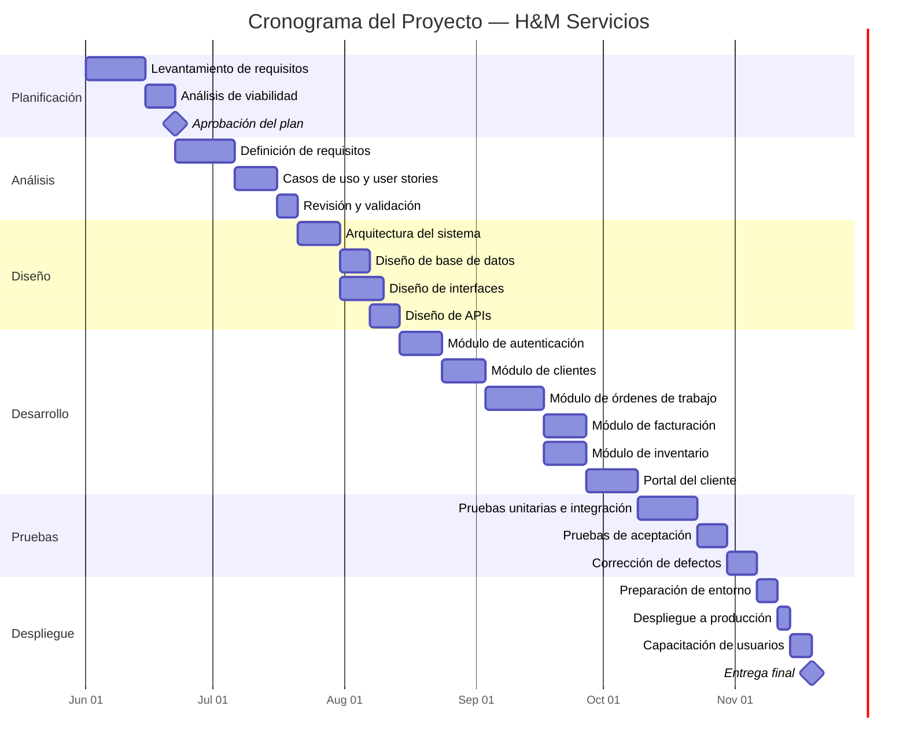
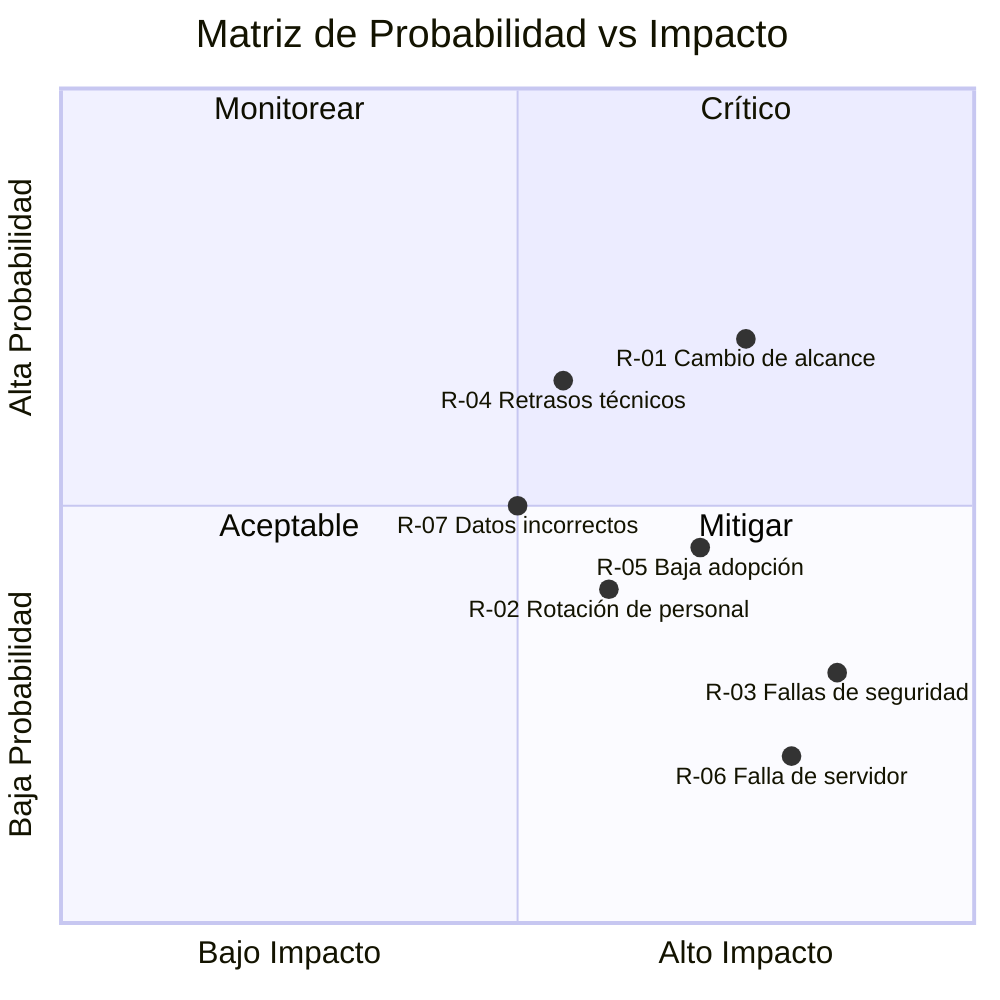
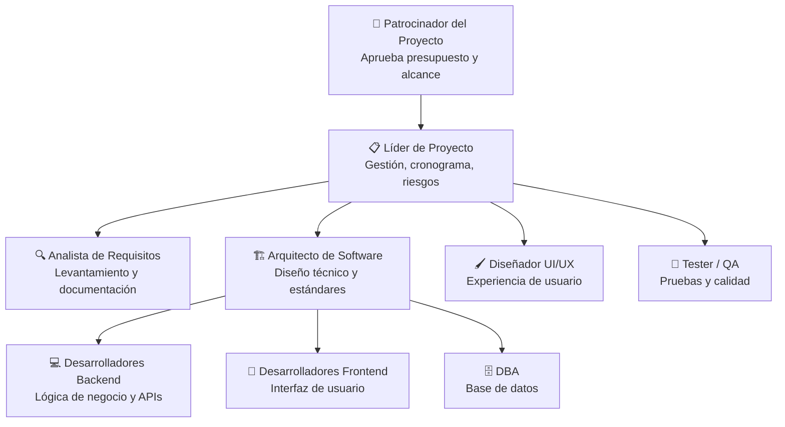

# 📋 H&M Servicios — Fase de Planificación

| Campo           | Detalle                                      |
|-----------------|----------------------------------------------|
| **Proyecto**    | Plataforma de Gestión — H&M Servicios        |
| **Fase**        | 01 — Planificación                           |
| **Versión**     | 1.0                                          |
| **Fecha**       | 26 de mayo de 2026                           |
| **Autor**       | Equipo de Desarrollo H&M Servicios           |
| **Estado**      | Aprobado                                     |

---

## 1. Introducción

El presente documento describe la planificación integral del proyecto **Plataforma de Gestión para H&M Servicios**, una empresa dedicada al mantenimiento de gasodomésticos (estufas, hornos, calentadores de agua, chimeneas y calefactores a gas) y a obras civiles (pintura, estuco, resane y acabados). La plataforma busca digitalizar y optimizar los procesos operativos, administrativos y de atención al cliente de la compañía.

---

## 2. Alcance del Proyecto

### 2.1 Alcance Incluido

| Área                    | Descripción                                                                                 |
|-------------------------|---------------------------------------------------------------------------------------------|
| Gestión de clientes     | Registro, edición, historial de servicios y consulta de clientes.                           |
| Gestión de servicios    | Catálogo de servicios de gasodomésticos y obras civiles, precios y descripciones.            |
| Órdenes de trabajo      | Creación, asignación, seguimiento y cierre de órdenes de trabajo.                           |
| Agenda y programación   | Calendario de citas, asignación de técnicos y disponibilidad.                               |
| Facturación             | Generación de cotizaciones, facturas y control de pagos.                                    |
| Inventario              | Control de repuestos, materiales y herramientas.                                            |
| Reportes                | Dashboards, indicadores clave (KPIs) y reportes exportables.                                |
| Usuarios y roles        | Autenticación, autorización y gestión de perfiles (admin, técnico, recepcionista, cliente).  |
| Notificaciones          | Alertas por correo electrónico y notificaciones internas.                                   |
| Portal del cliente      | Consulta de estado de servicio, historial y solicitudes en línea.                           |

### 2.2 Alcance Excluido

- Integración con sistemas contables de terceros (fase futura).
- Aplicación móvil nativa (se considerará en fase 2).
- Gestión de nómina y recursos humanos.
- Comercio electrónico de productos.

---

## 3. Objetivos del Proyecto

### 3.1 Objetivo General

Desarrollar e implementar una plataforma web integral que permita a **H&M Servicios** gestionar de forma eficiente sus operaciones de mantenimiento de gasodomésticos y obras civiles, mejorando la experiencia del cliente y la productividad operativa.

### 3.2 Objetivos Específicos

1. **OE-01** — Reducir en un 40 % el tiempo de gestión administrativa de órdenes de trabajo.
2. **OE-02** — Centralizar la información de clientes y servicios en una base de datos unificada.
3. **OE-03** — Automatizar la generación de cotizaciones y facturas.
4. **OE-04** — Implementar un sistema de agenda que optimice la asignación de técnicos.
5. **OE-05** — Proporcionar un portal web donde los clientes puedan consultar el estado de sus servicios.
6. **OE-06** — Generar reportes e indicadores que apoyen la toma de decisiones gerenciales.
7. **OE-07** — Garantizar la seguridad y privacidad de los datos conforme a la normativa colombiana (Ley 1581 de 2012).

---

## 4. Cronograma del Proyecto

### 4.1 Resumen de Fases

| Fase              | Duración Estimada | Fecha Inicio   | Fecha Fin      |
|-------------------|-------------------|----------------|----------------|
| Planificación     | 3 semanas         | 01/06/2026     | 21/06/2026     |
| Análisis          | 4 semanas         | 22/06/2026     | 19/07/2026     |
| Diseño            | 5 semanas         | 20/07/2026     | 23/08/2026     |
| Desarrollo        | 9 semanas         | 24/08/2026     | 25/10/2026     |
| Pruebas           | 4 semanas         | 26/10/2026     | 22/11/2026     |
| Despliegue        | 2 semanas         | 23/11/2026     | 06/12/2026     |
| **Total**         | **27 semanas**    | **01/06/2026** | **06/12/2026** |

---

## 5. Recursos del Proyecto

### 5.1 Recursos Humanos

| Rol                         | Cantidad | Dedicación |
|-----------------------------|----------|------------|
| Líder de proyecto           | 1        | 100 %      |
| Analista de requisitos      | 1        | 100 %      |
| Arquitecto de software      | 1        | 50 %       |
| Desarrollador backend       | 2        | 100 %      |
| Desarrollador frontend      | 2        | 100 %      |
| Diseñador UI/UX             | 1        | 75 %       |
| Tester / QA                 | 1        | 100 %      |
| Administrador de base de datos | 1     | 50 %       |

### 5.2 Recursos Tecnológicos

| Recurso                     | Especificación                             |
|-----------------------------|--------------------------------------------|
| Servidor de desarrollo      | 8 GB RAM, 4 vCPU, 100 GB SSD              |
| Servidor de staging         | 8 GB RAM, 4 vCPU, 100 GB SSD              |
| Servidor de producción      | 16 GB RAM, 8 vCPU, 250 GB SSD             |
| Repositorio de código       | GitHub (plan Team)                         |
| Herramienta de gestión      | Jira / Trello                              |
| Herramienta de comunicación | Microsoft Teams / Slack                    |
| Entorno CI/CD               | GitHub Actions                             |

---

## 6. Análisis de Riesgos

### 6.1 Matriz de Riesgos

### 6.2 Registro Detallado de Riesgos

| ID    | Riesgo                                      | Probabilidad | Impacto  | Nivel    | Estrategia de Mitigación                                                        |
|-------|----------------------------------------------|--------------|----------|----------|----------------------------------------------------------------------------------|
| R-01  | Cambios frecuentes en el alcance             | Alta         | Alto     | Crítico  | Gestión estricta de cambios con comité de aprobación y control de versiones.     |
| R-02  | Rotación de personal clave                   | Media        | Alto     | Alto     | Documentación exhaustiva y sesiones de transferencia de conocimiento.            |
| R-03  | Vulnerabilidades de seguridad                | Baja         | Crítico  | Alto     | Auditorías de seguridad periódicas, pruebas OWASP, cifrado de datos sensibles.   |
| R-04  | Retrasos por complejidad técnica             | Alta         | Medio    | Alto     | Sprints cortos con revisiones frecuentes; prototipos tempranos.                  |
| R-05  | Baja adopción por parte de usuarios finales  | Media        | Alto     | Alto     | Plan de capacitación, interfaz intuitiva, soporte post-implementación.           |
| R-06  | Falla o caída del servidor de producción     | Baja         | Crítico  | Alto     | Infraestructura con redundancia, backups automáticos y plan de recuperación.     |
| R-07  | Migración de datos incorrecta                | Media        | Medio    | Medio    | Scripts de validación, migración en fases con verificación manual.               |
| R-08  | Incumplimiento de normativas de datos        | Baja         | Alto     | Medio    | Asesoría legal, cumplimiento de Ley 1581/2012, política de privacidad.           |
| R-09  | Problemas de rendimiento en producción       | Media        | Medio    | Medio    | Pruebas de carga, optimización de consultas, uso de caché.                       |
| R-10  | Conflictos de integración entre módulos      | Media        | Medio    | Medio    | Integración continua, pruebas de integración automatizadas.                      |

---

## 7. Estimación de Presupuesto

### 7.1 Costos de Personal

| Rol                         | Cantidad | Costo Mensual (COP) | Meses | Subtotal (COP)    |
|-----------------------------|----------|----------------------|-------|--------------------|
| Líder de proyecto           | 1        | $6.500.000           | 7     | $45.500.000        |
| Analista de requisitos      | 1        | $4.800.000           | 3     | $14.400.000        |
| Arquitecto de software      | 1        | $7.000.000           | 3     | $21.000.000        |
| Desarrollador backend       | 2        | $5.500.000           | 5     | $55.000.000        |
| Desarrollador frontend      | 2        | $5.000.000           | 5     | $50.000.000        |
| Diseñador UI/UX             | 1        | $4.500.000           | 3     | $13.500.000        |
| Tester / QA                 | 1        | $4.200.000           | 3     | $12.600.000        |
| DBA                         | 1        | $5.000.000           | 2     | $10.000.000        |
| **Subtotal Personal**       |          |                      |       | **$222.000.000**   |

### 7.2 Costos de Infraestructura y Herramientas

| Concepto                     | Costo Mensual (COP) | Meses | Subtotal (COP)   |
|------------------------------|----------------------|-------|-------------------|
| Servidor de desarrollo       | $350.000             | 7     | $2.450.000        |
| Servidor de staging          | $350.000             | 5     | $1.750.000        |
| Servidor de producción       | $750.000             | 12    | $9.000.000        |
| Dominio y SSL                | $150.000             | 12    | $1.800.000        |
| GitHub Team                  | $120.000             | 7     | $840.000          |
| Herramientas de gestión      | $200.000             | 7     | $1.400.000        |
| Licencias de software        | $300.000             | 7     | $2.100.000        |
| **Subtotal Infraestructura** |                      |       | **$19.340.000**   |

### 7.3 Otros Costos

| Concepto                     | Subtotal (COP)   |
|------------------------------|-------------------|
| Capacitación de usuarios     | $3.500.000        |
| Contingencia (10 %)          | $24.484.000       |
| Documentación y manuales     | $2.000.000        |
| **Subtotal Otros**           | **$29.984.000**   |

### 7.4 Presupuesto Total

| Categoría        | Total (COP)        |
|------------------|--------------------|
| Personal         | $222.000.000       |
| Infraestructura  | $19.340.000        |
| Otros            | $29.984.000        |
| **TOTAL**        | **$271.324.000**   |

---

## 8. Roles y Responsabilidades

### 8.1 Matriz RACI

| Actividad                        | Patrocinador | Líder | Analista | Arquitecto | Dev Backend | Dev Frontend | Diseñador | QA   | DBA  |
|----------------------------------|:------------:|:-----:|:--------:|:----------:|:-----------:|:------------:|:---------:|:----:|:----:|
| Definición de alcance            | A            | R     | C        | C          | I           | I            | I         | I    | I    |
| Levantamiento de requisitos      | I            | A     | R        | C          | I           | I            | C         | I    | I    |
| Diseño de arquitectura           | I            | A     | C        | R          | C           | C            | I         | I    | C    |
| Diseño de base de datos          | I            | A     | C        | R          | C           | I            | I         | I    | R    |
| Desarrollo de módulos            | I            | A     | I        | C          | R           | R            | C         | I    | I    |
| Pruebas funcionales              | I            | A     | C        | I          | C           | C            | I         | R    | I    |
| Despliegue a producción          | A            | R     | I        | R          | C           | C            | I         | C    | C    |
| Capacitación de usuarios         | I            | R     | R        | I          | I           | I            | C         | I    | I    |

> **R** = Responsable · **A** = Aprobador · **C** = Consultado · **I** = Informado

---

## 9. Plan de Comunicación

### 9.1 Canales de Comunicación

| Canal                  | Propósito                                        | Frecuencia         |
|------------------------|--------------------------------------------------|---------------------|
| Reunión de inicio      | Alineación del equipo y stakeholders             | Una vez (kick-off)  |
| Daily standup          | Seguimiento diario de avances y bloqueos         | Diaria (15 min)     |
| Revisión de sprint     | Demostración de entregables del sprint           | Quincenal           |
| Retrospectiva          | Mejora continua del proceso                      | Quincenal           |
| Comité de seguimiento  | Reporte de avance al patrocinador                | Mensual             |
| Correo electrónico     | Comunicaciones formales y documentación          | Según necesidad     |
| Microsoft Teams/Slack  | Comunicación informal y resolución rápida        | Continuo            |
| Repositorio (GitHub)   | Revisiones de código y documentación técnica     | Continuo            |

### 9.2 Matriz de Comunicación por Stakeholder

| Stakeholder              | Información                             | Medio              | Frecuencia    | Responsable         |
|--------------------------|------------------------------------------|---------------------|---------------|---------------------|
| Gerencia H&M Servicios   | Avance general, riesgos, presupuesto     | Reunión + Informe   | Mensual       | Líder de proyecto   |
| Equipo de desarrollo     | Tareas, bloqueos, decisiones técnicas    | Daily + Teams       | Diaria        | Líder de proyecto   |
| Técnicos de campo        | Requisitos funcionales, feedback de uso  | Entrevistas         | Quincenal     | Analista            |
| Clientes finales         | Estado del proyecto, fechas clave        | Correo electrónico  | Mensual       | Líder de proyecto   |
| Área administrativa      | Funcionalidades de facturación/reportes  | Reunión             | Quincenal     | Analista            |

### 9.3 Plantilla de Informe de Avance

Cada informe mensual al comité directivo incluirá:

1. **Resumen ejecutivo** — Estado general del proyecto (verde, amarillo, rojo).
2. **Avance por fase** — Porcentaje de completitud respecto al cronograma.
3. **Hitos cumplidos** — Entregables completados en el período.
4. **Riesgos actualizados** — Nuevos riesgos o cambios en riesgos existentes.
5. **Solicitudes de cambio** — Cambios solicitados y su estado de aprobación.
6. **Próximos pasos** — Actividades planificadas para el siguiente período.
7. **Métricas clave** — Velocidad del equipo, defectos abiertos, cobertura de pruebas.

---

## 10. Metodología de Trabajo

Se adoptará una metodología **Scrum** adaptada con las siguientes características:

- **Sprints** de 2 semanas.
- **Product Backlog** priorizado por valor de negocio.
- **Ceremonias**: Planning, Daily Standup, Review, Retrospectiva.
- **Herramienta de gestión**: Jira con tablero Kanban complementario.
- **Definition of Done (DoD)**:
  - Código revisado por pares (code review).
  - Pruebas unitarias con cobertura ≥ 80 %.
  - Documentación actualizada.
  - Sin defectos bloqueantes o críticos.
  - Integrado en la rama principal sin conflictos.

---

## 11. Criterios de Éxito

| Criterio                                                    | Métrica                        | Meta           |
|-------------------------------------------------------------|--------------------------------|----------------|
| Entrega dentro del cronograma                               | Desviación temporal            | ≤ 10 %         |
| Entrega dentro del presupuesto                              | Desviación presupuestal        | ≤ 15 %         |
| Satisfacción del cliente (H&M Servicios)                    | Encuesta de satisfacción       | ≥ 4.0 / 5.0    |
| Cobertura de requisitos funcionales                         | Requisitos implementados       | 100 %          |
| Disponibilidad del sistema en producción                    | Uptime                         | ≥ 99.5 %       |
| Defectos críticos en producción (primer mes)                | Cantidad de defectos           | ≤ 3            |

---

## 12. Aprobaciones

| Nombre                  | Rol                      | Firma        | Fecha       |
|-------------------------|--------------------------|--------------|-------------|
| ________________________ | Patrocinador del Proyecto | ____________ | ___/___/___ |
| ________________________ | Líder de Proyecto         | ____________ | ___/___/___ |
| ________________________ | Arquitecto de Software    | ____________ | ___/___/___ |

---

> **Documento controlado** — Cualquier modificación debe ser aprobada por el comité de cambios del proyecto.
