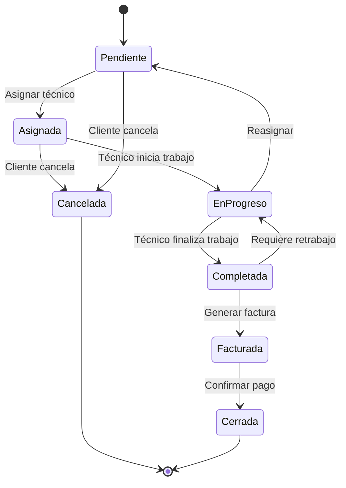
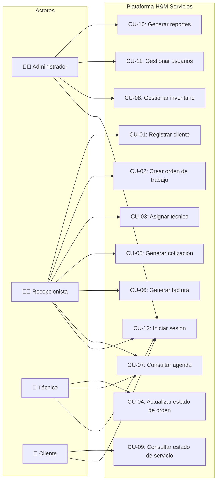
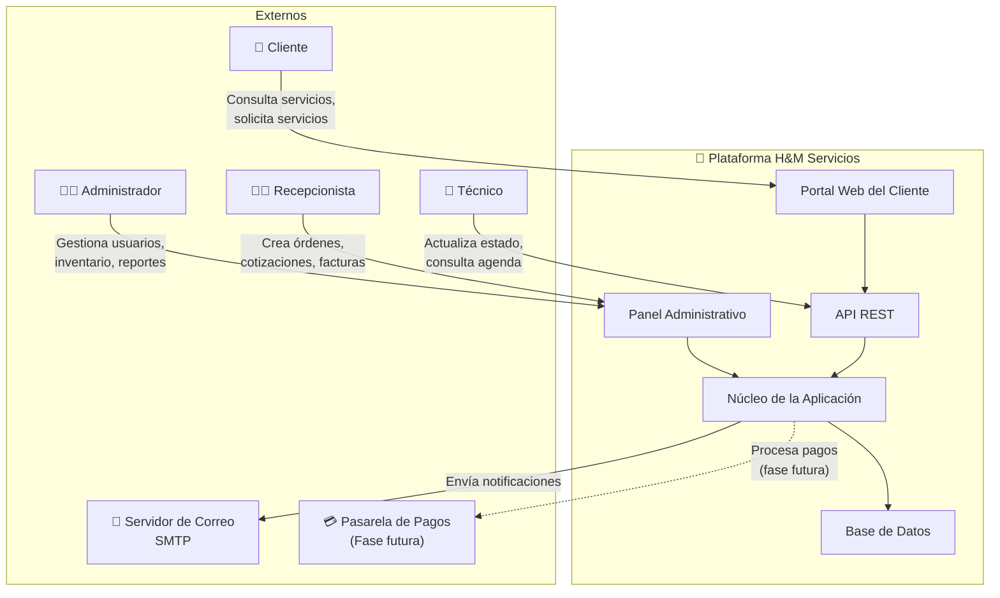
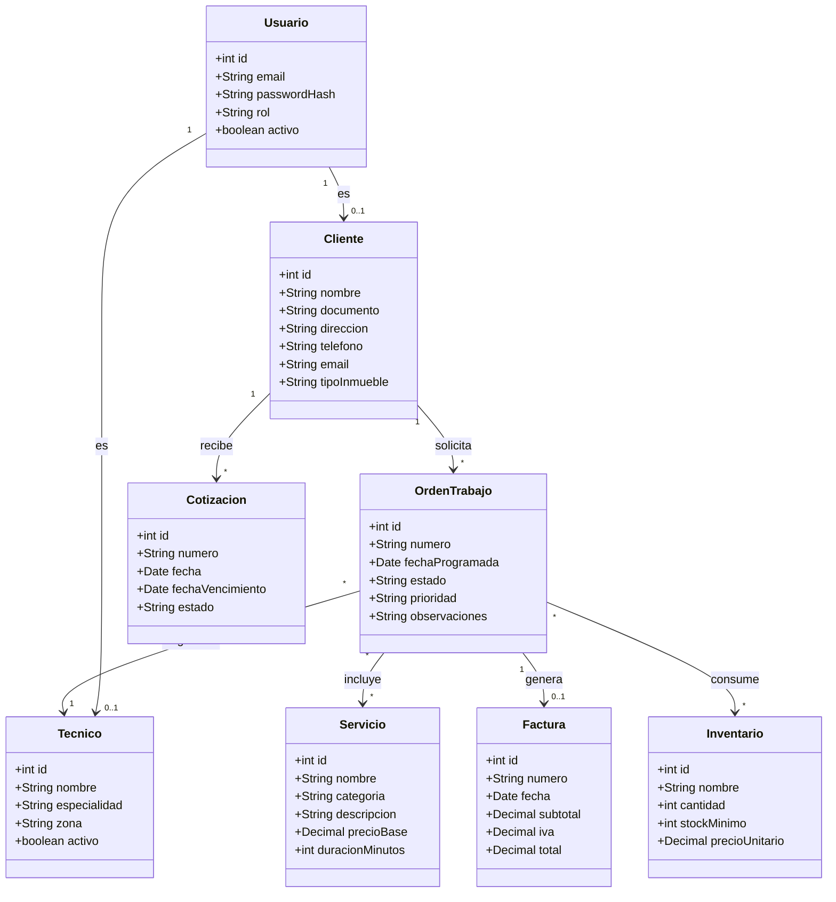

# 🔍 H&M Servicios — Fase de Análisis

| Campo           | Detalle                                      |
|-----------------|----------------------------------------------|
| **Proyecto**    | Plataforma de Gestión — H&M Servicios        |
| **Fase**        | 02 — Análisis                                |
| **Versión**     | 1.0                                          |
| **Fecha**       | 26 de mayo de 2026                           |
| **Autor**       | Equipo de Desarrollo H&M Servicios           |
| **Estado**      | Aprobado                                     |

---

## 1. Introducción

Este documento presenta el análisis detallado de requisitos funcionales y no funcionales, casos de uso, historias de usuario y diagramas de contexto del sistema **Plataforma de Gestión para H&M Servicios**. El análisis se realizó mediante entrevistas con el personal administrativo, técnicos de campo y clientes de la empresa.

---

## 2. Requisitos Funcionales

### 2.1 Catálogo de Requisitos Funcionales

| ID     | Nombre                              | Módulo              | Prioridad | Descripción                                                                                                                                              |
|--------|--------------------------------------|---------------------|-----------|----------------------------------------------------------------------------------------------------------------------------------------------------------|
| RF-01  | Registro de clientes                | Clientes            | Alta      | El sistema debe permitir registrar clientes con datos personales (nombre, cédula/NIT, dirección, teléfono, correo electrónico, tipo de inmueble).         |
| RF-02  | Gestión de catálogo de servicios    | Servicios           | Alta      | El sistema debe mantener un catálogo de servicios dividido en dos categorías: gasodomésticos y obras civiles, con descripciones, precios base y duración estimada. |
| RF-03  | Creación de órdenes de trabajo      | Órdenes             | Alta      | El sistema debe permitir crear órdenes de trabajo asociando un cliente, uno o más servicios, un técnico asignado, fecha programada y observaciones.        |
| RF-04  | Seguimiento de órdenes de trabajo   | Órdenes             | Alta      | El sistema debe permitir actualizar el estado de las órdenes de trabajo: Pendiente → Asignada → En Progreso → Completada → Facturada → Cerrada.          |
| RF-05  | Asignación de técnicos              | Agenda              | Alta      | El sistema debe permitir asignar técnicos a órdenes de trabajo según disponibilidad, especialidad (gasodomésticos u obras civiles) y zona geográfica.     |
| RF-06  | Agenda y calendario                 | Agenda              | Alta      | El sistema debe mostrar un calendario con las citas programadas por técnico, permitiendo visualización diaria, semanal y mensual.                         |
| RF-07  | Generación de cotizaciones          | Facturación         | Alta      | El sistema debe generar cotizaciones detalladas con servicios, materiales, mano de obra e IVA, exportables en PDF.                                        |
| RF-08  | Generación de facturas              | Facturación         | Alta      | El sistema debe generar facturas electrónicas con numeración consecutiva, datos fiscales y cálculo automático de impuestos (IVA 19 %).                     |
| RF-09  | Control de inventario               | Inventario          | Media     | El sistema debe registrar entradas y salidas de repuestos y materiales, con alertas de stock mínimo.                                                      |
| RF-10  | Portal del cliente                  | Portal              | Media     | El sistema debe proporcionar un portal web donde los clientes puedan consultar el estado de sus servicios, historial y solicitar nuevos servicios.         |
| RF-11  | Generación de reportes              | Reportes            | Media     | El sistema debe generar reportes de: servicios realizados, ingresos por período, desempeño de técnicos, inventario y clientes frecuentes.                 |
| RF-12  | Gestión de usuarios y permisos      | Seguridad           | Alta      | El sistema debe permitir crear, editar y desactivar usuarios con roles diferenciados: administrador, técnico, recepcionista y cliente.                     |

### 2.2 Detalle de Requisitos Funcionales Clave

#### RF-01 — Registro de Clientes

- **Datos obligatorios**: Nombre completo, tipo de documento (CC, CE, NIT), número de documento, dirección, ciudad, teléfono, correo electrónico.
- **Datos opcionales**: Tipo de inmueble (casa, apartamento, local comercial, edificio), estrato, notas especiales.
- **Validaciones**: Documento único, formato de correo válido, teléfono de 10 dígitos.
- **Funcionalidades adicionales**: Búsqueda por nombre o documento, exportación CSV de listado.

#### RF-03 — Creación de Órdenes de Trabajo

- **Datos de la orden**: Número consecutivo automático, cliente asociado, servicios seleccionados, técnico asignado, fecha y hora programada, dirección del servicio, prioridad (baja, media, alta, urgente), observaciones.
- **Servicios de gasodomésticos incluidos**:
  - Mantenimiento preventivo de estufas
  - Reparación de hornos
  - Instalación y mantenimiento de calentadores de agua
  - Limpieza y revisión de chimeneas
  - Instalación y reparación de calefactores a gas
  - Detección de fugas de gas
  - Certificación de instalaciones de gas
- **Servicios de obras civiles incluidos**:
  - Pintura interior y exterior
  - Aplicación de estuco
  - Resane de paredes y techos
  - Acabados y enchapes
  - Reparaciones menores de albañilería

#### RF-04 — Seguimiento de Órdenes de Trabajo

---

## 3. Requisitos No Funcionales

| ID      | Categoría       | Requisito                                                                                                     | Métrica / Criterio                    |
|---------|-----------------|---------------------------------------------------------------------------------------------------------------|---------------------------------------|
| RNF-01  | Rendimiento     | El sistema debe responder a cualquier solicitud en menos de 2 segundos bajo condiciones normales de carga.     | Tiempo de respuesta ≤ 2 s            |
| RNF-02  | Rendimiento     | El sistema debe soportar al menos 100 usuarios concurrentes sin degradación del servicio.                     | 100 usuarios simultáneos             |
| RNF-03  | Disponibilidad  | El sistema debe tener una disponibilidad mínima del 99.5 % mensual.                                          | Uptime ≥ 99.5 %                      |
| RNF-04  | Seguridad       | Todas las contraseñas deben almacenarse con hash bcrypt con un factor de costo mínimo de 10.                  | bcrypt cost factor ≥ 10              |
| RNF-05  | Seguridad       | Las comunicaciones deben estar cifradas mediante HTTPS/TLS 1.2 o superior.                                    | TLS ≥ 1.2                            |
| RNF-06  | Seguridad       | El sistema debe implementar protección contra OWASP Top 10.                                                   | Auditoría OWASP aprobada             |
| RNF-07  | Usabilidad      | Un usuario nuevo debe poder crear una orden de trabajo en menos de 5 minutos sin capacitación previa.         | Tiempo de tarea ≤ 5 min              |
| RNF-08  | Usabilidad      | La interfaz debe ser responsive, adaptándose a dispositivos móviles (≥ 320px).                                | Compatible con móviles               |
| RNF-09  | Escalabilidad   | La arquitectura debe permitir escalar horizontal y verticalmente sin cambios en el código fuente.             | Escalabilidad horizontal             |
| RNF-10  | Mantenibilidad  | El código debe seguir estándares de codificación documentados con cobertura de pruebas ≥ 80 %.                | Cobertura ≥ 80 %                     |
| RNF-11  | Compatibilidad  | El sistema debe funcionar en Chrome (≥ 90), Firefox (≥ 88), Edge (≥ 90) y Safari (≥ 14).                      | Navegadores soportados               |
| RNF-12  | Legalidad       | El sistema debe cumplir con la Ley 1581 de 2012 (Protección de Datos Personales de Colombia).                 | Cumplimiento legal verificado        |

---

## 4. Casos de Uso

### 4.1 Diagrama de Casos de Uso

### 4.2 Descripción Detallada de Casos de Uso

#### CU-01: Registrar Cliente

| Campo                | Descripción                                                                                    |
|----------------------|-----------------------------------------------------------------------------------------------|
| **ID**               | CU-01                                                                                         |
| **Nombre**           | Registrar cliente                                                                              |
| **Actor principal**  | Recepcionista                                                                                  |
| **Descripción**      | Permite registrar un nuevo cliente en el sistema con sus datos personales y de contacto.        |
| **Precondiciones**   | El recepcionista debe haber iniciado sesión. El cliente no debe existir previamente en el sistema. |
| **Flujo principal**  | 1. El recepcionista selecciona "Nuevo cliente".   2. Ingresa los datos del cliente.   3. El sistema valida los datos.   4. El sistema registra al cliente y muestra confirmación. |
| **Flujo alternativo**| 3a. Si el documento ya existe, el sistema muestra un error y sugiere buscar al cliente existente. |
| **Postcondiciones**  | El cliente queda registrado en la base de datos y disponible para asociar a órdenes de trabajo. |
| **Prioridad**        | Alta                                                                                           |

#### CU-02: Crear Orden de Trabajo

| Campo                | Descripción                                                                                    |
|----------------------|-----------------------------------------------------------------------------------------------|
| **ID**               | CU-02                                                                                         |
| **Nombre**           | Crear orden de trabajo                                                                         |
| **Actor principal**  | Recepcionista                                                                                  |
| **Descripción**      | Permite crear una nueva orden de trabajo asociando cliente, servicios, técnico y fecha.          |
| **Precondiciones**   | El recepcionista debe haber iniciado sesión. El cliente debe estar registrado en el sistema.     |
| **Flujo principal**  | 1. El recepcionista busca y selecciona al cliente.   2. Selecciona los servicios del catálogo.   3. Define fecha, hora y prioridad.   4. El sistema sugiere técnicos disponibles.   5. El recepcionista asigna un técnico.   6. El sistema crea la orden con estado "Pendiente". |
| **Flujo alternativo**| 4a. Si no hay técnicos disponibles, se muestra una alerta y se permite programar para otra fecha. |
| **Postcondiciones**  | La orden de trabajo queda creada y visible en la agenda del técnico asignado.                   |
| **Prioridad**        | Alta                                                                                           |

#### CU-04: Actualizar Estado de Orden

| Campo                | Descripción                                                                                    |
|----------------------|-----------------------------------------------------------------------------------------------|
| **ID**               | CU-04                                                                                         |
| **Nombre**           | Actualizar estado de orden de trabajo                                                          |
| **Actor principal**  | Técnico                                                                                        |
| **Descripción**      | Permite al técnico actualizar el estado de una orden de trabajo asignada.                       |
| **Precondiciones**   | El técnico debe haber iniciado sesión. La orden debe estar asignada al técnico.                 |
| **Flujo principal**  | 1. El técnico consulta sus órdenes asignadas.   2. Selecciona la orden a actualizar.   3. Cambia el estado (ej.: "En Progreso" → "Completada").   4. Agrega observaciones y evidencia fotográfica.   5. El sistema registra el cambio con marca de tiempo. |
| **Flujo alternativo**| 3a. Si el técnico requiere retrabajo, puede regresar la orden a "En Progreso" con justificación. |
| **Postcondiciones**  | El estado de la orden se actualiza y se notifica al recepcionista/administrador.                |
| **Prioridad**        | Alta                                                                                           |

#### CU-06: Generar Factura

| Campo                | Descripción                                                                                    |
|----------------------|-----------------------------------------------------------------------------------------------|
| **ID**               | CU-06                                                                                         |
| **Nombre**           | Generar factura                                                                                |
| **Actor principal**  | Recepcionista                                                                                  |
| **Descripción**      | Genera una factura electrónica a partir de una orden de trabajo completada.                     |
| **Precondiciones**   | La orden de trabajo debe tener estado "Completada". El cliente debe tener datos fiscales completos.|
| **Flujo principal**  | 1. El recepcionista selecciona la orden completada.   2. Selecciona "Generar Factura".   3. El sistema calcula totales (servicios + materiales + IVA 19 %).   4. Asigna número consecutivo.   5. Genera documento PDF.   6. Envía copia al correo del cliente. |
| **Flujo alternativo**| 3a. Si se requiere descuento, el recepcionista aplica el porcentaje autorizado (máx. 15 %).     |
| **Postcondiciones**  | La factura queda registrada, la orden pasa a estado "Facturada" y el cliente recibe la factura. |
| **Prioridad**        | Alta                                                                                           |

#### CU-09: Consultar Estado de Servicio (Portal del Cliente)

| Campo                | Descripción                                                                                    |
|----------------------|-----------------------------------------------------------------------------------------------|
| **ID**               | CU-09                                                                                         |
| **Nombre**           | Consultar estado de servicio                                                                   |
| **Actor principal**  | Cliente                                                                                        |
| **Descripción**      | Permite al cliente consultar el estado de sus órdenes de trabajo a través del portal web.       |
| **Precondiciones**   | El cliente debe haber iniciado sesión en el portal.                                             |
| **Flujo principal**  | 1. El cliente accede al portal y visualiza su dashboard.   2. Ve una lista de sus órdenes activas y pasadas.   3. Selecciona una orden para ver detalles (técnico asignado, estado, fecha, observaciones). |
| **Flujo alternativo**| 2a. Si no tiene órdenes, el sistema muestra un mensaje informativo y la opción de solicitar un servicio. |
| **Postcondiciones**  | El cliente obtiene la información actualizada de sus servicios.                                 |
| **Prioridad**        | Media                                                                                          |

---

## 5. Historias de Usuario

### 5.1 Historias de Usuario con Criterios de Aceptación

#### HU-01: Registro de Clientes

> **Como** recepcionista,  
> **quiero** registrar los datos de un nuevo cliente en el sistema,  
> **para que** pueda asociarle órdenes de trabajo y mantener un historial de servicios.

**Criterios de aceptación:**
- [ ] Puedo ingresar nombre, documento, dirección, teléfono y correo electrónico.
- [ ] El sistema valida que el número de documento no esté duplicado.
- [ ] El sistema valida el formato del correo electrónico.
- [ ] Al guardar, el cliente aparece en el listado de clientes.
- [ ] Puedo buscar al cliente por nombre o número de documento.

**Estimación:** 5 puntos de historia

---

#### HU-02: Crear Orden de Trabajo

> **Como** recepcionista,  
> **quiero** crear una orden de trabajo seleccionando cliente, servicios y técnico,  
> **para que** el equipo técnico tenga claridad sobre el trabajo a realizar.

**Criterios de aceptación:**
- [ ] Puedo buscar y seleccionar un cliente registrado.
- [ ] Puedo seleccionar uno o más servicios del catálogo (gasodomésticos u obras civiles).
- [ ] El sistema me muestra los técnicos disponibles para la fecha seleccionada.
- [ ] La orden se crea con estado "Pendiente" y número consecutivo.
- [ ] El técnico asignado puede ver la orden en su agenda.

**Estimación:** 8 puntos de historia

---

#### HU-03: Actualizar Estado de Orden

> **Como** técnico,  
> **quiero** actualizar el estado de las órdenes que me han asignado,  
> **para que** la oficina y el cliente conozcan el avance del servicio.

**Criterios de aceptación:**
- [ ] Solo puedo actualizar órdenes que estén asignadas a mí.
- [ ] Puedo cambiar el estado siguiendo el flujo definido.
- [ ] Puedo agregar observaciones de texto al cambiar el estado.
- [ ] El cambio de estado queda registrado con fecha y hora.
- [ ] El recepcionista recibe una notificación del cambio.

**Estimación:** 5 puntos de historia

---

#### HU-04: Consultar Agenda

> **Como** técnico,  
> **quiero** ver mi agenda diaria y semanal con las órdenes de trabajo asignadas,  
> **para que** pueda organizar mis desplazamientos y priorizar las visitas.

**Criterios de aceptación:**
- [ ] Puedo ver la agenda en vista diaria, semanal y mensual.
- [ ] Cada entrada muestra: cliente, dirección, servicio, hora y prioridad.
- [ ] Las órdenes urgentes se resaltan visualmente en rojo.
- [ ] Puedo filtrar por estado de la orden.

**Estimación:** 5 puntos de historia

---

#### HU-05: Generar Cotización

> **Como** recepcionista,  
> **quiero** generar una cotización detallada para un cliente,  
> **para que** el cliente conozca el costo estimado antes de autorizar el servicio.

**Criterios de aceptación:**
- [ ] La cotización incluye desglose de servicios, materiales y mano de obra.
- [ ] Se calcula el IVA (19 %) automáticamente.
- [ ] Puedo exportar la cotización en formato PDF.
- [ ] La cotización tiene una validez de 30 días configurables.
- [ ] El cliente puede aprobar o rechazar la cotización desde el portal.

**Estimación:** 8 puntos de historia

---

#### HU-06: Portal del Cliente

> **Como** cliente de H&M Servicios,  
> **quiero** acceder a un portal web donde pueda ver el estado de mis servicios,  
> **para que** no tenga que llamar por teléfono para consultar el avance.

**Criterios de aceptación:**
- [ ] Puedo iniciar sesión con mi correo electrónico y contraseña.
- [ ] Veo un dashboard con mis órdenes activas y su estado actual.
- [ ] Puedo ver el historial de servicios pasados.
- [ ] Puedo solicitar un nuevo servicio desde el portal.
- [ ] Puedo ver y descargar mis facturas.

**Estimación:** 13 puntos de historia

---

#### HU-07: Gestión de Inventario

> **Como** administrador,  
> **quiero** registrar entradas y salidas de repuestos y materiales,  
> **para que** siempre haya disponibilidad de insumos para los servicios.

**Criterios de aceptación:**
- [ ] Puedo registrar nuevos productos con nombre, descripción, cantidad y precio.
- [ ] Puedo registrar entradas (compras) y salidas (uso en órdenes) de materiales.
- [ ] El sistema alerta cuando un producto está por debajo del stock mínimo.
- [ ] Puedo consultar el kardex de movimientos de cada producto.

**Estimación:** 8 puntos de historia

---

#### HU-08: Reportes Gerenciales

> **Como** administrador,  
> **quiero** generar reportes de servicios, ingresos y desempeño de técnicos,  
> **para que** pueda tomar decisiones basadas en datos.

**Criterios de aceptación:**
- [ ] Puedo seleccionar un rango de fechas para los reportes.
- [ ] Disponibles: reporte de ingresos, servicios por tipo, desempeño de técnicos, inventario.
- [ ] Los reportes se muestran en gráficos y tablas.
- [ ] Puedo exportar los reportes en PDF y Excel.

**Estimación:** 13 puntos de historia

---

## 6. Diagrama de Contexto del Sistema

---

## 7. Modelo de Dominio

---

## 8. Glosario de Términos

| Término                | Definición                                                                                                          |
|------------------------|---------------------------------------------------------------------------------------------------------------------|
| **Gasodoméstico**      | Aparato o equipo que funciona con gas natural o GLP para uso doméstico: estufas, hornos, calentadores, chimeneas, calefactores. |
| **Orden de trabajo**   | Documento que describe el servicio a realizar, el cliente, el técnico asignado y las condiciones del trabajo.        |
| **Cotización**         | Documento que presenta al cliente un estimado de costos por los servicios solicitados, antes de la ejecución.        |
| **Factura**            | Documento fiscal que detalla los servicios prestados, materiales utilizados, impuestos y total a pagar.              |
| **Técnico**            | Profesional certificado que ejecuta los servicios de mantenimiento de gasodomésticos o de obras civiles.             |
| **Recepcionista**      | Personal administrativo encargado de atender solicitudes, crear órdenes y gestionar la comunicación con el cliente.  |
| **Estuco**             | Mezcla de cal, arena y/o cemento utilizada para revestir paredes y techos, proporcionando una superficie lisa.       |
| **Resane**             | Reparación de grietas, fisuras o imperfecciones en paredes, techos o pisos.                                          |
| **Acabados**           | Trabajos finales de construcción u obra civil que incluyen pintura, enchapes, molduras y detalles estéticos.         |
| **Kardex**             | Registro detallado de entradas, salidas y saldos de productos en el inventario.                                      |
| **IVA**                | Impuesto sobre el Valor Agregado, actualmente del 19 % en Colombia.                                                 |
| **Sprint**             | Período de trabajo (generalmente 2 semanas) en la metodología Scrum.                                                |
| **Dashboard**          | Panel visual con indicadores clave que permite un seguimiento rápido del estado del negocio.                         |
| **API REST**           | Interfaz de programación de aplicaciones basada en el protocolo HTTP con principios REST.                            |
| **CRUD**               | Acrónimo de Create, Read, Update, Delete — las operaciones básicas sobre datos.                                     |
| **Ley 1581 de 2012**   | Ley colombiana de Protección de Datos Personales que regula la recolección y tratamiento de información personal.    |
| **Stock mínimo**       | Cantidad mínima de un producto en inventario antes de que se genere una alerta de reabastecimiento.                  |

---

## 9. Restricciones del Sistema

| Restricción                                                   | Justificación                                              |
|---------------------------------------------------------------|------------------------------------------------------------|
| El sistema debe desarrollarse con tecnologías web open source | Reducir costos de licenciamiento.                          |
| Debe desplegarse en la nube (AWS, Azure o similar)            | Garantizar disponibilidad y escalabilidad.                 |
| La base de datos debe ser relacional (PostgreSQL o MySQL)     | Integridad referencial y consultas complejas.              |
| Debe cumplir con la Ley 1581 de 2012                         | Obligación legal en Colombia.                              |
| El desarrollo debe completarse en 7 meses                    | Restricción de presupuesto y necesidades del negocio.      |
| La interfaz debe funcionar en navegadores modernos           | Accesibilidad para todos los usuarios.                     |

---

## 10. Supuestos

1. H&M Servicios proporcionará acceso oportuno a personal clave para entrevistas y validaciones.
2. Los datos históricos de clientes y servicios se entregarán en formato digital (Excel o CSV).
3. La empresa cuenta con una conexión a internet estable en sus oficinas.
4. Los técnicos de campo tendrán acceso a dispositivos con navegador web (smartphones o tablets).
5. El presupuesto aprobado se mantendrá sin recortes durante la ejecución del proyecto.

---

> **Documento controlado** — Cualquier modificación debe ser aprobada por el comité de cambios del proyecto.
