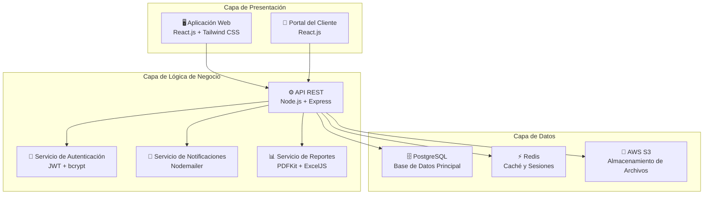
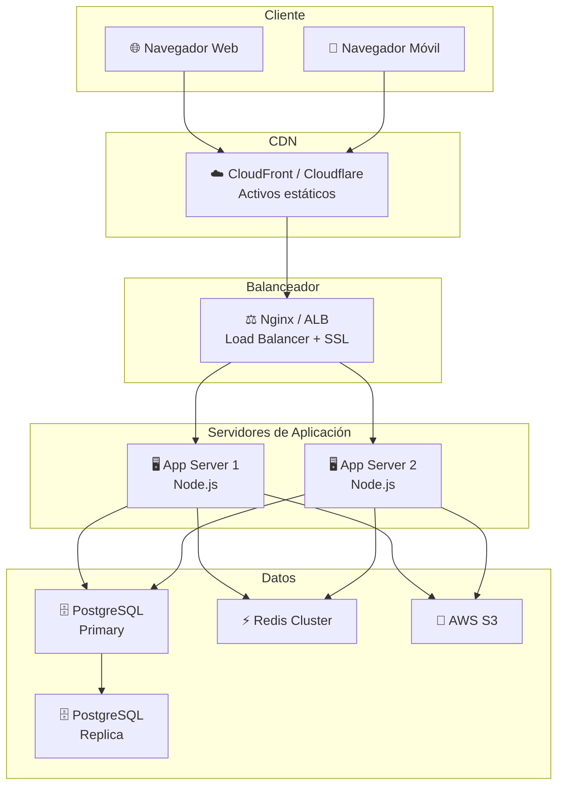
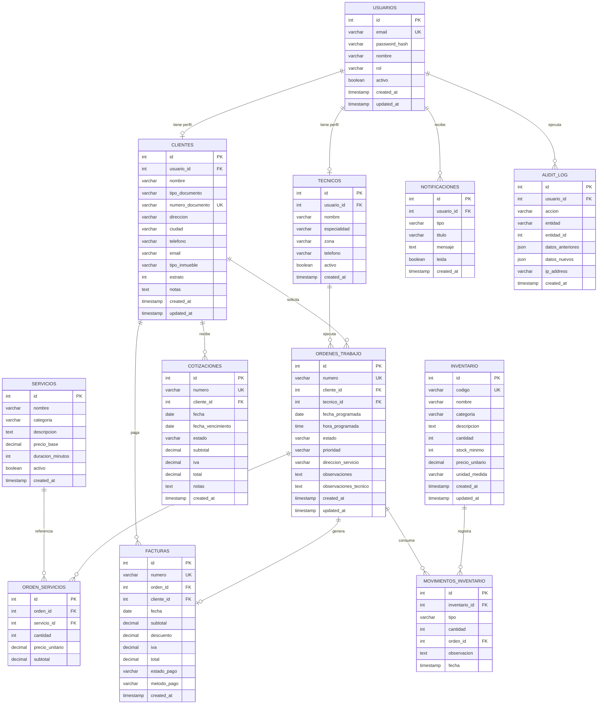
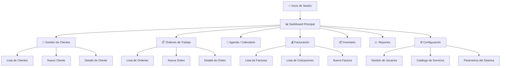
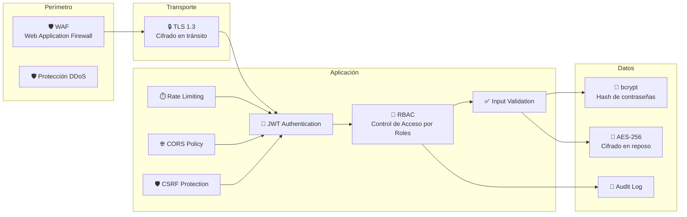

# 🏗️ H&M Servicios — Fase de Diseño

| Campo           | Detalle                                      |
|-----------------|----------------------------------------------|
| **Proyecto**    | Plataforma de Gestión — H&M Servicios        |
| **Fase**        | 03 — Diseño                                 |
| **Versión**     | 1.0                                          |
| **Fecha**       | 26 de mayo de 2026                           |
| **Autor**       | Equipo de Desarrollo H&M Servicios           |
| **Estado**      | Aprobado                                     |

---

## 1. Introducción

Este documento describe el diseño técnico completo de la **Plataforma de Gestión para H&M Servicios**, incluyendo la arquitectura del sistema, el esquema de base de datos, la especificación de la API REST, las descripciones de la interfaz de usuario, la arquitectura de seguridad y los patrones de diseño utilizados.

---

## 2. Arquitectura del Sistema

### 2.1 Arquitectura de Tres Capas

La plataforma se diseña bajo una arquitectura de tres capas (3-tier), separando la presentación, la lógica de negocio y el acceso a datos.



### 2.2 Diagrama de Despliegue



### 2.3 Stack Tecnológico

| Capa               | Tecnología                       | Justificación                                              |
|---------------------|----------------------------------|------------------------------------------------------------|
| Frontend            | React.js 18+                     | Ecosistema maduro, componentes reutilizables, rendimiento. |
| Estilos             | Tailwind CSS 3+                  | Utilidades CSS, responsive por defecto, productividad.     |
| Backend             | Node.js 20 LTS + Express 4       | JavaScript full-stack, rendimiento I/O, ecosistema npm.    |
| ORM                 | Prisma ORM                       | Type-safety, migraciones, consultas tipadas.               |
| Base de datos       | PostgreSQL 16                    | ACID, JSON support, extensibilidad, madurez.               |
| Caché               | Redis 7                          | Velocidad, sesiones, rate limiting, pub/sub.               |
| Autenticación       | JWT + bcrypt                     | Stateless, estándar industria, seguro.                     |
| Almacenamiento      | AWS S3                           | Escalable, duradero, costo-eficiente.                      |
| CI/CD               | GitHub Actions                   | Integrado con repositorio, gratuito para open source.      |
| Monitoreo           | Prometheus + Grafana             | Métricas, alertas, dashboards, open source.                |
| Logging             | Winston + ELK Stack             | Logging estructurado, búsqueda centralizada.               |

---

## 3. Esquema de Base de Datos

### 3.1 Diagrama Entidad-Relación



### 3.2 Detalle de Tablas

#### Tabla: `usuarios`

| Columna        | Tipo           | Restricción          | Descripción                                       |
|----------------|----------------|----------------------|---------------------------------------------------|
| id             | SERIAL         | PRIMARY KEY          | Identificador único auto-incremental.             |
| email          | VARCHAR(255)   | UNIQUE, NOT NULL     | Correo electrónico para inicio de sesión.         |
| password_hash  | VARCHAR(255)   | NOT NULL             | Hash bcrypt de la contraseña.                     |
| nombre         | VARCHAR(150)   | NOT NULL             | Nombre completo del usuario.                      |
| rol            | VARCHAR(20)    | NOT NULL, CHECK      | Rol: 'admin', 'tecnico', 'recepcionista', 'cliente'. |
| activo         | BOOLEAN        | DEFAULT true         | Estado activo/inactivo del usuario.               |
| created_at     | TIMESTAMP      | DEFAULT NOW()        | Fecha de creación del registro.                   |
| updated_at     | TIMESTAMP      | DEFAULT NOW()        | Fecha de última actualización.                    |

#### Tabla: `clientes`

| Columna           | Tipo           | Restricción          | Descripción                                    |
|-------------------|----------------|----------------------|------------------------------------------------|
| id                | SERIAL         | PRIMARY KEY          | Identificador único.                           |
| usuario_id        | INT            | FK → usuarios(id)    | Relación con cuenta de usuario (opcional).      |
| nombre            | VARCHAR(200)   | NOT NULL             | Nombre completo o razón social.                |
| tipo_documento    | VARCHAR(10)    | NOT NULL             | CC, CE, NIT, Pasaporte.                        |
| numero_documento  | VARCHAR(20)    | UNIQUE, NOT NULL     | Número del documento de identidad.             |
| direccion         | VARCHAR(300)   | NOT NULL             | Dirección de correspondencia.                  |
| ciudad            | VARCHAR(100)   | NOT NULL             | Ciudad de residencia.                          |
| telefono          | VARCHAR(15)    | NOT NULL             | Número de teléfono.                            |
| email             | VARCHAR(255)   | NOT NULL             | Correo electrónico de contacto.                |
| tipo_inmueble     | VARCHAR(50)    |                      | Casa, Apartamento, Local, Edificio.            |
| estrato           | SMALLINT       | CHECK(1-6)           | Estrato socioeconómico (1-6).                  |
| notas             | TEXT           |                      | Observaciones adicionales.                     |
| created_at        | TIMESTAMP      | DEFAULT NOW()        | Fecha de creación.                             |
| updated_at        | TIMESTAMP      | DEFAULT NOW()        | Fecha de actualización.                        |

#### Tabla: `ordenes_trabajo`

| Columna              | Tipo           | Restricción              | Descripción                                     |
|----------------------|----------------|--------------------------|------------------------------------------------|
| id                   | SERIAL         | PRIMARY KEY              | Identificador único.                            |
| numero               | VARCHAR(20)    | UNIQUE, NOT NULL         | Número consecutivo (ej: OT-2026-0001).          |
| cliente_id           | INT            | FK → clientes(id), NOT NULL | Cliente que solicita el servicio.             |
| tecnico_id           | INT            | FK → tecnicos(id)        | Técnico asignado.                               |
| fecha_programada     | DATE           | NOT NULL                 | Fecha de ejecución del servicio.                |
| hora_programada      | TIME           |                          | Hora de la cita.                                |
| estado               | VARCHAR(20)    | NOT NULL, CHECK          | Pendiente, Asignada, EnProgreso, Completada, Facturada, Cerrada, Cancelada. |
| prioridad            | VARCHAR(10)    | DEFAULT 'media'          | baja, media, alta, urgente.                     |
| direccion_servicio   | VARCHAR(300)   | NOT NULL                 | Dirección donde se realizará el servicio.       |
| observaciones        | TEXT           |                          | Notas del recepcionista.                        |
| observaciones_tecnico| TEXT           |                          | Notas del técnico tras el servicio.             |
| created_at           | TIMESTAMP      | DEFAULT NOW()            | Fecha de creación.                              |
| updated_at           | TIMESTAMP      | DEFAULT NOW()            | Fecha de actualización.                         |

#### Tabla: `servicios`

| Columna           | Tipo           | Restricción          | Descripción                                    |
|-------------------|----------------|----------------------|------------------------------------------------|
| id                | SERIAL         | PRIMARY KEY          | Identificador único.                           |
| nombre            | VARCHAR(200)   | NOT NULL             | Nombre del servicio.                           |
| categoria         | VARCHAR(30)    | NOT NULL, CHECK      | 'gasodomesticos' o 'obras_civiles'.            |
| descripcion       | TEXT           |                      | Descripción detallada.                         |
| precio_base       | DECIMAL(12,2)  | NOT NULL             | Precio base en COP.                            |
| duracion_minutos  | INT            |                      | Duración estimada en minutos.                  |
| activo            | BOOLEAN        | DEFAULT true         | Si está disponible en el catálogo.             |
| created_at        | TIMESTAMP      | DEFAULT NOW()        | Fecha de creación.                             |

#### Tabla: `facturas`

| Columna        | Tipo           | Restricción              | Descripción                                    |
|----------------|----------------|--------------------------|------------------------------------------------|
| id             | SERIAL         | PRIMARY KEY              | Identificador único.                           |
| numero         | VARCHAR(20)    | UNIQUE, NOT NULL         | Número consecutivo (ej: FAC-2026-0001).        |
| orden_id       | INT            | FK → ordenes_trabajo(id) | Orden asociada.                                |
| cliente_id     | INT            | FK → clientes(id)        | Cliente facturado.                             |
| fecha          | DATE           | NOT NULL                 | Fecha de emisión.                              |
| subtotal       | DECIMAL(14,2)  | NOT NULL                 | Subtotal antes de impuestos.                   |
| descuento      | DECIMAL(14,2)  | DEFAULT 0                | Descuento aplicado.                            |
| iva            | DECIMAL(14,2)  | NOT NULL                 | IVA (19 %).                                    |
| total          | DECIMAL(14,2)  | NOT NULL                 | Total a pagar.                                 |
| estado_pago    | VARCHAR(20)    | DEFAULT 'pendiente'      | pendiente, pagada, anulada.                    |
| metodo_pago    | VARCHAR(30)    |                          | Efectivo, transferencia, tarjeta.              |
| created_at     | TIMESTAMP      | DEFAULT NOW()            | Fecha de creación.                             |

---

## 4. Especificación de la API REST

### 4.1 Convenciones Generales

| Aspecto              | Convención                                        |
|----------------------|---------------------------------------------------|
| Base URL             | `https://api.hmservicios.com/v1`                  |
| Formato              | JSON (application/json)                           |
| Autenticación        | Bearer Token (JWT)                                |
| Versionado           | URI path (`/v1/`)                                 |
| Paginación           | Query params: `?page=1&limit=20`                  |
| Ordenamiento         | Query params: `?sort=created_at&order=desc`       |
| Códigos HTTP         | 200 OK, 201 Created, 400 Bad Request, 401 Unauthorized, 403 Forbidden, 404 Not Found, 500 Server Error |

### 4.2 Endpoints de Autenticación

#### `POST /v1/auth/login`

Inicia sesión y obtiene token JWT.

**Request:**
```json
{
  "email": "recepcion@hmservicios.com",
  "password": "contraseñaSegura123"
}
```

**Response (200):**
```json
{
  "success": true,
  "data": {
    "token": "eyJhbGciOiJIUzI1NiIs...",
    "expiresIn": 86400,
    "user": {
      "id": 1,
      "email": "recepcion@hmservicios.com",
      "nombre": "María García",
      "rol": "recepcionista"
    }
  }
}
```

#### `POST /v1/auth/refresh`

Renueva el token JWT antes de su expiración.

#### `POST /v1/auth/logout`

Invalida el token actual.

### 4.3 Endpoints de Clientes

#### `GET /v1/clientes`

Lista todos los clientes con paginación y filtros.

**Query params:** `?page=1&limit=20&search=Juan&ciudad=Bogotá`

**Response (200):**
```json
{
  "success": true,
  "data": [
    {
      "id": 1,
      "nombre": "Juan Pérez",
      "tipo_documento": "CC",
      "numero_documento": "1023456789",
      "direccion": "Calle 45 #12-34, Bogotá",
      "telefono": "3001234567",
      "email": "juan.perez@email.com",
      "tipo_inmueble": "Apartamento"
    }
  ],
  "pagination": {
    "page": 1,
    "limit": 20,
    "total": 156,
    "totalPages": 8
  }
}
```

#### `POST /v1/clientes`

Registra un nuevo cliente.

**Request:**
```json
{
  "nombre": "Ana Rodríguez",
  "tipo_documento": "CC",
  "numero_documento": "1098765432",
  "direccion": "Carrera 7 #72-15, Bogotá",
  "ciudad": "Bogotá",
  "telefono": "3109876543",
  "email": "ana.rodriguez@email.com",
  "tipo_inmueble": "Casa",
  "estrato": 4,
  "notas": "Acceso por la puerta principal, timbre 201"
}
```

**Response (201):**
```json
{
  "success": true,
  "data": {
    "id": 157,
    "nombre": "Ana Rodríguez",
    "numero_documento": "1098765432",
    "created_at": "2026-05-26T10:30:00Z"
  },
  "message": "Cliente registrado exitosamente."
}
```

#### `GET /v1/clientes/:id`

Obtiene un cliente por su ID, incluyendo historial de servicios.

#### `PUT /v1/clientes/:id`

Actualiza los datos de un cliente existente.

#### `DELETE /v1/clientes/:id`

Desactiva un cliente (soft delete).

### 4.4 Endpoints de Órdenes de Trabajo

#### `GET /v1/ordenes`

Lista órdenes de trabajo con filtros.

**Query params:** `?estado=Pendiente&tecnico_id=3&fecha_desde=2026-06-01&fecha_hasta=2026-06-30&prioridad=alta`

#### `POST /v1/ordenes`

Crea una nueva orden de trabajo.

**Request:**
```json
{
  "cliente_id": 1,
  "tecnico_id": 3,
  "fecha_programada": "2026-06-15",
  "hora_programada": "09:00",
  "prioridad": "alta",
  "direccion_servicio": "Calle 45 #12-34, Apto 501, Bogotá",
  "observaciones": "El cliente reporta olor a gas cerca de la estufa.",
  "servicios": [
    { "servicio_id": 1, "cantidad": 1 },
    { "servicio_id": 5, "cantidad": 1 }
  ]
}
```

**Response (201):**
```json
{
  "success": true,
  "data": {
    "id": 342,
    "numero": "OT-2026-0342",
    "estado": "Pendiente",
    "fecha_programada": "2026-06-15",
    "tecnico": {
      "id": 3,
      "nombre": "Carlos Martínez"
    },
    "servicios": [
      { "nombre": "Detección de fugas de gas", "precio": 85000 },
      { "nombre": "Mantenimiento preventivo de estufa", "precio": 120000 }
    ]
  },
  "message": "Orden de trabajo creada exitosamente."
}
```

#### `PATCH /v1/ordenes/:id/estado`

Actualiza el estado de una orden.

**Request:**
```json
{
  "estado": "Completada",
  "observaciones_tecnico": "Se realizó mantenimiento preventivo. Se detectó fuga menor en la conexión. Se reparó y verificó con agua jabonosa."
}
```

### 4.5 Endpoints de Servicios

| Método | Endpoint             | Descripción                          | Roles Permitidos            |
|--------|----------------------|--------------------------------------|-----------------------------|
| GET    | /v1/servicios        | Listar catálogo de servicios         | Todos                       |
| POST   | /v1/servicios        | Crear nuevo servicio                 | admin                       |
| GET    | /v1/servicios/:id    | Obtener detalle de servicio          | Todos                       |
| PUT    | /v1/servicios/:id    | Actualizar servicio                  | admin                       |
| DELETE | /v1/servicios/:id    | Desactivar servicio                  | admin                       |

### 4.6 Endpoints de Facturación

| Método | Endpoint                   | Descripción                          | Roles Permitidos            |
|--------|----------------------------|--------------------------------------|-----------------------------|
| GET    | /v1/facturas               | Listar facturas                      | admin, recepcionista        |
| POST   | /v1/facturas               | Generar factura desde orden          | admin, recepcionista        |
| GET    | /v1/facturas/:id           | Obtener factura                      | admin, recepcionista, cliente |
| GET    | /v1/facturas/:id/pdf       | Descargar factura en PDF             | Todos                       |
| PATCH  | /v1/facturas/:id/pago      | Registrar pago                       | admin, recepcionista        |

### 4.7 Endpoints de Inventario

| Método | Endpoint                        | Descripción                          | Roles Permitidos    |
|--------|---------------------------------|--------------------------------------|---------------------|
| GET    | /v1/inventario                  | Listar productos en inventario       | admin               |
| POST   | /v1/inventario                  | Agregar producto al inventario       | admin               |
| GET    | /v1/inventario/:id              | Detalle de producto                  | admin               |
| PUT    | /v1/inventario/:id              | Actualizar producto                  | admin               |
| POST   | /v1/inventario/:id/movimiento   | Registrar entrada o salida           | admin               |
| GET    | /v1/inventario/:id/kardex       | Consultar kardex de producto         | admin               |
| GET    | /v1/inventario/alertas          | Productos con stock bajo             | admin               |

### 4.8 Endpoints de Reportes

| Método | Endpoint                    | Descripción                          | Roles Permitidos    |
|--------|-----------------------------|--------------------------------------|---------------------|
| GET    | /v1/reportes/ingresos       | Reporte de ingresos por período      | admin               |
| GET    | /v1/reportes/servicios      | Reporte de servicios realizados      | admin               |
| GET    | /v1/reportes/tecnicos       | Desempeño de técnicos                | admin               |
| GET    | /v1/reportes/dashboard      | Datos para dashboard principal       | admin               |
| GET    | /v1/reportes/export/:tipo   | Exportar en PDF o Excel              | admin               |

### 4.9 Endpoints de Técnicos y Agenda

| Método | Endpoint                         | Descripción                          | Roles Permitidos            |
|--------|----------------------------------|--------------------------------------|-----------------------------|
| GET    | /v1/tecnicos                     | Listar técnicos                      | admin, recepcionista        |
| GET    | /v1/tecnicos/:id/disponibilidad  | Consultar disponibilidad             | admin, recepcionista        |
| GET    | /v1/agenda                       | Consultar agenda (filtros por fecha, técnico) | admin, recepcionista, tecnico |

---

## 5. Descripción de Interfaces de Usuario

### 5.1 Mapa de Navegación



#### Mockup de la Interfaz (Landing Page)
Para visualizar el diseño interactivo y la estética de la página de inicio, consulte el siguiente mockup guardado en los activos del proyecto:


### 5.2 Descripción de Pantallas Principales

#### Dashboard Principal

- **KPIs en cards**: Órdenes pendientes hoy, ingresos del mes, técnicos activos, clientes nuevos del mes.
- **Gráfico de barras**: Servicios realizados por categoría (gasodomésticos vs. obras civiles) en los últimos 6 meses.
- **Gráfico circular**: Distribución de estados de órdenes de trabajo.
- **Tabla**: Últimas 10 órdenes de trabajo con estado, cliente y técnico.
- **Alertas**: Inventario con stock bajo, órdenes urgentes sin asignar.

#### Lista de Órdenes de Trabajo

- **Filtros**: Por estado, técnico, fecha, prioridad, categoría de servicio.
- **Tabla**: Número, cliente, servicio(s), técnico, fecha, estado, prioridad, acciones.
- **Acciones rápidas**: Ver detalle, cambiar estado, asignar técnico, generar factura.
- **Código de colores**: Urgente (rojo), Alta (naranja), Media (azul), Baja (gris).

#### Formulario de Nueva Orden

- **Paso 1**: Seleccionar o buscar cliente (con opción de crear nuevo).
- **Paso 2**: Seleccionar servicios del catálogo con cantidades.
- **Paso 3**: Definir fecha, hora, prioridad y dirección.
- **Paso 4**: Asignar técnico (con vista de disponibilidad).
- **Paso 5**: Revisar resumen y confirmar.

---

## 6. Arquitectura de Seguridad

### 6.1 Modelo de Seguridad



### 6.2 Matriz de Permisos por Rol

| Recurso / Acción            | Admin | Recepcionista | Técnico | Cliente |
|-----------------------------|:-----:|:-------------:|:-------:|:-------:|
| Gestionar usuarios          | ✅    | ❌            | ❌      | ❌      |
| Ver todos los clientes      | ✅    | ✅            | ❌      | ❌      |
| Crear/editar clientes       | ✅    | ✅            | ❌      | ❌      |
| Ver todas las órdenes       | ✅    | ✅            | ❌      | ❌      |
| Ver órdenes propias         | ✅    | ✅            | ✅      | ✅      |
| Crear órdenes               | ✅    | ✅            | ❌      | ✅*     |
| Actualizar estado de orden  | ✅    | ✅            | ✅      | ❌      |
| Generar cotizaciones        | ✅    | ✅            | ❌      | ❌      |
| Generar facturas            | ✅    | ✅            | ❌      | ❌      |
| Gestionar inventario        | ✅    | ❌            | ❌      | ❌      |
| Ver reportes                | ✅    | ❌            | ❌      | ❌      |
| Ver agenda completa         | ✅    | ✅            | ❌      | ❌      |
| Ver agenda propia           | ✅    | ✅            | ✅      | ❌      |
| Ver/descargar sus facturas  | ❌    | ❌            | ❌      | ✅      |
| Configuración del sistema   | ✅    | ❌            | ❌      | ❌      |

> *\* El cliente puede solicitar un servicio que generará una orden en estado "Pendiente".*

### 6.3 Políticas de Seguridad

| Política                     | Detalle                                                          |
|------------------------------|------------------------------------------------------------------|
| Contraseñas                  | Mínimo 8 caracteres, mayúscula, minúscula, número, especial.    |
| Expiración de sesión         | Token JWT con expiración de 24 horas.                            |
| Bloqueo por intentos fallidos| 5 intentos → bloqueo temporal de 15 minutos.                     |
| Rate limiting                | 100 requests/minuto por IP, 1000 requests/minuto por usuario.    |
| Sanitización de entradas     | Validación y escape de todas las entradas del usuario.           |
| Headers de seguridad         | X-Content-Type-Options, X-Frame-Options, CSP, HSTS.             |
| Logs de auditoría            | Registro de todas las acciones sensibles con IP y timestamp.     |

---

## 7. Patrones de Diseño Utilizados

| Patrón                | Aplicación en el Sistema                                                              |
|-----------------------|---------------------------------------------------------------------------------------|
| **MVC**               | Separación de Modelo (Prisma), Vista (React), Controlador (Express routes/handlers).  |
| **Repository**        | Capa de abstracción para acceso a datos, facilitando cambios de ORM/BD.               |
| **Service Layer**     | Lógica de negocio encapsulada en servicios (OrderService, ClientService, etc.).        |
| **DTO**               | Objetos de transferencia de datos para validar y transformar datos entre capas.        |
| **Observer**           | Sistema de notificaciones: al cambiar estado de una orden, se notifica a los interesados. |
| **Strategy**          | Cálculo de precios según tipo de servicio (gasodomésticos vs. obras civiles).          |
| **Middleware**        | Cadena de middlewares en Express: auth, validation, rate-limiting, error handling.      |
| **Singleton**         | Conexión a base de datos y cliente Redis como instancias únicas.                       |
| **Factory**           | Creación de reportes: ReportFactory genera el reporte adecuado según el tipo.          |
| **Facade**            | API unificada para facturación que orquesta orden, cálculos e impresión PDF.           |

---

> **Documento controlado** — Cualquier modificación debe ser aprobada por el comité de cambios del proyecto.
